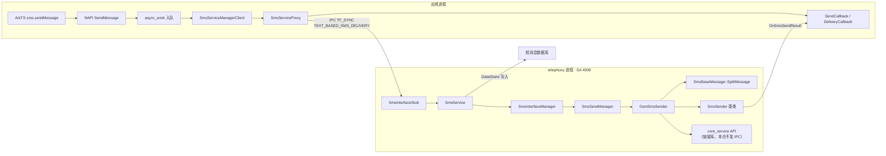
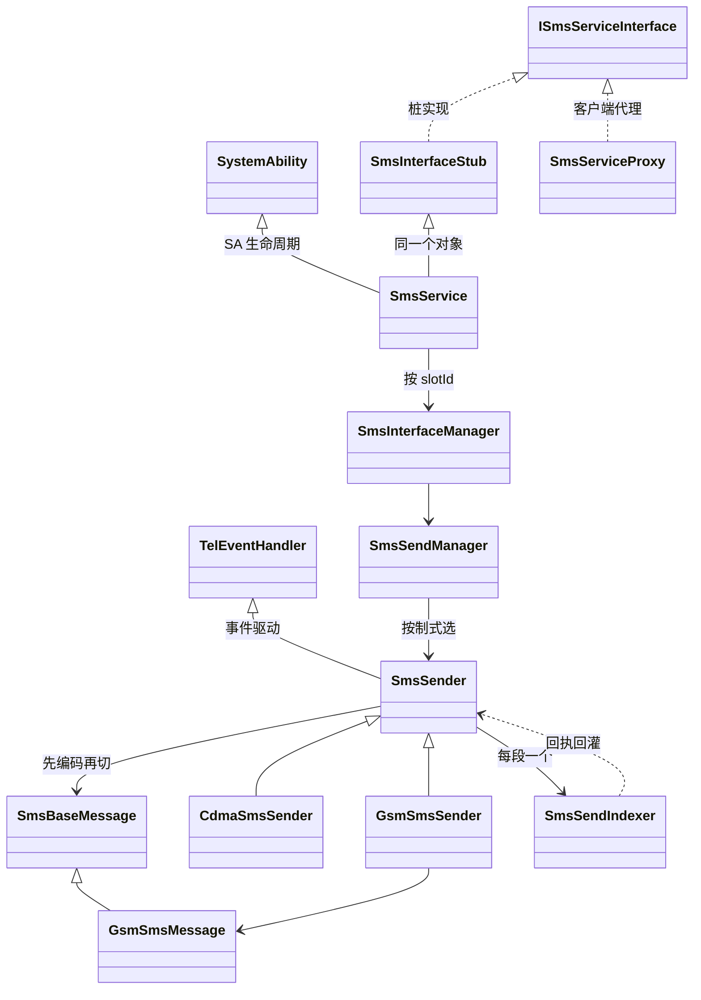
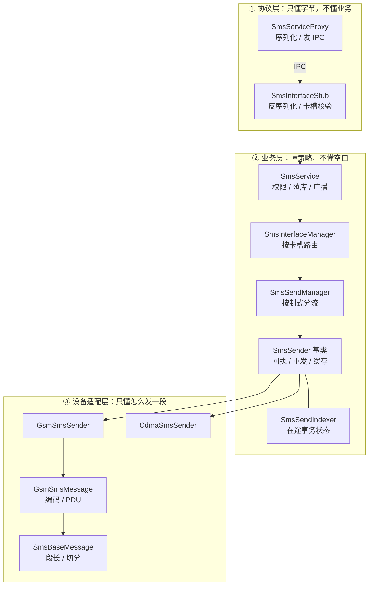
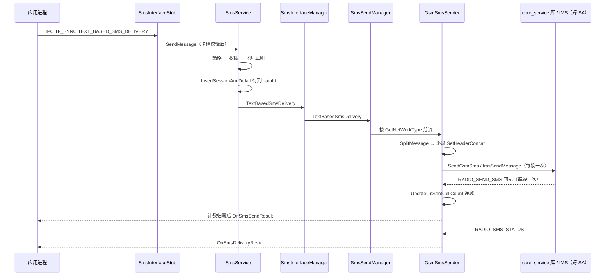
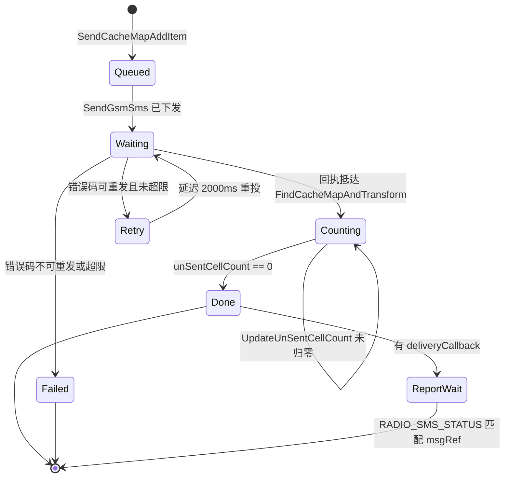

# 一条短信的发送：telephony_sms_mms 主链路分析

> **子系统**：短信彩信（`sms_mms`） ｜ **源码基线**：OpenHarmony-7.0-Release（commit `e06478b`） ｜ **切片**：`telephony_sms_mms` ｜ **上游仓**：`base/telephony/sms_mms`
> **锚点格式**：`相对切片根的路径:行号#符号名`，全部经 `oh_verify.py` 校验，结果见第五节。
> 本报告以**静态代码事实**为主，不包含设备侧观测；所有推断均已标注。第五节末附一处**算法级本地复现**（分片逻辑逐行移植后在本机执行），用于校验数值结论，不等同设备复现。

---

## 一、子系统定位与边界

> **读之前，先约定四个词。** 后面全文反复用到，第一次看到不用回翻。
>
> - **SA（System Ability，系统能力）**：OpenHarmony 里"可以被别的进程按编号找到并调用"的常驻服务。本文的主角编号是 **4008**，进程名叫 `telephony`。可以理解成"系统里的一个科室"，门口挂着号牌。
> - **IPC（Inter-Process Communication，进程间通信）**：两个进程之间唯一的说话方式。进程之间不能直接读对方内存，只能把参数打包、交给内核递过去——这个过程比普通函数调用贵好几个数量级。
> - **RIL（Radio Interface Layer，无线接口层）**：系统里负责跟基带（真正发射信号的芯片）打交道的部分。短信最终要交给它。
> - **PDU（Protocol Data Unit，协议数据单元）**：短信在空口上的"一个信封"，装收件号码、内容、编码方式。一条短信就是一个 PDU；长短信被拆成的每一段，也各是一个 PDU。

### 1.1 一句话结论

**先说人话（不带术语）。**
你按下发送键，短信应用把一段文字交给系统里一个常驻的"短信服务"。这个服务不直接发，它先做三件事：把文字按编码规则转成字节、看字节数够不够装进一条短信、装不下就切成几段。切完之后，每一段都要单独送出去，每一段也都会单独收到一个"运营商已收下"的回执。最后，只有**所有分段的回执都回来了**，它才告诉应用"发送成功"——中途只要有一段失败，整条就算失败。

这条路上有三个反直觉的点，后面会逐一展开：**分片按字节切，不按字数切**；**多段在应用眼里只是一个结果**；**"交给基带成功"和"对方收到"是两回事**。

**再上术语（同一件事的精确说法）。**
一条短信从应用到空口，本质是**把一段 UTF-8 文本切成若干条 140 字节以内的 PDU，逐段挂上 `refId`（一次发送的 64 位标识，用来把回执认回原来的请求）投进一张进程内静态缓存表，等每一段的 RIL 回执把计数器减到 0，才向应用回调"成功"**。
整条链路有 8 跳，**本仓代码只发起 2 处 IPC**（应用→服务的同步 IPC、服务→应用的回调）。到 RIL 那一跳由链接进来的 `CoreManagerInner` 完成，**本仓在这一跳没有写一次 SA 查找**。注意限定：`core_service` 自身是 SA `4010`（见 1.2），它是否与 SA 4008 同进程**不在本切片内**，所以本报告只主张"本仓没发起 IPC"，不主张"整条链一共只跨两次进程"；另见 3.3 的 IMS 分支（那里确定多一次跨进程）。

- `services/sms/gsm/gsm_sms_sender.cpp:242#CoreManagerInner`
- `BUILD.gn:137#tel_core_service_api`

### 1.2 它是什么

**一句话定位**（与汇报封面的定义句同一口径）：`telephony_sms_mms` 是 OpenHarmony 通信子系统 `telephony` 下的一个**独立部件**（component），职责是**把「短信/彩信」这项能力，从对外的 TypeScript API 声明，一直实现到与 Modem 交互的完整链路**。

| 项 | 值 |
|---|---|
| 部件 / 子系统 | `sms_mms` / `telephony` |
| 系统服务 | SA `4008`，进程 `telephony`，产物 `libtel_sms_mms.z.so` |
| 启动配置 | `sa_profile/4008.json` 常驻启动；`sa_profile/4008_dynamic.json` 按基带上下电 |
| 职责范围 | 短消息收发、SIM 卡短消息、小区广播、WAP Push；彩信发送、下载与编解码 |
| 上游依赖 | core_service（RIL 与卡状态）、telephony_data（DataShare 数据库）、netmanager 与 netstack（彩信网络）、IMS 服务 |
| 下游消费者 | 应用（`@ohos.telephony.sms`）、短信应用（DataShare 表与公共事件） |

> 表的写法照搬**仓库主干自带的代码地图**里的"部件定位"节（该文档不在 7.0 切片内，只作组织方式参考）；"职责/上游/下游"三行的具体内容已逐条回 7.0 源码核对过。上游四家可在构建依赖里直接读到：

- `BUILD.gn:137#tel_core_service_api` — core_service（RIL 与卡状态）
- `BUILD.gn:149#net_conn_manager_if` — netmanager（彩信数据网络）
- `BUILD.gn:150#http_client` — netstack（彩信 HTTP）
- `BUILD.gn:157#tel_telephony_data` — telephony_data（DataShare 数据库）

动态启停能力在 `sa_profile/4008_dynamic.json` 里，由 `const.vendor.ril.dynamic_switch_modem` 与 `telephony.dynamic_poweroff_modem` 两个参数控制（基带下电时本 SA 可被停掉），这是"按需启停"与"常驻"并存的第二种启动形态：`sa_profile/4008_dynamic.json:36`。

**本报告只走"发短消息"这一条链**，彩信、小区广播、卫星短消息仅在边界处提及。

`bundle.json` 中 `part_name` 为 `sms_mms`。系统服务侧的身份由 **SA profile（SA 的注册文件，声明它跑在哪个进程、链接哪个库、依赖谁）** 固定：进程名为 `telephony`，SA id `4008`，产物 `libtel_sms_mms.z.so`，且声明了对 SA `4010` 的启动依赖、等待上限 60000 ms（超过就认为依赖启动失败）。

- `sa_profile/4008.json:2#process`
- `sa_profile/4008.json:6#libpath`
- `sa_profile/4008.json:11#depend_time_out`

在进程内，`SmsService` 同时继承系统能力框架与 IPC 桩类，即「一个对象既是 SA，又是 Stub」。

先把 **Stub / Proxy** 这对称呼说清楚，后面会一直用到：

- **Proxy（代理）**：放在**调用方**那边。长得像服务，实际只做两件事——把参数打包、把结果解包。应用以为自己在调本地函数，其实每一次都在跨进程。
- **Stub（桩）**：放在**服务方**那边。负责把收到的字节还原成参数，再转给真正的业务代码。

一进一出，两头各一个，中间才是真的 IPC。

```cpp
class SmsService : public SystemAbility, public SmsInterfaceStub, public std::enable_shared_from_this<SmsService>
```

- `services/sms/include/sms_service.h:30#SmsService`

这一行决定了后面所有的调用形状：**外部通过 Stub 的纯虚函数进来，内部通过 `SmsService` 的实现落地**，两者之间没有额外的路由层。

### 1.3 边界在哪

| 层 | 归属 | 关键文件 | 本仓是否实现 |
|---|---|---|---|
| 应用 API | **ArkTS**（鸿蒙的 TypeScript 方言）/ **NAPI**（Native API，让 JS 能调 C++ 的桥）；另有 taihe（ArkTS 1.2）与仓颉 cj 两套绑定 | `frameworks/js/napi`、`frameworks/ets/taihe`、`frameworks/cj` | 是 |
| 客户端（Proxy 侧，见上文解释） | 调用方进程 | `frameworks/native/sms` | 是 |
| IPC 契约 | `interfaces/innerkits` | 事务码枚举 | 是 |
| 服务（Stub + 业务） | `telephony` 进程 | `services/sms` | 是 |
| RIL / 空口 | `core_service` 的 api 库（**链接库；本仓这一跳不发 IPC**，进程归属在本切片外） | `CoreManagerInner` | **否**，只发请求 |
| 数据持久化 | `telephony_data`（**DataShare**，系统提供的跨进程数据共享框架，相当于一个「大家都能按 URI 读写」的数据库） | `services/sms/sms_persist_helper.cpp` | 部分 |

**目录名本身就是判据**（这一段对没读过鸿蒙的人最有用）：

- `interfaces/kits` 下是**给第三方应用用**的接口，只有 `.d.ts` 声明，没有实现；
- `interfaces/innerkits` 下是**部件间契约**：接口码、`ISmsServiceInterface`、Proxy/Stub、跨进程数据结构（`ShortMessage`、`MmsMsg`）。**它只能被系统部件使用**；
- `frameworks` 下是三套语言绑定（`js/napi` 服务 ArkTS 1.1、`ets/taihe` 服务 ArkTS 1.2、`cj` 服务仓颉）与客户端代理；
- `services` 才是实现本体，`sa_profile/4008.json` 决定它以 SA 4008 的身份常驻。

所以判断"这段代码第三方能不能调"，看它在 `kits` 还是 `innerkits` 就够了。读仓顺序也照这个来：**契约（`.d.ts`）→ 边界（`innerkits`）→ 实现（`services`）**。

最后一行的"部分"是有意的：本仓调用 DataShare 写入短消息库，但库表结构不属本仓。
同样，单条上限交给两个文件级常量决定：`MAX_GSM_7BIT_DATA_LEN = 160`、`MAX_UCS2_DATA_LEN = 140`，二者都定义在本切片内（`services/sms/sms_base_message.cpp:35`、`services/sms/sms_base_message.cpp:36`）。

这里必须停一下，因为后面所有数字都从这两个常量长出来：

- **7bit**：GSM 规定的一种 7 位编码，一个字符占 7 个二进制位。它只能表达 GSM 基本字符集（英文、数字、少量符号），**写不了中文**。160 的单位不是字节，而是「7 位组的个数」（**septet**，读作「塞普泰特」，就是 7 个 bit 一组）。
- **UCS2**：一种 16 位定长编码，一个字符固定 2 字节。**中文、emoji 都走这条路**。140 的单位是**字节**。

所以 160 和 140 **单位不同**，直接比大小没有意义——这正是后面「67 个汉字」和「153 个字符」看起来对不上、实际都对的原因。
因此本报告的数值结论只用**仓内可证的 153 / 134**（见 3.1），不引用外部常量值。

- `services/sms/sms_base_message.cpp:478#SplitMessage`
- `services/sms/sms_base_message.cpp:290#multiSegSms7BitLength`

### 1.4 全景图



图中每个节点在正文中均有对应的完整锚点（`路径:行号#符号`）；图本身不标行号，避免与正文锚点版本不一致。

### 1.5 静态结构：11 个核心类

上一节是**运行时视角**——消息经过哪些边界。这一节换成**静态视角**——职责被切给了谁。两者不能互相替代：跳讲"先后"，类讲"归属"；评委问"这个模块有哪些核心类、各自干什么"，8 跳是答不出来的。

#### 1.5.1 类图



图里有三处不看代码就画不出来的细节，正好是三个"考点"：

1. **`SmsService` 同时继承 `SystemAbility` 与 `SmsInterfaceStub`**：SA 本体和 IPC 桩是**同一个对象**，中间没有一层转发。所以权限只能在这一层收口，Stub 里查不到 `Permission` 是必然的，不是漏写。
2. **`SmsSender` 继承 `TelEventHandler`**：它不是被直接调用的普通对象，而是挂在自己事件循环上的处理器。延时重发、超时清理都走事件，不走 sleep。
3. **消息类与事务类完全分离**：`SmsBaseMessage` 描述"内容怎么编码"，`SmsSendIndexer` 描述"这一次发送走到哪了"。前者无状态可复用，后者每段一个、有生命周期。这个分离是第 3.2 节"计数归零"能成立的前提。

#### 1.5.2 十一个类的职责

读表前先认五个词：**GSM** 与 **CDMA** 是两种移动通信制式（前者欧洲主导，后者北美主导）；**IMS** 是 4G/5G 时代用 IP 网络承载语音和短信的子系统；**CS（Circuit Switched，电路域）** 是传统「打电话那条专用线路」；**PS（Packet Switched，分组域）** 是「上网那条共享链路」。短信优先走 IMS，走不通退回 CS——展开在第 3.3 节。

| # | 类 | 所在层 | 职责 | 关键方法 | 锚点 |
|---|---|---|---|---|---|
| 1 | `ISmsServiceInterface` | 接口定义 | 定义客户端与服务端的共同契约，双方都依赖它而不依赖彼此 | — | `interfaces/innerkits/i_sms_service_interface.h:26#ISmsServiceInterface` |
| 2 | `SmsServiceProxy` | 协议层（应用侧） | 参数序列化、发起同步 IPC、把回调对象写进请求 | `SendMessage` | `interfaces/innerkits/sms_service_proxy.h:27#SmsServiceProxy` |
| 3 | `SmsInterfaceStub` | 协议层（服务侧） | 反序列化、卡槽号边界校验、按事务码分发 | `OnSendSmsTextRequest` | `services/sms/include/sms_interface_stub.h:34#SmsInterfaceStub` |
| 4 | `SmsService` | 服务层 | SA 生命周期、**权限收口**、落库、广播 | `SendMessage`、`CheckSmsPermission` | `services/sms/include/sms_service.h:30#SmsService` |
| 5 | `SmsInterfaceManager` | 卡槽级门面 | 按 `slotId` 路由到对应卡槽的发送/接收管理器 | `TextBasedSmsDelivery` | `services/sms/include/sms_interface_manager.h:36#SmsInterfaceManager` |
| 6 | `SmsSendManager` | 卡槽级调度 | 判断网络制式，选 GSM 还是 CDMA 实现 | `TextBasedSmsDelivery` | `services/sms/include/sms_send_manager.h:31#SmsSendManager` |
| 7 | `SmsSender` | 业务基类 | **模板方法**：回执处理、重发、超时、进程内缓存表；只把"怎么发一段"留给子类 | `HandleMessageResponse`、`HandleResend` | `services/sms/include/sms_sender.h:40#SmsSender` |
| 8 | `GsmSmsSender` | 设备适配（GSM） | 分片投递、IMS/CS 域选择、下发 RIL、状态报告解析 | `TextBasedSmsDelivery`、`StatusReportAnalysis` | `services/sms/include/gsm/gsm_sms_sender.h:34#GsmSmsSender` |
| 9 | `CdmaSmsSender` | 设备适配（CDMA） | 与 GSM 同构的另一套实现 | `SendSmsToRil` | `services/sms/include/cdma/cdma_sms_sender.h:28#CdmaSmsSender` |
| 10 | `SmsBaseMessage` | 消息模型 | 段长计算、分片算法（7bit 等长切、UCS2 按字符边界切） | `GetSegmentSize`、`SplitMessage` | `services/sms/include/sms_base_message.h:64#SmsBaseMessage` |
| 11 | `GsmSmsMessage` | 消息模型（GSM） | 编码方案选择、TPDU 编码 | `DecodeMessage` | `services/sms/include/gsm/gsm_sms_message.h:24#GsmSmsMessage` |
| 12 | `SmsSendIndexer` | 在途事务 | 承载一条分段的全部状态：消息号、剩余段数、共享失败标志、超时 | `SetUnSentCellCount`、`GetHasCellFailed` | `services/sms/include/sms_send_indexer.h:28#SmsSendIndexer` |

> 表里 12 行、标题写 11 个类：第 1 行是纯接口，没有实现代码，所以按"有实现的类"算是 11 个。这个口径要在答辩前统一，否则容易被抓"你自己说有 11 个，表里 12 行"。

#### 1.5.3 三层职责划分



划这三层的判据是**依赖方向**：协议层只依赖接口定义，业务层只依赖抽象 `SmsSender`，设备适配层才依赖具体制式的编码规则。所以加一种制式不需要动协议层和业务层。

#### 1.5.4 三个设计意图，以及各自的代价

**① 把 SA 与 Stub 合成一个类（三继承）**

- 意义：省掉一层"SA 持有 Stub"的转发，调用链少一跳，类数少一个。
- 代价：SA 的生命周期方法与 IPC 分发方法混在一个类里，单文件 1037 行；权限校验只能放在这里，一旦有人复用 Stub 另起一个入口，就绕过了权限。

**② 发送器用模板方法模式：基类管流程，子类管一段**

`SmsSender` 把 7 个动作声明为纯虚函数——`TextBasedSmsDelivery`、`DataBasedSmsDelivery`、`SendSmsToRil`、`Init`、`ResendTextDelivery`、`ResendDataDelivery`、`IsImsSmsSupported`（见 `services/sms/include/sms_sender.h:53#SendSmsToRil`、`services/sms/include/sms_sender.h:59#IsImsSmsSupported`）。

- 意义：回执聚合、重发节流、超时清理这些"容易写错但每个制式都一样"的逻辑只写一遍；CDMA 的存在本身就是这个抽象的验证——它是同构的第二份实现。
- 代价：基类必须知道子类的存在（`GSM` / `CDMA` 枚举分流），抽象没有彻底反过来；新增制式仍要改 `SmsSendManager` 的分支。

**③ 消息对象与事务对象分离**

- 意义：`SmsBaseMessage` 无状态、可被反复调用（同一段文本可以算多次段长）；`SmsSendIndexer` 每段一个、带消息号与计数，正好承载"这一段的命运"。两者分离后，聚合逻辑才有地方挂——计数挂在事务对象上，不挂在消息内容上。
- 代价：一次发送要建 N 个索引器 + 1 个消息对象，对象数量随段数线性增长；而且索引器必须手动把共享失败标志传对，漏传就退化成"失败被吞"。

一句话概括这一节：**这个模块的类设计是"抽象到位、边界清楚"，但抽象的位置偏高——它抽象了"怎么发一段"，没有抽象"发完怎么知道结果"**。后者散落在基类的事件处理与静态缓存表里，是第 4.4 节打"可维护性中"的主要依据。


---

## 二、端到端主链路：一条短信的发送

下面按"一条 GSM 文本短信、100 个汉字"走完全程。100 个汉字在 UCS2 下占 200 字节，超过单条上限 140 字节，必然触发**分片**，因此这一条链路能同时覆盖分片与多段聚合两个机制。

### 第 1 跳 · 应用侧入口（异步，不阻塞 UI）

NAPI 层拿到参数后不直接发，而是先建一个异步工作项再入队：

- `frameworks/js/napi/src/napi_sms.cpp:262#SendMessage`
- `frameworks/js/napi/src/napi_sms.cpp:286#napi_create_async_work`

真正干活的是 `NativeSendMessage`，它调用 `ActuallySendMessage` 做参数分流（文本/原始数据、是否落库），最终进入 `ActuallySendTextMessage`：

- `frameworks/js/napi/src/napi_sms.cpp:156#NativeSendMessage`
- `frameworks/js/napi/src/napi_sms.cpp:78#ActuallySendTextMessage`

这一跳的**代价**很明确：`napi_create_async_work` + `napi_queue_async_work_with_qos` 把调用推迟到工作线程，主线程立即返回 `undefined`，结果只能靠 callback 或 Promise 拿。收益是不阻塞 UI，代价是调用方拿不到同步错误码。

### 第 2 跳 · 客户端封装与序列化

客户端单例负责拿到代理，然后由代理完成序列化。**接口令牌是权限边界之外的第一道类型校验**，写失败直接返回错误码，不会进入 IPC：

- `frameworks/native/sms/src/sms_service_manager_client.cpp:98#SendMessage`
- `frameworks/native/sms/src/sms_service_proxy.cpp:33#SendMessage`
- `frameworks/native/sms/src/sms_service_proxy.cpp:41#WriteInterfaceToken`

随后按固定顺序写 `slotId`、目的地址、短信中心地址、正文，再把两个回调**作为远程对象**写进 parcel，最后补上 `bundleName`（服务端据此判断是否彩信应用）：

- `frameworks/native/sms/src/sms_service_proxy.cpp:51#WriteRemoteObject`
- `frameworks/native/sms/src/sms_service_proxy.cpp:65#SendRequest`

注意 `SendRequest` 用的是 `TF_SYNC`（第 40 行 `MessageOption option(MessageOption::TF_SYNC)`）。这是一个容易被忽略的设计选择：**NAPI 层是异步的，但 IPC 本身是同步的**。它意味着服务端在处理期间，调用方的工作线程是阻塞的。

### 第 3 跳 · IPC 分发

事务码 `TEXT_BASED_SMS_DELIVERY` 取值 0，是这张接口表的第一个入口：

- `interfaces/innerkits/sms_service_ipc_interface_code.h:26#TEXT_BASED_SMS_DELIVERY`

Stub 在构造时把事务码映射到具体处理函数，构成一张 lambda 表：

- `services/sms/sms_interface_stub.cpp:38#TEXT_BASED_SMS_DELIVERY`

处理函数按写入顺序反向读出参数，先做**卡槽合法性**校验（越界直接 return，不回包），再把两个远程对象 `iface_cast` 成本地回调接口，最后去掉地址里的空格：

- `services/sms/sms_interface_stub.cpp:161#OnSendSmsTextRequest`
- `services/sms/sms_interface_stub.cpp:169#IsValidSlotId`
- `services/sms/sms_interface_stub.cpp:186#RemoveSpacesInDesAddr`

> 这一点值得单独记住：**Stub 层不做权限校验**。它对 `Permission` 的引用为 0 处，权限收口全部下沉到 Service 层（见 4.2 的弊）。

### 第 4 跳 · 服务层：策略、权限、落库

`SmsService::SendMessage` 是整条链路的"业务闸门"，按顺序做五件事：

1. 策略开关（企业管控可整体禁用短信）：`services/sms/sms_service.cpp:150#IsSmsPolicyDisable`
2. 权限校验：`services/sms/sms_service.cpp:155#CheckSmsPermission`
3. 地址非空与正则合法性：`services/sms/sms_service.cpp:173#ValidDestinationAddress`
4. **写数据库**：普通短信先落 session + detail，拿到 `dataId`；彩信应用则反查已存在的"发送中"记录：
   - `services/sms/sms_service.cpp:181#InsertSessionAndDetail`
5. 交给接口管理器：`services/sms/sms_service.cpp:193#TextBasedSmsDelivery`

这一步是整条链路里最"重"的一跳。发送尚未成功，数据库里已经有一条状态为"发送中"的记录；后续无论成功或失败，都要靠这条 `dataId` 回写状态（见第 8 跳）。

### 第 5 跳 · 卡槽级接口管理与制式分流

`SmsInterfaceManager` 是按卡槽一人一个的实例，只做空参校验后转发给发送管理器：

- `services/sms/sms_interface_manager.cpp:68#TextBasedSmsDelivery`
- `services/sms/sms_interface_manager.cpp:86#smsSendManager_`

`SmsSendManager` 才是制式决策点：查当前网络类型，GSM 走 `GsmSmsSender`，CDMA 走 `CdmaSmsSender`，未知制式直接回调失败：

- `services/sms/sms_send_manager.cpp:103#TextBasedSmsDelivery`
- `services/sms/sms_send_manager.cpp:123#GetNetWorkType`
- `services/sms/sms_send_manager.cpp:125#NET_TYPE_GSM`

### 第 6 跳 · 分片与 PDU 编码

GSM 发送器的入口只做三件事：分片、建 TPDU、检查段数上限，然后在锁内逐段下发：

- `services/sms/gsm/gsm_sms_sender.cpp:45#TextBasedSmsDelivery`
- `services/sms/gsm/gsm_sms_sender.cpp:54#SplitMessage`
- `services/sms/gsm/gsm_sms_sender.cpp:57#CreateDefaultSubmitSmsTpdu`
- `services/sms/gsm/gsm_sms_sender.cpp:63#MAX_SEGMENT_NUM`

分段投递循环里，每个分段都会新建一个 `SmsSendIndexer`（下称"索引器"），把该段编码后的数据覆盖进同一份 TPDU 模板，并在段数 >1 时补上拼接头：

- `services/sms/gsm/gsm_sms_sender.cpp:74#TextBasedSmsSplitDelivery`
- `services/sms/gsm/gsm_sms_sender.cpp:99#SmsSendIndexer`
- `services/sms/gsm/gsm_sms_sender.cpp:126#SetHeaderConcat`

同时设置"是否还有后续段"与"是否要状态报告"：除最后一段外一律 `bStatusReport = false`，只有最后一段继承调用方是否要回执的意愿：

- `services/sms/gsm/gsm_sms_sender.cpp:138#bStatusReport`

### 第 7 跳 · 域选择与投递

每一段最终都进入 `SendSmsToRil`：分配 64 位 `refId`、把索引器塞进静态缓存表、组出 RIL 需要的 `GsmSimMessageParam`，然后按域选择走 CS 还是 IMS：

- `services/sms/gsm/gsm_sms_sender.cpp:179#SendSmsToRil`
- `services/sms/gsm/gsm_sms_sender.cpp:200#SendCacheMapAddItem`
- `services/sms/gsm/gsm_sms_sender.cpp:218#sendCsSMS`

两条出口：

- CS 域：`services/sms/gsm/gsm_sms_sender.cpp:242#SendGsmSms`（多段时改用 `SendSmsMoreMode`）
- IMS 域：`services/sms/gsm/gsm_sms_sender.cpp:266#SendImsSms` → `:280#ImsSendMessage`

判断条件是"非 IMS 域、IMS 短信能力未开启、PS 域重发次数已达上限"三者任一成立即走 CS。
换句话说：**IMS 优先，CS 兜底，兜底入口与重发上限共用同一个判断式**。

### 第 8 跳 · 回执聚合与状态回写

RIL 回执以事件形式回到 `SmsSender::ProcessEvent`，按事件 ID 分派：

- `services/sms/sms_sender.cpp:43#ProcessEvent`

发送结果的处理有三步，是整条链路最精巧的部分：

1. 用回执里的 `flag`（即 `refId`）在缓存表里反查索引器，并顺手把**同一 `refId` 的所有分段**的未发送计数减 1：
   - `services/sms/sms_sender.cpp:274#FindCacheMapAndTransform`
   - `services/sms/sms_sender.cpp:323#UpdateUnSentCellCount`
2. 从缓存表摘除该条，成功则进状态报告等待队列，失败则进重发：
   - `services/sms/sms_sender.cpp:96#HandleMessageResponse`
   - `services/sms/sms_sender.cpp:361#HandleResend`
3. 只有计数归零（即最后一段也回来了）才向应用回调，并据"是否有任一段失败"决定最终结果：
   - `services/sms/sms_sender.cpp:120#SendMessageSucceed`
   - `services/sms/sms_sender.cpp:129#unSentCellCount`
   - `services/sms/sms_sender.cpp:138#GetHasCellFailed`

最后回写数据库并广播，应用侧据此刷新会话列表：

- `services/sms/sms_sender.cpp:153#UpdateSms`
- `services/sms/sms_sender.cpp:161#SendBroadcast`

若调用方要了送达报告，则等 RIL 上报 `RADIO_SMS_STATUS` 时按 8bit `msgRef` 在等待队列里匹配，回 ACK 并把原始报告 PDU 抛回应用：

- `services/sms/gsm/gsm_sms_sender.cpp:306#StatusReportAnalysis`
- `services/sms/gsm/gsm_sms_sender.cpp:330#GetMsgRef`
- `services/sms/gsm/gsm_sms_sender.cpp:346#SendSmsAck`
- `services/sms/gsm/gsm_sms_sender.cpp:350#OnSmsDeliveryResult`

### 2.1 时序图



---

## 三、核心机制

这一章只讲三个机制。为什么是这三个？因为一条短信从「一段文字」变成「对端收到」，中间只有三件事会出错：

| 会出错的环节 | 出错会怎样 | 对应机制 |
|---|---|---|
| **切分** | 切在半个汉字、半个 emoji 上，对端拼回来是乱码 | 3.1 分片 |
| **结果** | 切了三段，只回来两段，应用不知道该报成功还是失败 | 3.2 聚合 |
| **通路** | 这条路走不通（没 IMS 信号、基带拒收），一直重试把基带打爆 | 3.3 域选择与重发 |

换句话说，三个机制分别回答三个问题：**内容对不对**、**结果准不准**、**发不发得出去**。

它们的关系不是并列的：3.1 和 3.3 是「每一段都要过一次」，3.2 是「整批只有一个」——所以 3.2 必须放在最后讲，它管的是前面两步的结果怎么汇总。

### 3.1 机制一：分片——先按编码定段长，再按段长切

**问题**：一条短信的承载上限由协议决定，与用户输入的字符数不成正比。同样是 100 个字符，全 ASCII 只占 100 字节、一条发完；换成 100 个汉字就是 200 字节、必须切两段。切在哪个字节上，直接决定对端能否还原。

**方案**：三步走。

第一步，先编码再量长度。`SplitMessage` 不做字符级切分，而是先把整段文本按编码方案解码到一个大缓冲区，拿到**编码后的字节数** `encodeLen`：

- `services/sms/sms_base_message.cpp:478#SplitMessage`
- `services/sms/sms_base_message.cpp:501#DecodeMessage`

第二步，用字节数反推每段长度。`GetSegmentSize` 的比较是"数据长度 + 头部长度 是否超过单条上限"：超了就降到多段长度，没超就整条不切。

- `services/sms/sms_base_message.cpp:287#GetSegmentSize`
- `services/sms/sms_base_message.cpp:312#maxSize`

四个数字全部在仓内可证，而且必须分成两组看：**单条上限** `MAX_GSM_7BIT_DATA_LEN = 160`、`MAX_UCS2_DATA_LEN = 140`（`services/sms/sms_base_message.cpp:35`、`services/sms/sms_base_message.cpp:36`）；**多段时每段的长度** `multiSegSms7BitLength = 153`、`multiSegSmsUcs2Length = 134`（同文件 `services/sms/sms_base_message.cpp:290`、`services/sms/sms_base_message.cpp:291`）。

两组不能混：`134` 不是分片阈值，而是"已经决定要分了"之后每段的长度。真阈值是 140 字节——70 个汉字（140 字节）仍然一条发完，71 个汉字（142 字节）才开始切，切成 134 + 8。

两个多段长度的来历也要分开算，因为单位不同。UCS2 按字节：140 − 6 字节 UDH（1 字节长度标识 + 5 字节拼接信息）= 134。7bit 按 septet：6 字节 UDH 打包后占 7 个 septet，160 − 7 = 153。**同样是 6 字节头部，在两种编码下扣掉的额度不同**，这是最容易记错的一处。

- `services/sms/sms_base_message.cpp:290#multiSegSms7BitLength`
- `services/sms/sms_base_message.cpp:291#multiSegSmsUcs2Length`

第三步，段数取上整。`ceil(encodeLen / segSize)` 得到段数，**每段长度固定为 segSize，只有最后一段取余数**：

- `services/sms/sms_base_message.cpp:511#segCount`

**代价与特例**：UCS2 多段时不能按字节硬切。一个 emoji 在 UTF-16 里占 4 字节（2 个 code unit），硬切会把代理对劈成两半，接收端解码出乱码。因此代码专门给"UCS2 且段数 > 1"开了岔路，改用按 2 字节对齐的切法：

- `services/sms/sms_base_message.cpp:414#SplitMessageUcs2`

**段数上限**：`MAX_SEGMENT_NUM` 为 15，超出直接判失败并上报故障事件，不做"截断后发送"这种静默降级：

- `services/sms/include/gsm/gsm_pdu_code_type.h:27#MAX_SEGMENT_NUM`

### 3.2 机制二：多段聚合——用"未发送计数 + 共享失败标志"把 N 段伪装成 1 条

**问题**：一条长短信在空口上是 N 条独立短信。若每段各自回调，应用会收到 N 次"发送成功"，UI 上可能闪出 N 条记录。更糟的是：第 1 段成功、第 2 段失败时，若按段回调，应用无法表达"这条长短信整体失败"。

**方案**：用"共享失败标志 + 每段同步递减的计数"把 N 段绑成一个事务。

发送前，为这一批分段创建一份剩余计数与一个失败标志。两者的传递方式**并不相同**：失败标志以 `shared_ptr<bool>`（C++ 的共享指针：多个对象指向同一份数据，改一处、全都看得见）逐段共享，剩余计数却是**值拷贝**——`SetUnSentCellCount(*unSentCellCount)` 传的是解引用后的值，不是指针，所以每段各存一份副本。

打个比方：失败标志是**一块大家共用的黑板**，谁都能往上写"失败"；剩余计数则是**每人发一张复印件**，要改得挨个通知。

- `services/sms/gsm/gsm_sms_sender.cpp:86#unSentCellCount`
- `services/sms/gsm/gsm_sms_sender.cpp:87#hasCellFailed`
- `services/sms/gsm/gsm_sms_sender.cpp:150#SetUnSentCellCount`

回执到达时，`UpdateUnSentCellCount` 不是只递减"当前这条索引器"，而是遍历缓存表，**把所有 `msgRef` 相同的分段计数一起减 1**：

- `services/sms/sms_sender.cpp:323#UpdateUnSentCellCount`

这就保证了：无论哪一段先回来，计数都单调递减，且最后归零的那一次必定对应"全部回执到齐"。

**这正是补偿"计数不共享"的关键**：计数各存一份副本，但递减动作是广播的，几份副本同步步进，效果等价于一份共享计数。换句话说，**共享的不是变量，是节奏**。

**回调时机**由计数是否归零决定，而不是由"是否收到回执"决定：

- `services/sms/sms_sender.cpp:129#unSentCellCount`

**最终结果**取"或"语义——任一段失败过，整条就是失败：

- `services/sms/sms_sender.cpp:138#GetHasCellFailed`

**代价**：这套聚合依赖三个隐含前提，任一破掉就会退化：
1. 所有分段必须共享同一份 `shared_ptr<bool>`，一旦某个分段漏设，失败就吞掉；
2. `refId` 必须能在缓存表里稳定找回，缓存表被超时清理后回执抵达即"找不到索引器"；
3. 计数递减只在回执路径上发生，若某段回执永久丢失，计数永不归零，应用永远收不到回调。

第三条正是缓存表需要超时兜底的原因，见 4.2。

### 3.3 机制三：域选择与重发——IMS 优先、CS 兜底、双计数器限流

**问题**：短信在 4G/5G 时代有两条路：走 IMS（IP 域）或走 CS（电路域）。选错会导致发送失败或长时间无响应。而失败后若无限重试，一条短信就能把基带打爆。

**方案**：一次判断决定域，两个计数器分别限流。

域判定的输入只有三个：是否在 IMS 域、IMS 短信能力是否开启、PS 域重发次数是否已达上限。三者任一成立即选 CS：

- `services/sms/gsm/gsm_sms_sender.cpp:218#sendCsSMS`

重发由 `HandleResend` 统一裁决：只有错误码是"命令发送失败"才重发，且按当前域选择对应的计数器，未超上限则延迟 2000 ms 重新入队：

- `services/sms/sms_sender.cpp:361#HandleResend`
- `services/sms/sms_sender.cpp:383#MSG_SMS_RETRY_DELIVERY`

两个计数器共用常量 3（`MAX_SEND_RETRIES`），初始为 0（`INITIAL_COUNT`）；但**判定符不同**：CS 用 `< MAX_SEND_RETRIES`（最多重发 3 次），PS 用 `<= MAX_SEND_RETRIES`（最多重发 4 次）。这处不对称是仓内可查的，也是"PS 会比 CS 多试一次"的直接原因：

- `services/sms/include/sms_sender.h:111#MAX_SEND_RETRIES`
- `services/sms/include/sms_sender.h:112#INITIAL_COUNT`

有意思的是**成功时也会重置计数器**：最后一段成功回调前，两个计数被显式清零，避免同一条索引器在后续复用中带着旧计数：

- `services/sms/sms_sender.cpp:134#SetPsResendCount`

**两条路的调用形态不同（容易被讲成一样）**：CS 分支调的是链接进来的 `CoreManagerInner` 单例，本仓不发起 IPC；IMS 分支走 `ImsSmsClient`，后者内部用 `CheckSystemAbility` 拿远程对象、再 `iface_cast` 成代理，**这一步确定跨进程**：

- `services/sms/gsm/gsm_sms_sender.cpp:242#CoreManagerInner` — CS：链接库单例
- `services/sms/ims_service_interaction/src/ims_sms_client.cpp:76#GetImsSmsProxy` — IMS：`CheckSystemAbility` + `iface_cast`
- `services/sms/gsm/gsm_sms_sender.cpp:264#SendImsSms` — IMS 分支入口

所以"本仓只发起两次 IPC"这句话的适用范围是 **CS 路径**；走 IMS 时下行实际是三段（应用→SA 4008→IMS 服务）。这也是把"同进程"改口为"本仓不发 IPC"的原因之一（见 1.1、7.8）。

**代价**：重发次数用尽后不再区分"网络临时不可用"与"号码非法"，统一回落为 `SEND_SMS_FAILURE_UNKNOWN`，应用侧拿不到可区分的失败原因。这一点在 4.2 展开。

### 3.4 状态机图（索引器生命周期）



---

## 四、设计权衡

### 4.1 利：三个明确收益

**1) 进程内静态缓存表让"回执 → 索引器"的定位变成 O(1) 查表，而不需要跨进程会话。**
（限定：这个 O(1) 只对单条回执的定位成立；批次递减要遍历全表，见 3.2。）
RIL 回执只带回一个 64 位 `refId`，服务端靠这张表把回执还原成完整的业务上下文（目标地址、回调对象、数据库 id）。表本身是静态成员，即**跨卡槽、跨发送器共享**：

- `services/sms/sms_sender.cpp:35#sendCacheMap_`

**2) 回调对象随 parcel 跨进程传递，服务端无需知道调用方是谁。**
两个回调以 `IRemoteObject` 形式进入服务端，服务端只调接口，不关心对面是 ArkTS、仓颉还是原生应用。这使同一套服务端代码能支撑三套前端（`frameworks/js`、`frameworks/cj`、`frameworks/ets/taihe`）：

- `frameworks/js/napi/include/send_callback.h:31#SendCallback`

**3) 制式差异被收在一层虚接口后面。**
`TextBasedSmsDelivery` 在基类声明为虚函数，GSM 与 CDMA 各自实现，`SmsSendManager` 只按网络类型选对象：

- `services/sms/include/sms_sender.h:45#TextBasedSmsDelivery`

新增制式时改动面被限制在"新增一个子类 + 在分流处加一个分支"，不会污染业务层。

### 4.2 弊：三个真实代价

**1) 发送尚未成功，数据库已经落了一条记录。**
`SmsService::SendMessage` 在真正下发前就写库并拿到 `dataId`。设计上是为"发送中"状态可见，但代价是：任何在写库之后、回调之前发生的进程崩溃，都会留下一条永久"发送中"的僵尸记录；而本切片内未见针对这类记录的启动清理，它只能靠后续按 `dataId` 回写覆盖。这条记录的生命周期完全依赖第 8 跳的 `UpdateSms` 兜底：

- `services/sms/sms_service.cpp:181#InsertSessionAndDetail`
- `services/sms/sms_sender.cpp:153#UpdateSms`

**2) 权限校验与卡槽校验分居两层，且 Stub 层完全不校验权限。**
Stub 只查 `slotId` 边界，权限在 Service 层。这**不是漏写，而是明文约定**：仓库主干的知识库把它写成红线（"禁止在 `SmsService` 之外做权限判断"），并逐接口列了所需权限。代价是**任何绕过 `SmsService` 直接复用 Stub 解析逻辑的新代码，都会绕开权限检查**。Stub 中 `Permission` 出现次数为 0：

- `services/sms/sms_interface_stub.cpp:169#IsValidSlotId`
- `services/sms/sms_service.cpp:155#CheckSmsPermission`

**3) 状态报告的匹配键是 8bit `msgRef`，天然存在回绕歧义。**
`msgRef` 只有 8 位，取值 0–255——**这是空口 PDU 头里的 TP-MR 字段宽度，协议只给一个字节**，不是实现者可以自行加宽的。等待队列按它匹配，队列上限 25 条；一旦短时间内发出的短信超过 256 条（或旧条目未被及时摘除），新报告就可能匹配到旧索引器。代码用"队列长度上限 + 最旧丢弃"缓解：

- `services/sms/gsm/gsm_sms_sender.cpp:330#GetMsgRef`
- `services/sms/include/sms_sender.h:123#MAX_REPORT_LIST_LIMIT`

但这是**概率性缓解，不是消除**：丢弃最旧意味着长时间不回报告的条目会静默丢失回调。

### 4.3 一处值得记下的不一致

同一份"未发送计数"的更新，发生在 `FindCacheMapAndTransform` 内部（第 298、317 行），而该函数在"回执对象为空"时会提前返回，不做递减。也就是说：**空回执事件既不会推进计数，也不会触发超时清理**——它只能等下一次任意回执到来时，由 `SendCacheMapTimeoutCheck` 顺带清理：

- `services/sms/sms_sender.cpp:298#UpdateUnSentCellCount`
- `services/sms/sms_sender.cpp:242#EXPIRED_TIME`

超时阈值是 180 秒（`EXPIRED_TIME = 60 * 3`）。这与"重发延迟 2 秒、最多 3 次"的时间尺度并不匹配：重发总耗时约 6 秒，而僵尸条目要 3 分钟才被回收。

- `services/sms/include/sms_sender.h:120#EXPIRED_TIME`

### 4.4 实现质量评价：五个维度

先把口径说清：4.1 / 4.2 评的是**设计取舍**（为什么这么做），这一节评的是**实现质量**（做得怎么样）。同一套设计可以写得干净，也可以写得难维护，两者要分开打分。

| 维度 | 判断 | 正面证据 | 负面证据 |
|---|---|---|---|
| 正确性 | 中上 | 先编码再切、UCS2 走字符边界、段数超限硬失败不截断 | 2401 字节缓冲截断并丢 1 字节；11 处 `(void)` 主动吞掉 `memcpy_s` / `memset_s` 返回值；`decodeData16Bit` 按输入长度开变长数组 |
| 可维护性 | 中 | 分层清晰、`SplitInfo` 结构体封装、命名统一、全模块 **0 处 TODO/FIXME** | `MAX_GSM_7BIT_DATA_LEN = 160` 在 **6 处**重复定义（源码 4 + 测试 2）；`GetSegmentSize` 与 `GetMaxSegmentSize` 前 12 行近逐字相同；`SmsService` 单文件 1037 行、约 50 个成员函数 |
| 可观测性 | **偏弱**（分两层看） | 统一 `TELEPHONY_LOGx` 宏，`services/sms` 内 1725 处打点；另有 `HiSysEvent` 四个入口（行为/故障各二），故障打点带 `SmsMmsErrorCode` | 文本日志层：LOGE 1426 : LOGI 266（约 5.4 : 1），**正常路径几乎不打点**；错误码层：`SEND_SMS_FAILURE_UNKNOWN` 用了 64 次，另一档 `SERVICE_UNAVAILABLE` 只有 6 次 |
| 性能 | 中 | 回执→索引器定位 O(1)；单条发送路径无冗余拷贝 | `SplitMessageUcs2` 每轮末重置迭代器，`isBoundary` 从 0 重扫，段数 n 时退化到 O(n²)；整段投递持 `mutex_` 且覆盖 RIL IPC |
| 可测性 | 良 | gtest + fuzztest 共 28867 行，占非测试代码 **53.4%**；有 `splitmessage`、`getsmssegmentsinfo` 专项 fuzzer | 无静态检查/lint 痕迹；`splitmessage` 的 fuzz 语料目录只有一个 662 字节占位文件 |

**三条结论**

**① "跑对"这一层合格，"跑错了看得见"这一层不合格。**
正确性主要靠人读代码保证：段长算错、缓冲截断、字节丢失，这三件事在运行期都不会产生一条日志。复现实验里那个"UCS2 下丢 1 字节"就是最典型的例子——它静默发生，连 LOGE 都没有。

- `services/sms/sms_base_message.cpp:483#decodeData`（2401 字节缓冲）
- `services/sms/sms_base_message.cpp:527#textData`（循环内 521 字节栈数组，memset 之后从不使用，属死代码）

**② 这是长期并行开发留下的演进痕迹，不是设计失误。**
常量靠复制、函数靠复制、错误码靠 `UNKNOWN`，三者同源：缺一个被所有人引用的公共常量头，和一张分级的错误码表。看到 `160` 在四个源文件里各定义一次，就大致能推出这个模块的协作方式。

- `services/sms/sms_base_message.cpp:35#MAX_GSM_7BIT_DATA_LEN`
- `services/sms/gsm/gsm_sms_message.cpp:29#MAX_GSM_7BIT_DATA_LEN`
- `services/sms/gsm/gsm_sms_common_utils.cpp:29#MAX_GSM_7BIT_DATA_LEN`
- `utils/sms_common_utils.cpp:25#MAX_GSM_7BIT_DATA_LEN`
- `services/sms/sms_base_message.cpp:287#GetSegmentSize` 与 `services/sms/sms_base_message.cpp:328#GetMaxSegmentSize`

**③ 要改的三处，按性价比排序：错误码 > 常量收口 > 缓冲。**
错误码分级不动架构、收益最大（应用能区分"超长""无卡""网络拒绝"）；常量收口防"改一处漏五处"；2401 缓冲要动接口和调用约定，成本最高但收益最明确（消除静默丢字节）。

- `services/sms/gsm/gsm_sms_sender.cpp:64#SEND_SMS_FAILURE_UNKNOWN`
- `services/sms/gsm/gsm_sms_sender.cpp:78#TextBasedSmsSplitDelivery`

**两句不能说的话**

- 不能说"代码质量差"——53.4% 的测试占比、0 处 TODO、分层与命名都是合格的，这在大仓里不算低标准；
- 不能说"实现优秀"——可观测性和错误码是明显欠账。一个"发不出去但不知道为什么"的模块，运维成本会全部转嫁到上层应用。

### 4.5 从操作系统视角看：验证了什么、暴露了什么

4.4 评的是「这份代码写得好不好」。这一节换个问法——**它作为 OS 的一个系统服务，对操作系统本身说明了什么**。前者是工程质量，后者是架构意义，两者不能混着答。

打个比方：把 OpenHarmony 当成一栋大楼，短信服务就是楼里的一个科室。4.4 问的是「这个科室业务办得顺不顺」，4.5 问的是「**这栋楼的物业规约——门禁、隔离、报修、超时——在这个科室身上够不够用**」。

> **事实与推断的分界**：4.5.1 表格里的五个锚点是**源码事实**；除此之外的所有判断——「框架有没有提供某个能力」「这是框架级还是模块级问题」「应该怎么改」——都是**分析**。答辩时也要这样分：能指行的说「代码里是这么写的」，其余的说「这是我的判断」。

#### 4.5.1 它验证了 SA 模型能承载「有状态 + 有外部设备 + 异步回执」的服务

**为什么要专门说「验证」？**

因为看一个框架能不能用，不能只看它的示例。框架自带的示例几乎都是「查个配置」「读个传感器」——无状态、不落库、不等外部设备回话。这种服务用哪个框架都好写。

短信不一样。它有五件麻烦事同时压在身上：

| 难点 | 人话解释 | 代码里的表现 | 锚点 |
|---|---|---|---|
| 有状态 | 一条长短信要记住「已经回来几段了」，这个记忆得跨好几次通信还活着 | 进程内静态缓存表 `sendCacheMap_` | `services/sms/sms_sender.cpp:35#sendCacheMap_` |
| 有外部设备 | 最终不是自己发，是交给基带，结果异步回来 | 调 `CoreManagerInner` 下发 | `services/sms/gsm/gsm_sms_sender.cpp:242#CoreManagerInner` |
| 有持久化 | 用户要能立刻在列表里看到「发送中」 | 先写库再下发 | `services/sms/sms_service.cpp:181#InsertSessionAndDetail` |
| 有权限 | 发短信是敏感能力，不能让随便哪个应用调 | `CheckSmsPermission` | `services/sms/sms_service.cpp:155#CheckSmsPermission` |
| 有多实例 | 双卡手机每张卡各一套收发逻辑 | 每卡槽一个 `SmsSendManager` | `services/sms/include/sms_send_manager.h:31#SmsSendManager` |

五件事同时成立还能跑通，说明 **SA 框架不是只能跑「无状态查询」这种简单服务**。这比任何「Hello World 型 SA」都有说服力——它证明这套抽象扛得住真实业务的复杂度。

**但它有一处没扛住。**

那条「已经回来几段了」的记忆，只活在服务进程的内存里（`sendCacheMap_` 是静态成员）。进程一旦重启，这张表就空了；而在途的那些短信，**永远不会再收到回调**——应用还在等，服务已经忘了。

框架没有提供「服务内的临时状态能不能存个盘、重启后捡回来」的中间层，模块只能自己扛，而本仓里没看到启动时的恢复逻辑。这一点是下一小节第 ② 条的引子。

#### 4.5.2 三个「框架级」问题，不是模块级

下面三个问题，每个都按同一节奏说：**这是什么 → 代码里怎么做 → 为什么算框架的事，而不是这个模块的锅。**

##### ① 权限校验没放在「进程门口」

**这是什么。** IPC 边界就是进程的门口。业界惯例是**在门口查证件**：谁进来、带了什么权限，门口先看一遍，不合格直接挡回去。这个模块的做法相反——**门口不查，进了屋再查**。

**代码里怎么做。** `SmsInterfaceStub` 是门口（IPC 桩），全文 0 处权限判断；真正的校验在屋里的 `SmsService`（`services/sms/sms_service.cpp:155#CheckSmsPermission`）。

**为什么算框架的事。** 屋里查当然也能挡住正常访客，功能上不缺。问题在于：如果将来有人复用这个 Stub、另开一个门（比如加一个内部调试入口），那个新门就没人查了。**「每道门都记得查」不该依赖每个写代码的人自觉——这该是物业统一装的。**

也要说清边界：OpenHarmony 是否另有系统级强制机制（类似 SELinux 那种强制访问控制——由内核统一裁决「谁能访问什么」，不依赖程序自己检查），不在本切片里，**不能断言它没有第二道防线**。

##### ② 请求发出去，没有「超时也算结局」的约定

**这是什么。** 发短信像寄挂号信：你交给邮局，邮局给张单子说「到了通知你」。如果通知永远不来，**现在没有任何机制替你宣布「这封信丢了」**。

**代码里怎么做。** 缓存表设了 180 秒超时（`services/sms/sms_sender.cpp:242#EXPIRED_TIME`）。但超时到了只做一件事——**把记录删掉、回收内存**，不会给应用补一个「失败」回调。于是：基带不回执 → 计数永远减不到 0 → 应用那边永远等不到结果。

**为什么算框架的事。** 一个请求发出去，逻辑上应该有且只有一个结局：成功、失败、超时。现在缺了「超时」这一种，等于允许「没有结局」存在。

- 模块级看：这是缺陷，应该补一段「超时即回调失败」。
- 框架级看：如果 SA 框架能约定「每个请求必须有终态」，或者提供带 deadline（截止时间）的 IPC（到点自动回一个超时错误），这个问题会在**所有服务里一次性消失**，而不是每个模块各自补一遍、各自漏一遍。

这是本节最值得提给框架的一条。

##### ③ 固定大小的缓冲，是单片机时代带过来的习惯

**这是什么。** 代码给「解码后的字节」准备了一个固定大小的碗：160 × 15 + 1 = **2401 字节**。文本超过这个长度，多出来的部分**不报错，是悄悄没了**。

更隐蔽的是：2401 是奇数，而 UCS2 按 2 字节一个字符来切，最后一轮除法会剩下 1 个字节，被整数除法直接丢掉——同样没有任何日志。

**代码里怎么做。** `services/sms/sms_base_message.cpp:483#decodeData`。这个数字不是随手写的：160 是单条上限，15 是最大段数，+1 大概是习惯性的保险位。

**为什么算框架的事，而不是「这个模块懒」。** 这个写法在单片机时代是对的：内存就那么大，宁可截断也不能因为动态申请失败而崩溃，这是当时的正确工程选择。

但手机 OS 上，输入长度是**用户**决定的，固定碗必然溢出。所以它反映的不是某个人偷懒，而是**从 LiteOS-M 一类轻量内核（跑在单片机上、内存以 KB 计的那种）向标准系统迁移时，工程习惯没跟着改**。这是 OS 演进过程中的真问题。

#### 4.5.3 三点可以提给框架的启示

##### ① 分段事务：现在每个模块都在重写同一段最容易错的逻辑

**现在的做法哪里不好。** 「一条逻辑消息 → N 个物理单元」这个模式，不只短信有：彩信、邮件附件、大文件分块上传，结构都一样。但每个模块都得自己实现一遍「计数到 0 才算完成、任一失败则整体失败」。

我们已经在这个模块里看到两个具体的坑：**计数是按值拷贝的**（不是共享），所以必须靠「广播递减」来同步；**失败标志必须手动传同一份 `shared_ptr`**，漏传就退化成「失败被吞」。这两个坑，换个人重写一遍大概率还会再踩。

**如果改了会怎样。** 框架提供「分段事务」原语——N 个子操作，全部完成才回调，任一失败则整体失败——这类模块能直接省掉最容易写错的那一段，只需要实现「怎么发一段」。

##### ② 服务契约：现在「受理」和「完成」混在一条路上

**现在的做法哪里不好。** `SendMessage` 是同步 IPC，它的返回值只代表「**收到请求了**」，真正的结果走回调。两条路径并存，应用很容易把「返回 0」理解成「发送成功」——这是语义上的陷阱，不是应用开发者粗心。

**如果改了会怎样。** 同步调用返回一个**事务句柄**（相当于取件码），完成时通过这个句柄回调，并且**保证有终态**：成功 / 失败 / 超时，三选一。这同时把 4.5.2 的第 ② 条解掉了。

##### ③ 进程内的「轻状态」：现在只有两个极端可选

**现在的做法哪里不好。** 那张缓存表放内存，是为了性能——回执是毫秒级的高频事件，每次都落库会被写放大拖垮。但放内存的代价是进程重启就丢。

框架目前没给中间选项：要么全量落库（对毫秒级事件太重），要么纯内存（会丢）。**这是一个空白地带**，不是模块自己选错了。

**如果改了会怎样。** 如果框架能提供一种「轻量、可恢复」的状态容器（比如定期的内存快照 + 重启恢复），这类「高频写、但丢了要能感知」的场景就有地方放了。

#### 4.5.4 一句话

> 这个模块对操作系统的「贡献」，不是它发明了什么机制，而是它**把 SA 模型放进一个真实复杂的场景里跑了一遍**，并如实露出三处接缝：**权限靠自觉、超时无终态、缓冲是旧时代的**。

反过来看，这也正是它值得作为课程案例的原因——一个只会「读配置」的 SA，暴露不出这些问题。


---

### 4.6 交叉验证：仓库自带的知识库怎么说

仓库主干（master）自带 `AGENTS.md` 与 7 份分层文档（合计 752 行），是维护者写给"要改这个仓的人"的约束集：11 条红线、4 条已知技术债、最小验证闭环。**这批文档不在 7.0 基线切片内**（`git archive` 出来的树里没有），所以只能当线索，不能当证据；下面每一条都回 7.0 源码核过。

| 知识库的说法 | 7.0 基线落点 | 核验结果 |
|---|---|---|
| 权限只在 `SmsService` 收口（红线 6） | `services/sms/sms_service.cpp:155#CheckSmsPermission` | 成立；4.2 第 2 条由"取舍"升级为"明文约定" |
| 段数写入 8 位字段、全段共享同一 8 位引用号 | `services/sms/gsm/gsm_sms_sender.cpp:85#msgRef8bit` | 成立；4.2 第 3 条由"实现选择"改为"协议决定" |
| 技术债：合并在用的计数是 `int8_t`。段数上限可到 255 | `services/sms/sms_receive_handler.cpp:336#count` | 成立；同函数 `:327` 的 `notNullPart` 同为 `int8_t`，比文档写的还多一处 |
| 技术债：拆分侧长度校验写成 `> 上限 + 1` | `services/sms/sms_sender.cpp:495#MAX_USER_DATA_LEN` | 成立；与 5.5 发现的 2401 缓冲同属"容量与上限混用" |
| 技术债：拆分投递的长度校验失败分支不回调 | `services/sms/gsm/gsm_sms_sender.cpp:78#TextBasedSmsSplitDelivery`（第 95 行） | 成立；这是"应用永久等待"级缺陷，见 4.6.1 |
| 三套前端 napi / taihe / cj，须同步修改（红线 9） | `frameworks/js/napi/`、`frameworks/ets/taihe/`、`frameworks/cj/src/sms_ffi.cpp` | 成立；且三套前端没有单元测试 |
| 4008 声明依赖 SA 4010，等待 60 秒 | `sa_profile/4008.json:8#depend`、`:11#depend_time_out` | 成立，并**反过来修正了本报告的措辞**：不再断言"RIL 与 SA 同进程"（见 1.1） |
| IMS 短消息经 `ImsSmsClient` 访问 IMS 服务 | `services/sms/ims_service_interaction/src/ims_sms_client.cpp:76#GetImsSmsProxy` | 成立；补上 3.3 的"IMS 多一次跨进程" |

#### 4.6.1 一处比"设计取舍"更严重的缺陷

`TextBasedSmsSplitDelivery` 在逐段投递时，先做长度校验：

```cpp
if (cellsInfos[i].encodeData.size() > MAX_USER_DATA_LEN + 1 || cellsInfos[i].encodeData.empty()) {
    return;   // 没有调用 SendResultCallBack
}
```

同一个分支踩了两条红线：**校验写的是"上限 + 1"**（放行超长 1 字节的数据），**失败又直接返回、不回调发送结果**。后者意味着应用侧会一直等一个永不到来的结果——比"错误码不够细"严重一个量级，因为它没有终态。仓库自己的技术债表里承认了这条。

- `services/sms/gsm/gsm_sms_sender.cpp:78#TextBasedSmsSplitDelivery`（函数入口）
- `services/sms/gsm/gsm_sms_sender.cpp:242#CoreManagerInner`（同文件的 CS 投递路径，可对照）

**三条结论**

1. 知识库能提高置信度，但**替代不了锚点**：它描述的是 master，跨版本引用必须回基线重新落行。
2. 它最有价值的地方不是"支持我们"，而是**顶回了我们一句话**——`depend: [4010]` 让我们把"同进程"改成"本仓不发 IPC"。这种"被文档修正"的记录，比"被文档确认"更能说明方法可靠。
3. 它还提供了一份**维护者视角的缺陷清单**：其中两条正好落在我们讲的主链上（拆分投递、长度校验），使"怎么改"不再是我们的主观建议。

## 五、证据与复现

### 5.1 锚点统计

| 指标 | 数值 |
|---|---|
| 锚点总数 | 见同目录锚点清单（与本文同步维护） |
| 校验结果 | **0 FAIL**（原始输出存于 `repo` 目录） |
| 覆盖文件 | 29 个（26 个源码 + 3 个配置） |
| 覆盖顶层目录 | `services/`、`frameworks/`、`interfaces/`、`utils/`、`sa_profile/`（5 个） |
| 图示 | 5 张 mermaid（全景 / 类图 / 三层职责 / 时序 / 状态机），源文件在 `repo/mermaid/` |

### 5.2 一条能跑的命令

```bash
# 在 G12_sms_mms 目录下执行（相对路径见下）
python ../../student_kit/scripts/oh_verify.py --root ../../telephony_sms_mms --input report.md
```

若组内使用独立基线切片，把 `--root` 换成分片目录即可，锚点路径不变。
说明：命令行里出现裸文件名 `report.md` 时，工具会额外报一条 `WARN 无目录前缀` —— 这是它对"命令行引用"的预期处理，不影响 0 FAIL 判定。正文不含任何裸文件名锚点。

### 5.3 版本口径（重要）

本报告的行号取自 **`OpenHarmony-7.0-Release` 分支尖端**（commit `e06478b`）。
工作区内的 `telephony_sms_mms/` 当前在 `master`（`d6c7b05`），比基线多 46 个提交。本报告的主链路锚点经实测比对（3 个函数、6 个行号）在两个版本间**未漂移**；其余文件未逐一比对，但两种 `--root` 全量校验均 **0 失败**，说明当前锚点集在两棵树上都成立。这是本子系统的巧合，不能推广为"换版本不用重追"。

### 5.4 证据等级（自评）

我们主张 **L1（结构）+ 分片逻辑的算法级局部复现**，不主张设备侧 L2。

按 `oh_level.py` 的机检口径，本报告现在是 **L2**：有效锚点 111 个、跨 5 个顶层目录、含 mermaid 图、0 失败，再加上 5.5 节本地运行输出里的时间戳与 `[INFO]` 标记，正好命中 L2 的"观测标记"判据。

但**这个 L2 只说明文本里有日志格式的痕迹，不说明我们在设备上跑过**。L2 的判据是正则匹配（`HILOG[DIWEF]`、`[INFO]`、时间戳、`hitrace` 任一命中即通过），它无法区分"设备日志"与"本地程序 stdout"。所以：

- **能诚实主张的**：整条 8 跳链路的静态结构（L1）；分片算法在本机可重复执行、结果与源码常量一致（5.5）。
- **不能主张的**：设备侧的端到端观测。我们没有鸿蒙设备、没有 hdc、没有能发短信的 SIM 卡或模组，也没有与 7.0-Release 对应的可运程系统。
- **所以**：报告正文的结论仍只建立在源码与静态链路上；5.5 的复现只用来校验"分片这一段"的数值，不用于支撑任何跨进程行为。

若后续补做设备验证，需要的是：能跑该模块的 OpenHarmony 系统（真机 / 开发板 / 模拟器）、一条能真正发短信的通道、以及与基线版本一致的调试版系统（否则日志能对上行为、对不上行号）。

### 5.5 算法级复现：分片逻辑的本地执行

**这一节是什么**：`repro` 目录下的复现脚本把分片相关函数逐行翻译成 Python 后在本机执行，原始输出也落在同一目录。它证明的是"这套算法对给定输入产出什么"，**不是**"设备上真的这样跑"。

**怎么保证不是凭记忆重写**

- 七个常量在运行时从基线源码里正则解析（`160` / `140` / `153` / `134` / `15` / `6` / `3`），解析不到就报错终止，不回落硬编码。
- 每个函数在代码注释里标出对应的原文件与行号：`GetSegmentSize`、`SplitMessage`、`SplitMessageUcs2`、`FindNextUnicodePosition`、`GsmSmsMessage::DecodeMessage`、`TextCoder::GsmUtf8ToAuto`、`TextCoder::Ucs2ToGsm7bitAuto`。
- 已知偏差写在文件头：ICU 只按码点边界近似（不处理 ZWJ 组合）、未移植 securec、未移植 7bit 位打包。

**13 个用例的关键结果**（下表只列 9 条，完整明细见 `repro` 目录的输出）

| 用例 | 输入 | 编码 | 编码后长度 | 单条上限 | 每段长度 | 段数 |
|---|---|---|---|---|---|---|
| A | 18 个汉字 | UCS2 | 36 B | 140 | 36 | 1 |
| C | 70 个汉字 | UCS2 | 140 B | 140 | 140 | 1 |
| D | 71 个汉字 | UCS2 | 142 B | 140 | 134 | 2（134+8） |
| E | 100 个汉字 | UCS2 | 200 B | 140 | 134 | 2（134+66） |
| F | 100 个 ASCII | 7bit | 100 septet | 160 | 100 | 1 |
| H | 161 个 ASCII | 7bit | 161 septet | 160 | 153 | 2（153+8） |
| I | 100 个 emoji | UCS2 | 400 B | 140 | 134 | 4（132×3+4） |
| K | 70 个汉字 + 端口号头 | UCS2 | 140 B | 140 | 134 | 2（134+6） |
| L | 3000 个汉字 | UCS2 | 2401 B（截断） | 140 | 134 | 18（超 15） |

**复现确认的三件事**

1. **单条阈值是 140 字节，不是 134。** 70 个汉字一条发完，71 个（142 字节）才切。`134` 是"决定要分"之后每段的长度，两者不能混。
2. **估算段数不等于实际段数。** 100 个 emoji 按 `ceil(400/134)` 估 3 段，实际切出 4 段（132 / 132 / 132 / 4）。原因是 `SplitMessageUcs2` 在字符边界上回退，宁可每段短一点，也不劈开代理对。`segCount` 只用于分支判断和等长切分，UCS2 分支的段数由 `SplitMessageUcs2` 自己决定。
3. **2401 字节缓冲会截断，UCS2 下还会丢 1 字节。** 3000 个汉字本应编码成 6000 字节，被 `decodeData[(160 × 15) + 1]` 截到 2401 字节；2401 是奇数，`encodeLen / 2` 整数除法得 1200 个码元，实际只带走 2400 字节，末尾 1 字节静默丢弃。截断后的 18 段仍超过 15 段上限，由发送侧判失败。

**边界**：以上只覆盖"给定文本 → 分段长度"这一个纯计算环节。跨进程、IPC、RIL 下发、回执聚合都不在复现范围内。

---

## 六、AI 协作纪实与结论

### 6.1 一次真实的纠错

**AI 的初始判断**：本地 `telephony_sms_mms` 在 master 分支，比基线多 46 个提交，因此"从本地取的行号在教师侧一定校验失败"，必须先重新拉基线。

**证伪过程**：导出 `origin/OpenHarmony-7.0-Release` 的完整副本后，对同一批函数在两个树上逐条取行号：

```bash
grep -n "int32_t SmsService::SendMessage" services/sms/sms_service.cpp
```

结果是 `146` 对 `146`，`services/sms/sms_sender.cpp` 的 `HandleMessageResponse` 均为 96，`services/sms/sms_interface_stub.cpp` 的 `OnSendSmsTextRequest` 均为 161。

**真相**：差异确实存在（41 个文件、+1291/−29），而且包含**语义改动**——`services/sms/sms_interface_stub.cpp` 的卡槽上限由 `SIM_SLOT_COUNT` 改为 `SIM_SLOT_COUNT_MD`，位置在第 33、113 行，正落在锚点（161 行）**上方**。但这两处都是**等行替换**（1 行换 1 行），其余插入又都在锚点之后，所以行号原地未动。可见"改动存在"与"行号不动"可以同时成立，判断只能靠实测。

**结论修正**：不是"一定失败"，而是"必须逐条实测，不能靠版本号猜"。这条经验直接改变了本组的操作流程：先锁基线副本取行号，再对双版本做一次批量比对，而不是凭 `git describe` 的领先数下判断。

### 6.2 第二个纠错

**AI 的初始判断**：`OnSendSmsTextRequest` 是 IPC 入口，权限校验理应在这里。

**证伪**：`services/sms/sms_interface_stub.cpp` 全文对 `Permission` 的引用为 0 处；真正的收口在水线更深处：

- `services/sms/sms_service.cpp:155#CheckSmsPermission`

**真相**：Stub 只做协议层校验（卡槽号边界、地址去空格），业务层校验（策略、权限、地址正则）全在 `SmsService`。这条纠错直接改写了本报告 4.2 的第 2 条弊端。

### 6.3 结论

1. 这条链路的设计核心不是"发出去"，而是**把 N 段不可靠的空口投递，收敛成 1 个对应用可见的原子结果**；聚合点是 `unSentCellCount` 归零。
2. 分片的正确性依赖"先编码再切"的顺序，以及 UCS2 下对代理对的特殊处理；把顺序倒过来（先按字符切再编码）会在长中文与 emoji 上稳定出错。
3. 三个已知薄弱点都有代码位置可查：写库在发送前（4.2-1）、权限只在一层（4.2-2）、报告匹配键仅 8 位（4.2-3）。它们不是"看代码看不出来"的隐患，而是**结构性取舍的必然结果**。

---

## 附录 A · 复现清单

| 步骤 | 命令 | 期望 |
|---|---|---|
| 1 锚点校验 | `python scripts/oh_verify.py --root ../telephony_sms_mms --input report.md` | 0 FAIL |
| 2 证据分级 | `python scripts/oh_level.py --root ../telephony_sms_mms --input report.md` | L1 |
| 3 单符号复核 | `python scripts/oh_trace.py --root ../telephony_sms_mms SplitMessage --kind define` | 命中 `services/sms/sms_base_message.cpp:478#SplitMessage` |
| 4 版本核对 | `git -C ../telephony_sms_mms rev-parse HEAD` | 记录于 report 头部 |

## 附录 B · 未做的事（避免误读为已覆盖）

- 未覆盖 CDMA 分支（`services/sms/cdma/`）与彩信分支（`services/mms/`），仅在第 5 跳提及分流点。
- 未覆盖接收链路与 WAP Push、小区广播。
- 未做设备实测，因此不主张 L2；日志与时序均为静态推断。
- 未验证 `MAX_GSM_7BIT_DATA_LEN` / `MAX_UCS2_DATA_LEN` 的取值（不在本切片内定义）。
