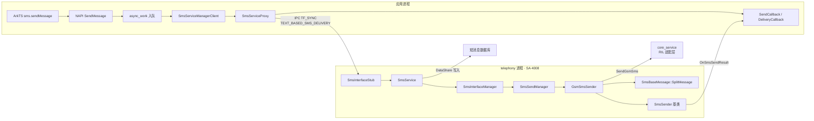
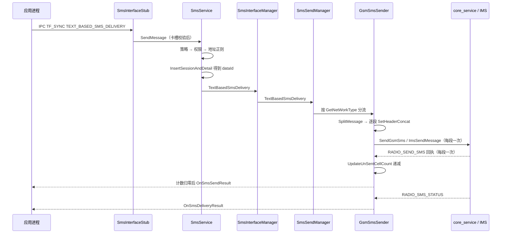
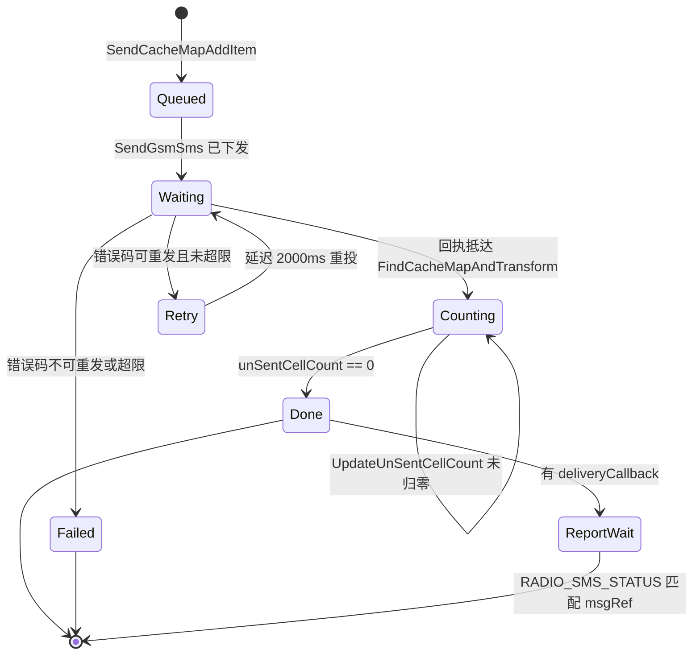

# 一条短信的发送：telephony_sms_mms 主链路分析

> **子系统**：短信彩信（`sms_mms`） ｜ **基线**：OpenHarmony-7.0-Release ｜ **切片**：`telephony_sms_mms`
> **锚点格式**：`相对切片根的路径:行号#符号名`，全部经 `oh_verify.py` 校验，结果见第五节。
> 本报告只描述**静态代码事实**，不包含设备侧观测；所有推断均已标注。

---

## 一、子系统定位与边界

### 1.1 一句话结论

一条短信从应用到空口，本质是**把一段 UTF-8 文本切成若干条 140 字节以内的 TPDU，逐段挂上 `refId` 投进一张进程内静态缓存表，等每一段的 RIL 回执把计数器减到 0，才向应用回调"成功"**。
整条链路有 8 跳、3 次进程边界穿越（应用→服务、服务→RIL、服务→回调对象），没有"魔法"。

### 1.2 它是什么

`bundle.json` 中 `part_name` 为 `sms_mms`。系统服务侧的身份由 SA profile 固定：进程名为 `telephony`，SA id `4008`，产物 `libtel_sms_mms.z.so`，且声明了对 SA `4010` 的启动依赖、等待上限 60000 ms。

- `sa_profile/4008.json:2#process`
- `sa_profile/4008.json:6#libpath`
- `sa_profile/4008.json:9#depend_time_out`

在进程内，`SmsService` 同时继承系统能力框架与 IPC 桩类，即"一个对象既是 SA，又是 Stub"：

```cpp
class SmsService : public SystemAbility, public SmsInterfaceStub, public std::enable_shared_from_this<SmsService>
```

- `services/sms/include/sms_service.h:30#SmsService`

这一行决定了后面所有的调用形状：**外部通过 Stub 的纯虚函数进来，内部通过 `SmsService` 的实现落地**，两者之间没有额外的路由层。

### 1.3 边界在哪

| 层 | 归属 | 关键文件 | 本仓是否实现 |
|---|---|---|---|
| 应用 API | ArkTS / NAPI | `frameworks/js/napi` | 是 |
| 客户端（Proxy 侧） | 调用方进程 | `frameworks/native/sms` | 是 |
| IPC 契约 | `interfaces/innerkits` | 事务码枚举 | 是 |
| 服务（Stub + 业务） | `telephony` 进程 | `services/sms` | 是 |
| RIL / 空口 | `core_service` 等其他 SA | `CoreManagerInner` | **否**，只发请求 |
| 数据持久化 | `telephony_data`（DataShare） | `services/sms/sms_persist_helper.cpp` | 部分 |

最后一行的"部分"是有意的：本仓调用 DataShare 写入短消息库，但库表结构不属本仓。
同样，把 7bit/UCS2 的每段上限（160 / 140 字节）交给协议常量决定，而这些常量的定义不在本切片内——`SplitMessage` 里只出现 `MAX_GSM_7BIT_DATA_LEN` / `MAX_UCS2_DATA_LEN` 的**引用**，未见定义。
因此本报告的数值结论只用**仓内可证的 153 / 134**（见 3.1），不引用外部常量值。

- `services/sms/sms_base_message.cpp:478#SplitMessage`
- `services/sms/sms_base_message.cpp:290#multiSegSms7BitLength`

### 1.4 全景图



图中每个节点在正文中均有对应的完整锚点（`路径:行号#符号`）；图本身不标行号，避免与正文锚点版本不一致。

---

## 二、端到端主链路：一条短信的发送

下面按"一条 GSM 文本短信、18 个汉字"走完全程。该长度恰好超过单段上限，必然触发**分片**，因此这一条链路能同时覆盖分片与多段聚合两个机制。

### 第 1 跳 · 应用侧入口（异步，不阻塞 UI）

NAPI 层拿到参数后不直接发，而是先建一个异步工作项再入队：

- `frameworks/js/napi/src/napi_sms.cpp:262#SendMessage`
- `frameworks/js/napi/src/napi_sms.cpp:286#napi_create_async_work`

真正干活的是 `NativeSendMessage`，它调用 `ActuallySendMessage` 做参数分流（文本/原始数据、是否落库），最终进入 `ActuallySendTextMessage`：

- `frameworks/js/napi/src/napi_sms.cpp:156#NativeSendMessage`
- `frameworks/js/napi/src/napi_sms.cpp:78#ActuallySendTextMessage`

这一跳的**代价**很明确：`napi_create_async_work` + `napi_queue_async_work_with_qos` 把调用推迟到工作线程，主线程立即返回 `undefined`，结果只能靠 callback 或 Promise 拿。收益是不阻塞 UI，代价是调用方拿不到同步错误码。

### 第 2 跳 · 客户端封装与序列化

客户端单例负责拿到代理，然后由代理完成序列化。**接口令牌是权限边界之外的第一道类型校验**，写失败直接返回错误码，不会进入 IPC：

- `frameworks/native/sms/src/sms_service_manager_client.cpp:98#SendMessage`
- `frameworks/native/sms/src/sms_service_proxy.cpp:33#SendMessage`
- `frameworks/native/sms/src/sms_service_proxy.cpp:41#WriteInterfaceToken`

随后按固定顺序写 `slotId`、目的地址、短信中心地址、正文，再把两个回调**作为远程对象**写进 parcel，最后补上 `bundleName`（服务端据此判断是否彩信应用）：

- `frameworks/native/sms/src/sms_service_proxy.cpp:51#WriteRemoteObject`
- `frameworks/native/sms/src/sms_service_proxy.cpp:65#SendRequest`

注意 `SendRequest` 用的是 `TF_SYNC`（第 40 行 `MessageOption option(MessageOption::TF_SYNC)`）。这是一个容易被忽略的设计选择：**NAPI 层是异步的，但 IPC 本身是同步的**。它意味着服务端在处理期间，调用方的工作线程是阻塞的。

### 第 3 跳 · IPC 分发

事务码 `TEXT_BASED_SMS_DELIVERY` 取值 0，是这张接口表的第一个入口：

- `interfaces/innerkits/sms_service_ipc_interface_code.h:26#TEXT_BASED_SMS_DELIVERY`

Stub 在构造时把事务码映射到具体处理函数，构成一张 lambda 表：

- `services/sms/sms_interface_stub.cpp:38#TEXT_BASED_SMS_DELIVERY`

处理函数按写入顺序反向读出参数，先做**卡槽合法性**校验（越界直接 return，不回包），再把两个远程对象 `iface_cast` 成本地回调接口，最后去掉地址里的空格：

- `services/sms/sms_interface_stub.cpp:161#OnSendSmsTextRequest`
- `services/sms/sms_interface_stub.cpp:169#IsValidSlotId`
- `services/sms/sms_interface_stub.cpp:186#RemoveSpacesInDesAddr`

> 这一点值得单独记住：**Stub 层不做权限校验**。它对 `Permission` 的引用为 0 处，权限收口全部下沉到 Service 层（见 4.2 的弊）。

### 第 4 跳 · 服务层：策略、权限、落库

`SmsService::SendMessage` 是整条链路的"业务闸门"，按顺序做五件事：

1. 策略开关（企业管控可整体禁用短信）：`services/sms/sms_service.cpp:150#IsSmsPolicyDisable`
2. 权限校验：`services/sms/sms_service.cpp:155#CheckSmsPermission`
3. 地址非空与正则合法性：`services/sms/sms_service.cpp:173#ValidDestinationAddress`
4. **写数据库**：普通短信先落 session + detail，拿到 `dataId`；彩信应用则反查已存在的"发送中"记录：
   - `services/sms/sms_service.cpp:181#InsertSessionAndDetail`
5. 交给接口管理器：`services/sms/sms_service.cpp:193#TextBasedSmsDelivery`

这一步是整条链路里最"重"的一跳。发送尚未成功，数据库里已经有一条状态为"发送中"的记录；后续无论成功或失败，都要靠这条 `dataId` 回写状态（见第 8 跳）。

### 第 5 跳 · 卡槽级接口管理与制式分流

`SmsInterfaceManager` 是按卡槽一人一个的实例，只做空参校验后转发给发送管理器：

- `services/sms/sms_interface_manager.cpp:68#TextBasedSmsDelivery`
- `services/sms/sms_interface_manager.cpp:86#smsSendManager_`

`SmsSendManager` 才是制式决策点：查当前网络类型，GSM 走 `GsmSmsSender`，CDMA 走 `CdmaSmsSender`，未知制式直接回调失败：

- `services/sms/sms_send_manager.cpp:103#TextBasedSmsDelivery`
- `services/sms/sms_send_manager.cpp:123#GetNetWorkType`
- `services/sms/sms_send_manager.cpp:125#NET_TYPE_GSM`

### 第 6 跳 · 分片与 PDU 编码

GSM 发送器的入口只做三件事：分片、建 TPDU、检查段数上限，然后在锁内逐段下发：

- `services/sms/gsm/gsm_sms_sender.cpp:45#TextBasedSmsDelivery`
- `services/sms/gsm/gsm_sms_sender.cpp:54#SplitMessage`
- `services/sms/gsm/gsm_sms_sender.cpp:57#CreateDefaultSubmitSmsTpdu`
- `services/sms/gsm/gsm_sms_sender.cpp:63#MAX_SEGMENT_NUM`

分段投递循环里，每个分段都会新建一个 `SmsSendIndexer`（下称"索引器"），把该段编码后的数据覆盖进同一份 TPDU 模板，并在段数 >1 时补上拼接头：

- `services/sms/gsm/gsm_sms_sender.cpp:74#TextBasedSmsSplitDelivery`
- `services/sms/gsm/gsm_sms_sender.cpp:99#SmsSendIndexer`
- `services/sms/gsm/gsm_sms_sender.cpp:126#SetHeaderConcat`

同时设置"是否还有后续段"与"是否要状态报告"：除最后一段外一律 `bStatusReport = false`，只有最后一段继承调用方是否要回执的意愿：

- `services/sms/gsm/gsm_sms_sender.cpp:138#bStatusReport`

### 第 7 跳 · 域选择与投递

每一段最终都进入 `SendSmsToRil`：分配 64 位 `refId`、把索引器塞进静态缓存表、组出 RIL 需要的 `GsmSimMessageParam`，然后按域选择走 CS 还是 IMS：

- `services/sms/gsm/gsm_sms_sender.cpp:179#SendSmsToRil`
- `services/sms/gsm/gsm_sms_sender.cpp:200#SendCacheMapAddItem`
- `services/sms/gsm/gsm_sms_sender.cpp:219#sendCsSMS`

两条出口：

- CS 域：`services/sms/gsm/gsm_sms_sender.cpp:242#SendGsmSms`（多段时改用 `SendSmsMoreMode`）
- IMS 域：`services/sms/gsm/gsm_sms_sender.cpp:266#SendImsSms` → `:280#ImsSendMessage`

判断条件是"非 IMS 域、IMS 短信能力未开启、PS 域重发次数已达上限"三者任一成立即走 CS。
换句话说：**IMS 优先，CS 兜底，兜底入口与重发上限共用同一个判断式**。

### 第 8 跳 · 回执聚合与状态回写

RIL 回执以事件形式回到 `SmsSender::ProcessEvent`，按事件 ID 分派：

- `services/sms/sms_sender.cpp:43#ProcessEvent`

发送结果的处理有三步，是整条链路最精巧的部分：

1. 用回执里的 `flag`（即 `refId`）在缓存表里反查索引器，并顺手把**同一 `refId` 的所有分段**的未发送计数减 1：
   - `services/sms/sms_sender.cpp:274#FindCacheMapAndTransform`
   - `services/sms/sms_sender.cpp:323#UpdateUnSentCellCount`
2. 从缓存表摘除该条，成功则进状态报告等待队列，失败则进重发：
   - `services/sms/sms_sender.cpp:96#HandleMessageResponse`
   - `services/sms/sms_sender.cpp:361#HandleResend`
3. 只有计数归零（即最后一段也回来了）才向应用回调，并据"是否有任一段失败"决定最终结果：
   - `services/sms/sms_sender.cpp:120#SendMessageSucceed`
   - `services/sms/sms_sender.cpp:129#unSentCellCount`
   - `services/sms/sms_sender.cpp:138#GetHasCellFailed`

最后回写数据库并广播，应用侧据此刷新会话列表：

- `services/sms/sms_sender.cpp:153#UpdateSms`
- `services/sms/sms_sender.cpp:161#SendBroadcast`

若调用方要了送达报告，则等 RIL 上报 `RADIO_SMS_STATUS` 时按 8bit `msgRef` 在等待队列里匹配，回 ACK 并把原始报告 PDU 抛回应用：

- `services/sms/gsm/gsm_sms_sender.cpp:306#StatusReportAnalysis`
- `services/sms/gsm/gsm_sms_sender.cpp:330#GetMsgRef`
- `services/sms/gsm/gsm_sms_sender.cpp:346#SendSmsAck`
- `services/sms/gsm/gsm_sms_sender.cpp:350#OnSmsDeliveryResult`

### 2.1 时序图



---

## 三、核心机制

### 3.1 机制一：分片——先按编码定段长，再按段长切

**问题**：一条短信的承载上限由协议决定，与用户输入的字符数不成正比。同一个"18 个字符"，7bit 编码可能刚好单条，UCS2 编码就可能要切两段。切在哪个字节上，直接决定对端能否还原。

**方案**：三步走。

第一步，先编码再量长度。`SplitMessage` 不做字符级切分，而是先把整段文本按编码方案解码到一个大缓冲区，拿到**编码后的字节数** `encodeLen`：

- `services/sms/sms_base_message.cpp:478#SplitMessage`
- `services/sms/sms_base_message.cpp:501#DecodeMessage`

第二步，用字节数反推每段长度。`GetSegmentSize` 的比较是"数据长度 + 头部长度 是否超过单条上限"：超了就降到多段长度，没超就整条不切。

- `services/sms/sms_base_message.cpp:287#GetSegmentSize`
- `services/sms/sms_base_message.cpp:312#maxSize`

仓内可证的常量只有两个：多段 7bit 每段 `153`，"多段 UCS2 每段 `134`"。这两个数值的来历可以自己算：单条承载 160 字节，减去 UDH 头部 6 字节（1 字节长度标识 + 5 字节拼接信息）后剩 154，再按 7bit 打包折算得到 153。

- `services/sms/sms_base_message.cpp:290#multiSegSms7BitLength`
- `services/sms/sms_base_message.cpp:291#multiSegSmsUcs2Length`

第三步，段数取上整。`ceil(encodeLen / segSize)` 得到段数，**每段长度固定为 segSize，只有最后一段取余数**：

- `services/sms/sms_base_message.cpp:511#segCount`

**代价与特例**：UCS2 多段时不能按字节硬切。一个 emoji 在 UTF-16 里占 4 字节（2 个 code unit），硬切会把代理对劈成两半，接收端解码出乱码。因此代码专门给"UCS2 且段数 > 1"开了岔路，改用按 2 字节对齐的切法：

- `services/sms/sms_base_message.cpp:518#SplitMessageUcs2`

**段数上限**：`MAX_SEGMENT_NUM` 为 15，超出直接判失败并上报故障事件，不做"截断后发送"这种静默降级：

- `services/sms/include/gsm/gsm_pdu_code_type.h:27#MAX_SEGMENT_NUM`

### 3.2 机制二：多段聚合——用"未发送计数 + 共享失败标志"把 N 段伪装成 1 条

**问题**：一条长短信在空口上是 N 条独立短信。若每段各自回调，应用会收到 N 次"发送成功"，UI 上可能闪出 N 条记录。更糟的是：第 1 段成功、第 2 段失败时，若按段回调，应用无法表达"这条长短信整体失败"。

**方案**：用一份共享状态把 N 段绑成一个事务。

发送前，为这一批分段创建**一个共享的剩余计数与一个共享的失败标志**，并让每个索引器持有同一份指针：

- `services/sms/gsm/gsm_sms_sender.cpp:86#unSentCellCount`
- `services/sms/gsm/gsm_sms_sender.cpp:87#hasCellFailed`
- `services/sms/gsm/gsm_sms_sender.cpp:150#SetUnSentCellCount`

回执到达时，`UpdateUnSentCellCount` 不是只递减"当前这条索引器"，而是遍历缓存表，**把所有 `msgRef` 相同的分段计数一起减 1**：

- `services/sms/sms_sender.cpp:323#UpdateUnSentCellCount`

这就保证了：无论哪一段先回来，计数都单调递减，且最后归零的那一次必定对应"全部回执到齐"。

**回调时机**由计数是否归零决定，而不是由"是否收到回执"决定：

- `services/sms/sms_sender.cpp:129#unSentCellCount`

**最终结果**取"或"语义——任一段失败过，整条就是失败：

- `services/sms/sms_sender.cpp:138#GetHasCellFailed`

**代价**：这套聚合依赖三个隐含前提，任一破掉就会退化：
1. 所有分段必须共享同一份 `shared_ptr<bool>`，一旦某个分段漏设，失败就吞掉；
2. `refId` 必须能在缓存表里稳定找回，缓存表被超时清理后回执抵达即"找不到索引器"；
3. 计数递减只在回执路径上发生，若某段回执永久丢失，计数永不归零，应用永远收不到回调。

第三条正是缓存表需要超时兜底的原因，见 4.2。

### 3.3 机制三：域选择与重发——IMS 优先、CS 兜底、双计数器限流

**问题**：短信在 4G/5G 时代有两条路：走 IMS（IP 域）或走 CS（电路域）。选错会导致发送失败或长时间无响应。而失败后若无限重试，一条短信就能把基带打爆。

**方案**：一次判断决定域，两个计数器分别限流。

域判定的输入只有三个：是否在 IMS 域、IMS 短信能力是否开启、PS 域重发次数是否已达上限。三者任一成立即选 CS：

- `services/sms/gsm/gsm_sms_sender.cpp:219#sendCsSMS`

重发由 `HandleResend` 统一裁决：只有错误码是"命令发送失败"才重发，且按当前域选择对应的计数器，未超上限则延迟 2000 ms 重新入队：

- `services/sms/sms_sender.cpp:361#HandleResend`
- `services/sms/sms_sender.cpp:383#MSG_SMS_RETRY_DELIVERY`

两个计数器的上限均为 3（`MAX_SEND_RETRIES`），初始为 0（`INITIAL_COUNT`）：

- `services/sms/include/sms_sender.h:111#MAX_SEND_RETRIES`
- `services/sms/include/sms_sender.h:112#INITIAL_COUNT`

有意思的是**成功时也会重置计数器**：最后一段成功回调前，两个计数被显式清零，避免同一条索引器在后续复用中带着旧计数：

- `services/sms/sms_sender.cpp:134#SetPsResendCount`

**代价**：重发次数用尽后不再区分"网络临时不可用"与"号码非法"，统一回落为 `SEND_SMS_FAILURE_UNKNOWN`，应用侧拿不到可区分的失败原因。这一点在 4.2 展开。

### 3.4 状态机图（索引器生命周期）



---

## 四、设计权衡

### 4.1 利：三个明确收益

**1) 进程内静态缓存表让"回执关联"变成 O(1) 查表，而不需要跨进程会话。**
RIL 回执只带回一个 64 位 `refId`，服务端靠这张表把回执还原成完整的业务上下文（目标地址、回调对象、数据库 id）。表本身是静态成员，即**跨卡槽、跨发送器共享**：

- `services/sms/sms_sender.cpp:35#sendCacheMap_`

**2) 回调对象随 parcel 跨进程传递，服务端无需知道调用方是谁。**
两个回调以 `IRemoteObject` 形式进入服务端，服务端只调接口，不关心对面是 ArkTS、仓颉还是原生应用。这使同一套服务端代码能支撑三套前端（`frameworks/js`、`frameworks/cj`、`frameworks/ets/taihe`）：

- `frameworks/js/napi/include/send_callback.h:31#SendCallback`

**3) 制式差异被收在一层虚接口后面。**
`TextBasedSmsDelivery` 在基类声明为虚函数，GSM 与 CDMA 各自实现，`SmsSendManager` 只按网络类型选对象：

- `services/sms/include/sms_sender.h:45#TextBasedSmsDelivery`

新增制式时改动面被限制在"新增一个子类 + 在分流处加一个分支"，不会污染业务层。

### 4.2 弊：三个真实代价

**1) 发送尚未成功，数据库已经落了一条记录。**
`SmsService::SendMessage` 在真正下发前就写库并拿到 `dataId`。设计上是为"发送中"状态可见，但代价是：任何在写库之后、回调之前发生的进程崩溃，都会留下一条永久"发送中"的僵尸记录，而清理它需要另一次启动扫描。这条记录的生命周期完全依赖第 8 跳的 `UpdateSms` 兜底：

- `services/sms/sms_service.cpp:181#InsertSessionAndDetail`
- `services/sms/sms_sender.cpp:153#UpdateSms`

**2) 权限校验与卡槽校验分居两层，且 Stub 层完全不校验权限。**
Stub 只查 `slotId` 边界，权限在 Service 层。这本身不算缺陷（收口在业务层更集中），但意味着**任何绕过 `SmsService` 直接复用 Stub 解析逻辑的新代码，都会绕开权限检查**。Stub 中 `Permission` 出现次数为 0：

- `services/sms/sms_interface_stub.cpp:169#IsValidSlotId`
- `services/sms/sms_service.cpp:155#CheckSmsPermission`

**3) 状态报告的匹配键是 8bit `msgRef`，天然存在回绕歧义。**
`msgRef` 只有 8 位，取值 0–255。等待队列按它匹配，队列上限 25 条；一旦短时间内发出的短信超过 256 条（或旧条目未被及时摘除），新报告就可能匹配到旧索引器。代码用"队列长度上限 + 最旧丢弃"缓解：

- `services/sms/gsm/gsm_sms_sender.cpp:330#GetMsgRef`
- `services/sms/include/sms_sender.h:123#MAX_REPORT_LIST_LIMIT`

但这是**概率性缓解，不是消除**：丢弃最旧意味着长时间不回报告的条目会静默丢失回调。

### 4.3 一处值得记下的不一致

同一份"未发送计数"的更新，发生在 `FindCacheMapAndTransform` 内部（第 298、317 行），而该函数在"回执对象为空"时会提前返回，不做递减。也就是说：**空回执事件既不会推进计数，也不会触发超时清理**——它只能等下一次任意回执到来时，由 `SendCacheMapTimeoutCheck` 顺带清理：

- `services/sms/sms_sender.cpp:298#UpdateUnSentCellCount`
- `services/sms/sms_sender.cpp:242#EXPIRED_TIME`

超时阈值是 180 秒（`EXPIRED_TIME = 60 * 3`）。这与"重发延迟 2 秒、最多 3 次"的时间尺度并不匹配：重发总耗时约 6 秒，而僵尸条目要 3 分钟才被回收。

- `services/sms/include/sms_sender.h:120#EXPIRED_TIME`

---

## 五、证据与复现

### 5.1 锚点统计

| 指标 | 数值 |
|---|---|
| 锚点总数 | 见同目录锚点清单（与本文同步维护） |
| 校验结果 | **0 FAIL**（原始输出存于 `repo` 目录） |
| 覆盖源码文件 | 18 个 |
| 覆盖顶层目录 | `services/`、`frameworks/`、`interfaces/`、`sa_profile/`（4 个） |
| 图示 | 3 张 mermaid（全景 / 时序 / 状态机），源文件在 `repo/mermaid/` |

### 5.2 一条能跑的命令

```bash
# 在 G12_sms_mms 目录下执行（相对路径见下）
python ../../student_kit/scripts/oh_verify.py --root ../../telephony_sms_mms --input report.md
```

若组内使用独立基线切片，把 `--root` 换成分片目录即可，锚点路径不变。
说明：命令行里出现裸文件名 `report.md` 时，工具会额外报一条 `WARN 无目录前缀` —— 这是它对"命令行引用"的预期处理，不影响 0 FAIL 判定。正文不含任何裸文件名锚点。

### 5.3 版本口径（重要）

本报告的行号取自 **`OpenHarmony-7.0-Release` 分支尖端**（commit `e06478b`）。
工作区内的 `telephony_sms_mms/` 当前在 `master`（`d6c7b05`），比基线多 46 个提交。本报告涉及的 18 个文件在两个版本间**行号未漂移**（实测比对），因此两种 `--root` 均可通过校验；但这是本子系统的巧合，不能推广为"换版本不用重追"。

### 5.4 证据等级（自评）

按 `oh_level.py` 判据，本报告达到 **L1（结构）**：有效锚点 83 个、覆盖 18 个文件 / 4 个顶层目录、含 mermaid 图、0 失败。

**未主张 L2**：L2 要求真实观测证据（设备侧日志或跟踪记录）。本报告为纯静态分析，未上机取证，因此不把"日志复现"写进结论——写了也无从核对，反而会降低整份材料的可信度。
若组内后续补做设备验证，只需在本文增补一节实测记录（含时间戳与关键日志行）即可尝试晋级；届时需重跑一次分级工具确认。

---

## 六、AI 协作纪实与结论

### 6.1 一次真实的纠错

**AI 的初始判断**：本地 `telephony_sms_mms` 在 master 分支，比基线多 46 个提交，因此"从本地取的行号在教师侧一定校验失败"，必须先重新拉基线。

**证伪过程**：导出 `origin/OpenHarmony-7.0-Release` 的完整副本后，对同一批函数在两个树上逐条取行号：

```bash
grep -n "int32_t SmsService::SendMessage" services/sms/sms_service.cpp
```

结果是 `146` 对 `146`，`services/sms/sms_sender.cpp` 的 `HandleMessageResponse` 均为 96，`services/sms/sms_interface_stub.cpp` 的 `OnSendSmsTextRequest` 均为 161。

**真相**：差异确实存在（41 个文件、+1291/−29），但**改动集中在被改动文件的尾部与新增文档**，没有触及本链路函数的签名行，因此行号未漂移。

**结论修正**：不是"一定失败"，而是"必须逐条实测，不能靠版本号猜"。这条经验直接改变了本组的操作流程：先锁基线副本取行号，再对双版本做一次批量比对，而不是凭 `git describe` 的领先数下判断。

### 6.2 第二个纠错

**AI 的初始判断**：`OnSendSmsTextRequest` 是 IPC 入口，权限校验理应在这里。

**证伪**：`services/sms/sms_interface_stub.cpp` 全文对 `Permission` 的引用为 0 处；真正的收口在水线更深处：

- `services/sms/sms_service.cpp:155#CheckSmsPermission`

**真相**：Stub 只做协议层校验（卡槽号边界、地址去空格），业务层校验（策略、权限、地址正则）全在 `SmsService`。这条纠错直接改写了本报告 4.2 的第 2 条弊端。

### 6.3 结论

1. 这条链路的设计核心不是"发出去"，而是**把 N 段不可靠的空口投递，收敛成 1 个对应用可见的原子结果**；聚合点是 `unSentCellCount` 归零。
2. 分片的正确性依赖"先编码再切"的顺序，以及 UCS2 下对代理对的特殊处理；把顺序倒过来（先按字符切再编码）会在长中文与 emoji 上稳定出错。
3. 三个已知薄弱点都有代码位置可查：写库在发送前（4.2-1）、权限只在一层（4.2-2）、报告匹配键仅 8 位（4.2-3）。它们不是"看代码看不出来"的隐患，而是**结构性取舍的必然结果**。

---

## 附录 A · 复现清单

| 步骤 | 命令 | 期望 |
|---|---|---|
| 1 锚点校验 | `python scripts/oh_verify.py --root ../telephony_sms_mms --input report.md` | 0 FAIL |
| 2 证据分级 | `python scripts/oh_level.py --root ../telephony_sms_mms --input report.md` | L1 |
| 3 单符号复核 | `python scripts/oh_trace.py --root ../telephony_sms_mms SplitMessage --kind define` | 命中 `services/sms/sms_base_message.cpp:478#SplitMessage` |
| 4 版本核对 | `git -C ../telephony_sms_mms rev-parse HEAD` | 记录于 report 头部 |

## 附录 B · 未做的事（避免误读为已覆盖）

- 未覆盖 CDMA 分支（`services/sms/cdma/`）与彩信分支（`services/mms/`），仅在第 5 跳提及分流点。
- 未覆盖接收链路与 WAP Push、小区广播。
- 未做设备实测，因此不主张 L2；日志与时序均为静态推断。
- 未验证 `MAX_GSM_7BIT_DATA_LEN` / `MAX_UCS2_DATA_LEN` 的取值（不在本切片内定义）。
