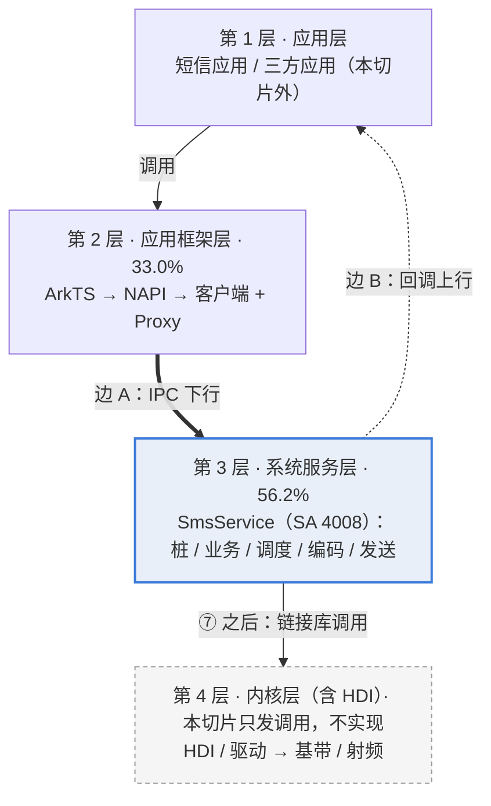
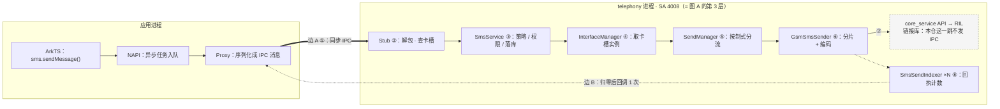
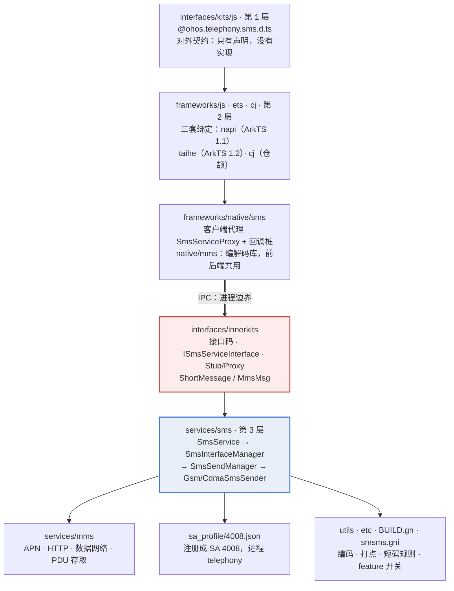
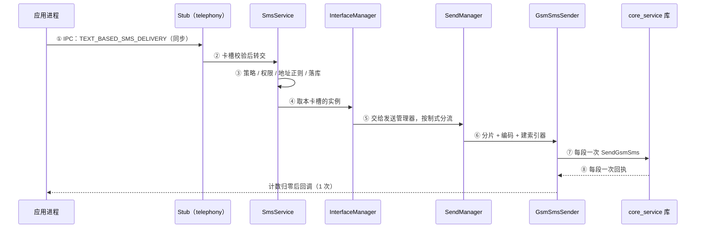
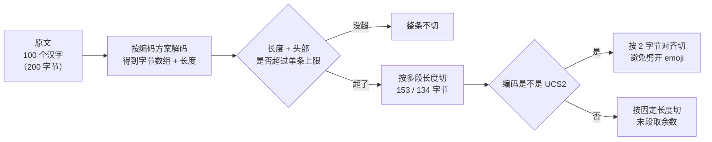
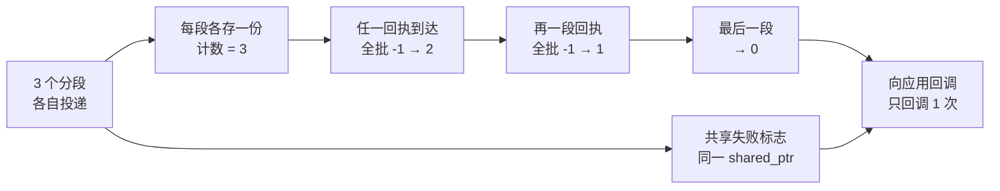
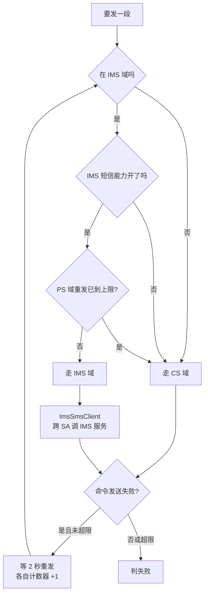
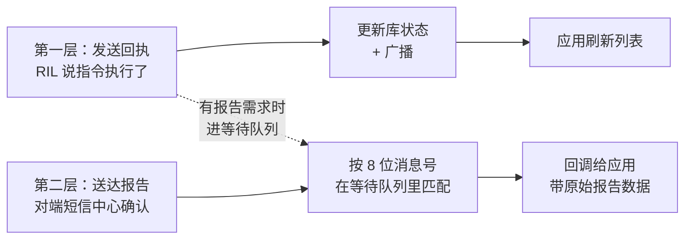
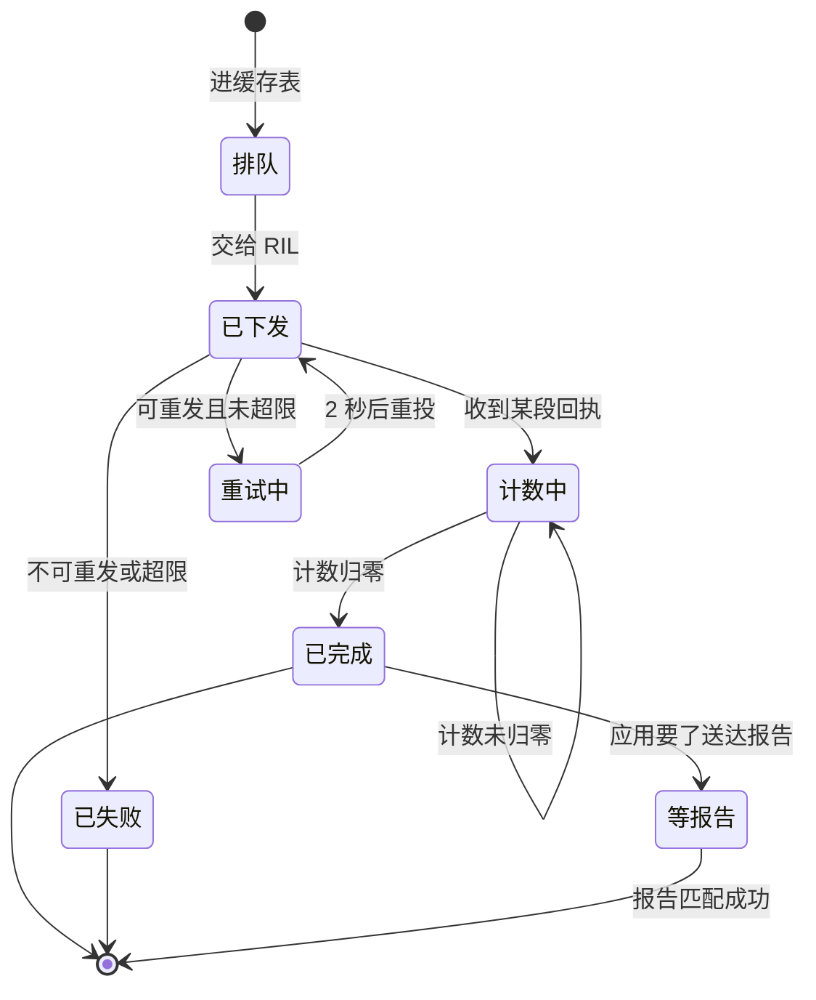

# 汇报脚本 · 一条短信的发送

> **这份文档不是 PPT，是"把 PPT 做出来"的施工图。**
> 用途：交给组内任何一个人，都能按这份脚本在学校模板里逐页填出同一套幻灯片；内容随时可改，改这里即可。
>
> 配套材料：`report.md`（证据与结论）、`anchors.md`（103 个锚点）、`ai-log.md`（AI 协作纪实）
> 基线：OpenHarmony-7.0-Release（`e06478b`）
> 本稿每一条结论都已回源码核对过一遍，修订记录与逐条核对表见**第 7 节**。

---

## 0. 怎么用这份脚本

### 0.1 三条约定

| 记号 | 含义 |
|---|---|
| **【浅】【中】【深】** | 认知深度。第 1–2 页让完全不懂的人跟上；第 3–4 页讲结构（**三图对照 + 时间轴对照**）；第 5–8 页讲机制；9–12 收尾 |
| **主旨句** | 直接抄到页面顶部当标题下面那行小字，或当页面唯一一句大字 |
| **图示** | mermaid 源码，可直接渲染成图；也可以在模板里照"手绘要点"用形状重画 |

### 0.2 套学校模板的四条规则

1. **一页只讲一件事**，正文不超过 6 行；讲不完的挪到备用页。
2. **主图占页面 55%–65%**，文字只做注解。所有图统一线宽、统一圆角、统一字号（节点文字 ≥14pt）。
3. **页脚固定**：左下"telephony_sms_mms @ OpenHarmony-7.0-Release"，右下页码"NN / 12"（备用页不编号）。
4. **色彩克制**：主色一种（深蓝）、强调一种（红，仅用于"问题/失败"）、其余灰阶。不要三种以上颜色同时出现。

### 0.3 改内容时只改这四处

| 要改的东西 | 改哪里 |
|---|---|
| 页数、顺序、时长 | 第 1 节总览表 + 第 4.1 节配速表（两处必须同步） |
| 某页讲什么 | 第 2 节对应小节（结构固定为：主旨 / 版式 / 图示 / 要点 / 讲稿） |
| 数字与结论 | 先改 `report.md`，再同步这里的数字（两处必须一致，抽问会对账） |
| 锚点 | 先改 `anchors.md`，再同步本脚本各页页脚与第 7 节（三处都会被校验，漏改就会对不上） |
| 基线版本 | 三处同步：封面基线行、`report.md` 抬头、`meta.json` 的 `baseline_commit`。换基线必须三处一起改，否则锚点会全部对不上 |
| 老师追问怎么答 | 第 8 节题库（54 问，按链路 / 权衡 / 方法 / 边界 / 结构 / 综合六类，另有 AI 效率 8.8、实现评价 8.9、知识库 8.10 三个专项）；被问住时翻第 13 页速答 |
| 复现结果 | 先改 `report.md` 5.5，再同步 `repro` 目录的脚本断言与第 7.5 节；三处不一致时以脚本实际输出为准 |

### 0.4 本版与上一版的差别（为什么重做）

上一版是直接生成的 .pptx，问题是：套不进学校模板、改一个字就要重排版、并且**没有讲清"这条调用链落在鸿蒙的哪一层"**。
这一版把重心从"排版好看"换成"讲清层级"：第 3 页把**分层地图、调用链、目录树三张图并到一页**互相对照（目录树是第六轮换上的：对没读过这个仓的人，"目录怎么排"比"类怎么依赖"好懂得多），第 4 页再把同一批编号换成时间轴，其余页全部改为可编辑文本。

**第八轮又改了一处更要紧的**：封面不再只写题目，而是**先给一句定义**——"它是什么"。理由很直接：整个汇报回答的是"这条链怎么走"，但如果听众不知道**走的是谁**，后面每一页都在给一个陌生人讲他的家谱。封面 25 秒 + 第 2 页一张六行定位表，解决的就是这件事。

> **为什么把三张图并成一页**：分层讲一遍、调用讲一遍、类再讲一遍，听众会当成三件事；并排放，再用同一套 ①–⑧ 编号钉住，才是"一件事的三种画法"。代价是这一页信息密度高，必须配 80 秒的讲法（见页 3 的"三个钉"）。

---

## 1. 全篇设计

> **一句话定位（全篇地基，就是封面那句）**
> `telephony_sms_mms` 是 OpenHarmony 通信子系统 `telephony` 下的一个**独立部件**（component），职责是**把「短信/彩信」这项能力，从对外的 TypeScript API 声明，一直实现到与 Modem 交互的完整链路**。
>
> 这一句照搬仓库自带代码地图的"部件定位"写法，它一次回答三个问题：**它是谁**（部件，不是 App，有 SA 编号 4008）、**边界在哪**（上只接一个 `.d.ts`，下经 core_service 到基带，旁接 DataShare 与网络）、**负责什么**（短信彩信全部；本汇报只走"发短消息"这一条）。后面九页都是这一句的展开：讲层=它落在第几层，讲链=这句话具体怎么走，讲目录=这句话的代码在哪。

### 1.1 一条主线

> **一次发送 = 一次跨层下行 + 一次跨层上行。**
> 下行：应用 → 框架 → 系统服务 → 硬件抽象 → 空口；
> 上行：回执 → 系统服务 → 回调对象 → 应用。
> 中间只有 **2 处 IPC 是本仓发起的**（下行、上行回调）；再往下到 RIL 调的是**链接进来的库**，本仓那一跳不发起 IPC（`core_service` 自身是 SA 4010，进程归属在切片外，详见 7.8）。N 段短信在系统服务层被"收敛"成 1 个结果。

### 1.2 由浅入深的三段式

| 段 | 页 | 回答的问题 | 听众收获 |
|---|---|---|---|
| 第一段 · 它是谁 + 看得见 | 1–2 | 这是什么东西？我按下发送之后发生了什么？ | 能一句话说清"它是部件、不是 App"，并有一个直觉画面 |
| 第二段 · 结构 | 3–4 | 它在鸿蒙里算什么？谁在调用谁？代码放在哪个目录？ | 能指着分层图说出这条链落在第 3 层，也能说出"这段代码第三方能不能调"看目录就知道 |
| 第三段 · 机制 | 5–8 | 为什么要这么设计？代价是什么？ | 理解分片、聚合、域选择三个机制 |
| 收尾 | 9–12 | 好在哪、差在哪、证据够不够 | 能回答追问 |

### 1.3 总览表

| 页 | 标题 | 深度 | 主图示 | 时长 |
|---|---|---|---|---|
| 1 | 一条短信的发送 | — | 封面：**一句话定位**（它是谁）+ 四要素行 | 25s |
| 2 | 它是什么，以及你按下发送之后 | 浅 | 用户视角五格图 + **部件定位表（6 行）** | 55s |
| 3 | 三个视角看同一条链 | 浅→中 | **三图同页**：四层地图 + 调用链 + 目录树，共用 ①–⑧ | 85s |
| 4 | 把上一页的编号按时间走一遍 | 中 | 编号条 + 双泳道时序（与页 3 逐格对齐） | 40s |
| 5 | 机制一：先编码，再切 | 深 | 文本→字节→分段 数据流 | 40s |
| 6 | 机制二：把 N 段伪装成 1 条 | 深 | 计数递减图 | 45s |
| 7 | 机制三：IMS 优先，CS 兜底 | 深 | 判定树 + 时间轴 | 45s |
| 8 | 闭环：回执怎么回来 | 深 | 上行回环图 | 25s |
| 9 | 利弊各三条 | 评 | 双栏对照 | 25s |
| 10 | 一次真实的 AI 纠错 | 证 | 三格推理链 | 35s |
| 11 | 结论与收获 | — | 数字卡 + 两栏短句 | 25s |
| 12 | 好不好、像谁、新在哪、怎么改 | 评 | 2×2 四问格 | 45s |
| 13 | 备用：锚点与预判 | 备用 | 表 | 按需 |

合计 **8 分 10 秒**（12 页正文 + 1 页备用；备用页不计时）。封面与第 2 页承担"它是什么"，这两页超出的 30 秒是从后面各页压出来的余量里补的，不是新增内容。

按课程"8 分钟 = 6 分钟讲 + 2 分钟问"的口径，讲稿要压进 6 分钟。**完整版 8:10，超 2 分 10 秒，必须砍。三刀：**
>
> - **7:10 档**（只砍三处）：跳第 8 页（−25s）、第 3 页只讲图 A、B（−25s）、第 4 页略②③④（−10s）。
> - **6:35 档**：再砍第 12 页只讲两格（−15s）、第 11 页跳过"三条收获"（−10s）、第 9 页只讲弊（−10s）。
> - **6:00 档**：再砍第 5 页略"段数上限"（−10s）、第 7 页略 IMS 句与重发细节（−10s）、**第 2 页只讲定位表不讲五格图（−15s）**。
>
> **砍的顺序有讲究**：先砍第 8 页（闭环可以在第 6 页顺带一句带过），再砍图 C（类图/目录树是加分项，层与链是及格项），**最后才动封面和第 2 页**——这两页是"让外行听懂"的地基，砍掉就等于回到"只讲链、不讲它在哪"的老问题。
>
> 第 3 页是唯一"砍图不砍页"的地方：宁可只讲两张图，也不要拆回三页——三张图并排才是这页的意义。

---

## 2. 逐页脚本

---

### 【页 1】封面

**深度**：— ｜ **时长**：25s

**主旨句**：一句话说清它是什么——把「短信/彩信」这项能力，从对外的 TypeScript API 声明，一路实现到与 Modem 交互的完整链路。

**版式**（左文右号；学校模板只借用标题区，其余用文本框）

```text
┌────────────────────────────────────────────────────────┬───────────┐
│ 一条短信的发送                                          │           │
│ telephony_sms_mms 主链路分析 · 从 ArkTS 调用到空口投递   │    4008   │
│                                                        │  SA 编号   │
│ ── 它是谁（本页主角，字号仅次于主标题）───────────────   │           │
│ telephony_sms_mms 是 OpenHarmony 通信子系统 telephony   │  libtel_  │
│ 下的一个独立部件（component），职责是把「短信/彩信」      │  sms_mms  │
│ 这项能力，从对外的 TypeScript API 声明，                │  .z.so    │
│ 一直实现到与 Modem（基带）交互的完整链路。               │           │
│                                                        │           │
│ 子系统 telephony ｜ SA 4008 ｜ 产物 libtel_sms_mms.z.so  │           │
│ 源码基线 OpenHarmony-7.0-Release · e06478b              │           │
│                                                        │           │
│ 第 12 组 ｜ 成员 ｜ 日期                                 │           │
└────────────────────────────────────────────────────────┴───────────┘
```

**要点**
1. **定位句就是封面主角**，不是副标题下面的小字。听众前 25 秒只该记住这一句：**它是个部件，把 API 声明实现到 Modem**。这句话后面每一页都能回收——讲层是"它落在第几层"，讲链是"这句话具体怎么走"，讲目录是"这句话的代码在哪"
2. 定位句里有三个英文词（`component`、`TypeScript API`、`Modem`），**念的时候把括号里的中文带出来**：部件、对外接口声明、基带。评委里只要有一个不是本专业，这三个词就是门槛
3. 四要素一行（子系统 / SA 编号 / 产物 so / 基线）：**这行是给内行看的，不用逐个念**，摆在那里就够
4. 基线必须带 commit（`e06478b`），与 `meta.json` 的 `baseline_commit` 一致；换基线两处同时改
5. 右侧数字方块 `4008` + 产物名：一个数字就说明"它是有编号的常驻服务，不是 App"
6. 底部：组号 / 成员 / 日期

**讲稿（约 25 秒）**
> "先用一句话说清我们在看什么：**telephony_sms_mms 是 OpenHarmony 通信子系统 telephony 下的一个独立部件，职责是把短信、彩信这项能力，从对外的 TypeScript 接口声明，一直实现到和 Modem——也就是基带——交互的完整链路。**"
>
> "**它不是 App**，是系统里一个常驻服务，编号 4008。这条链路很长，我们只讲其中一个动作：按下发送键之后，消息走了哪几层、被谁改了、什么时候才算成功。"

**页脚锚点**：`sa_profile/4008.json:2#process`、`sa_profile/4008.json:6#libpath`

---

### 【页 2】它是什么，以及你按下发送之后（浅）

**深度**：浅 ｜ **时长**：55s

**主旨句**：它不是 App，是系统里一个常驻部件；你看到的是一个动作，系统里是五个现场。

**版式**：上半五格图（约 34% 高），中间一行过渡小标题"这张表说清它在系统里的位置"，下半定位表（约 52%）。**表是主角，图是引子。**

**图示**


**手绘要点**
> 五个圆角矩形横排，箭头单向；最后一根箭头画虚线并回指第一个，表示"回执"。每个框只放一行字，框下方小字标"应用进程 / 系统服务进程 / 硬件"。

**要点**
1. 应用只负责"收集文字 + 显示结果"
2. 真正发出去的是**系统服务**，不是应用
3. 中间要过**基带**，这一步应用完全看不见
4. 成功与否取决于**回执**，不取决于"点没点上"

**它是什么：一张表说清（结构照搬仓库自带的代码地图，内容已回 7.0 源码核对）**

| 项 | 值 | 给没接触过鸿蒙的人 |
|---|---|---|
| 部件 / 子系统 | `sms_mms` / `telephony` | 子系统 = 按功能切的大块；**部件 = 能独立编译、独立裁剪的一块功能，不是 App** |
| 系统服务 | SA `4008` · 进程 `telephony` · 产物 `libtel_sms_mms.z.so` | **SA = 部件跑起来之后的常驻身份，有编号，别人按编号找它** |
| 启动配置 | `sa_profile/4008.json` 常驻；`sa_profile/4008_dynamic.json` 按基带上下电 | 一个 json 就决定了它叫什么号、跑在哪个进程 |
| 职责范围 | 短消息收发 · SIM 卡短消息 · 小区广播 · WAP Push；彩信发送、下载、编解码 | 本汇报只走"发短消息"这一条链，其余不展开 |
| 上游依赖 | core_service（RIL、卡状态）· telephony_data（DataShare 数据库）· netmanager + netstack（彩信网络）· IMS 服务 | 基带在 core_service 再往下一层，**不在本仓** |
| 下游消费者 | 应用（`@ohos.telephony.sms`）· 短信应用（DataShare 表 + 公共事件） | 对外的脸只有一个 `.d.ts` |

> 三个词记一下别再混：**子系统** = 按功能切的大块；**部件** = 能独立编译裁剪的一块，不是 App；**SA** = 部件跑起来后的常驻身份，有编号。基带（Modem）是真正发信号的硬件，在本仓之下，本仓只把请求递到它门口。

**讲稿（约 55 秒）**
> "先说人话版。你点发送，应用把文字交给系统；系统负责拆、编码、排队，交给基带发出去；网络那头收到后回一条回执。你只看到两次变化：消息出现在列表里，和一个'已发送'的勾。但在这两次变化之间，请求跨出了应用所在的进程，进了系统服务，再带着回执回来。"
>
> "那这个'系统服务'到底是谁？就是封面上那句话：一个独立部件，编号 4008，住在 telephony 进程里。**它不是 App**——应用卸载了它还在，开机它就在。它上面只接一个 TypeScript 接口，下面经 core_service 到基带，旁边接数据库和网络。**这张表六行，就是它的全部身份。**"
>
> "所以后面每讲一段链路，都可以回到这张表问三个问题：这一步在它里面还是外面？越过了哪个上游？结果回到谁手上？"

**页脚锚点**：`sa_profile/4008.json:5#name`、`sa_profile/4008.json:7#run-on-create`、`sa_profile/4008_dynamic.json:36`、`BUILD.gn:157#tel_telephony_data`、`BUILD.gn:149#net_conn_manager_if`

---

### 【页 3】三个视角看同一条链：在哪层、谁调谁、代码放哪（核心对照页）

**深度**：浅 → 中 ｜ **时长**：85s ｜ 本页合并了原"分层 / 四次翻译 / 两处边界"三页，**全篇最重要，讲慢**

**主旨句**：一张看层，一张看流，一张看代码放哪；三张图上的编号是同一件事。

**版式**（三图并置，不要上下叠）

```
┌──────────────────────────────────────────────────────────────┐
│ 三个视角看同一条链                                           │
├──────────────┬──────────────────────────┬────────────────────┤
│  图 A 地图   │      图 B 调用链         │   图 C 目录树      │
│  宽 26%      │      宽 42%              │    宽 32%          │
│  4 条横带    │      2 个竖框 + 8 节点   │    8 个目录节点    │
│  第 3 层上色 │      两粗一细三根箭头    │    目录即分层      │
├──────────────┴──────────────────────────┴────────────────────┤
│ 底条：① ② ③ ④ ⑤ ⑥ ⑦ ⑧   ← 三个视角共用这一套编号           │
└──────────────────────────────────────────────────────────────┘
```

三图同高（合计占页面 62%），底条 10%，标题区 12%。**三张图必须同一底色、同一线宽、同一字号**，否则"对照"会变成"三张互不相干的图"。

> **编号纪律（照抄，别改）**：**层级一律写"第 N 层"，圆圈数字 ①–⑧ 只留给八跳**。两者绝不能混用——同一页里"②"只能有一个意思，否则对照卡会自相矛盾。边界的两个记号也固定：**边 A**（下行 IPC）、**边 B**（回调上行）。

**图示 A：它落在哪一层（地图）**



**图示 B：谁把请求递给谁（调用链）**



**图示 C：代码放在哪（目录树 —— 目录形状就是架构）**



> **这张图在回答"没读过这个仓的人怎么一眼看懂"**：目录名本身就是答案。`kits` 是给第三方应用看的，`innerkits` 只能给系统部件用，`frameworks` 是绑定与代理，`services` 干活，`sa_profile` 给它一个 SA 号。11 个类怎么互相依赖是另一层信息，见 `report.md` 1.5.1，被追问时翻它，不占本页版面。

**手绘要点：三个"钉"，把三张图钉成一件事**

1. **底色钉**：图 A 第 3 层和图 B 右侧大框用**同一种底色**，并在图 B 框上直接写"= 图 A 第 3 层"。一眼看过去就知道"层框就是进程框"。
2. **编号钉**：①–⑧ 三张图都用同一套（图 A 标段落、图 B 标节点、图 C 标承接的目录）。指到哪个号，三张图指的是同一下落。层级写"第 N 层"，不占圆圈数字。
3. **箭头钉**：图 B 只画**两根粗箭头**（边 A 下行、边 B 回程）+ **一根细箭头**（⑦ 库调用）。`core_service` 画在 telephony 框**里面**，这一笔钉的是"**本仓代码发起了几次 IPC**"，不是"整条链一共跨几次进程"。

**要点：照图讲三句话**

1. **图 A 回答"它是什么身份"**：不是 App，是第三层的 SA（4008），往上供接口、往下找基带
2. **图 B 回答"谁把请求递给谁"**：8 跳，本仓代码只发起 2 次 IPC（① 下行、边 B 回程）；⑦ 调的是链接进来的库，本仓没写 SA 查找。**但 core_service 本身是 SA 4010**，`sa_profile/4008.json` 里声明了 `depend: [4010]` 并等 60 秒——所以这一跳的进程归属落在切片外，我们不硬说"同进程"（见 7.8）
3. **图 C 回答"代码放在哪"**：**目录形状就是架构**。一句话判据——**`kits` 是给第三方应用看的，`innerkits` 只能给系统部件用**。往下依次是：
   - `frameworks`：三套语言绑定（napi = ArkTS 1.1、taihe = ArkTS 1.2、cj = 仓颉）+ 客户端代理；
   - `interfaces/innerkits`：接口码、Proxy/Stub、跨进程数据结构——**进程边界正落在这一层**；
   - `services`：真正的实现，`sa_profile/4008.json` 给它 SA 号；
   - `utils` / `etc` / `BUILD.gn` / `smsmms.gni`：编码、短码规则、feature 开关（彩信、卫星、仓颉都能裁）。
   补充两处容易漏的：`frameworks/native/mms` 是 **source set**，服务端和前端编译同一份编解码代码，改它会同时影响两边；`telephony_ext_wrapper` 用 `dlopen` 加载厂商扩展，所以开源仓能独立编译通过
4. **三张必须一起看**：图 C 说不出先后，图 B 说不出代码在哪；对不上就是画窜了——图 B 的每个节点都必须能在图 C 里找到落脚的目录，找不到就说明画错了
5. **边界只决定两件事**（图 B 那两根粗箭头）：**能传什么**——可序列化参数 + 一个远程对象句柄；**崩了丢什么**——发送索引器那张缓存表是进程内静态成员，进程一重启，在途短信永远等不到回调（第 12 页"新在哪"会回收这条）

**底条对照卡**（放大就是这张表，现场可只留前三行）

| 编号 | 图 A：哪一层 | 图 B：哪个节点 | 图 C：落在哪个目录 |
|---|---|---|---|
| ① 之前 | 第 2 层 · 框架层 | ArkTS → NAPI → Proxy | `frameworks/js/napi`（绑定）+ `frameworks/native/sms`（代理） |
| ① | **边界 A**：IPC 下行 | Proxy ⇒ Stub | `interfaces/innerkits`——**进程边界就落在这一层** |
| ②–④ | 第 3 层 · 系统服务层 | Stub → SmsService → InterfaceManager | `services/sms`（同一个 `SmsService` 对象既是桩又是业务） |
| ⑤–⑥ | 第 3 层 · 系统服务层 | SendManager → GsmSmsSender | `services/sms` + `services/sms/gsm`（按制式分子目录） |
| ⑦ | 第 3 层调第 4 层：库调用，不跨界 | GsmSmsSender → core_service | 出图：调 `core_service` 的链接库，源码不在此仓 |
| ⑧ + 边 B | 回程（第 3 层 → 第 1 层） | Indexer 计数 → 回调 ×1 | `services/sms` 的事件循环 → 回到 `frameworks/native/sms` 的回调桩 |

**讲稿（约 85 秒）**

> "这一页三张图并排放是有意的：讲一个仓最容易犯的错，是分层讲一遍、调用讲一遍、目录再讲一遍，听众听成三件事。其实是同一件事的三种画法：抽象层、调用顺序、代码位置。"
>
> "图 A 看身份。鸿蒙官方分四层，短信不是 App，是第 3 层的 SA——一个能被别的进程按编号找到的常驻服务，号码 4008，办公室叫 telephony 进程。服务端代码占 56%、框架层 33%，所以第 3 层涂了底色。第 4 层是 HDI 和基带，切片只发调用、不实现。"
>
> "图 B 看流向。八跳，我们自己的代码只发起两次跨进程：应用进 telephony 一次，回执回来一次。到 RIL 那根是细箭头——链接进来的库，本仓这一跳没发 IPC。"
>
> "图 C 看代码在哪。目录形状就是分层：`kits` 放对外接口，只有声明；`frameworks` 放三套语言绑定和代理；`innerkits` 正好压在进程边界上；`services` 才干活；`sa_profile` 那个 json 决定了它叫 4008。**判断一段代码能不能被第三方调，看它在 kits 还是 innerkits 就够了。**"
>
> "三张图共用一套编号，① 到 ⑧ 就是八跳。下一页按时间走一遍。"

**页脚锚点**
- `sa_profile/4008.json:2#process` — 第三层的家：telephony 进程
- `services/sms/include/sms_service.h:30#SmsService` — 一个类三种身份
- `services/sms/sms_send_manager.cpp:103#TextBasedSmsDelivery` — ⑤ ⑥ 的分流点
- `services/sms/gsm/gsm_sms_sender.cpp:242#CoreManagerInner` — ⑦ 直接调单例，无 SA 查找

---

### 【页 4】把上一页的编号按时间走一遍（中）

**深度**：中 ｜ **时长**：40s

**主旨句**：编号没变，只是换了坐标轴：上一页是"谁挨着谁"，这页是"谁先谁后"。

**版式**（左窄条 + 右泳道，与上一页对照）

```
┌───────────────┬──────────────────────────────────────────────┐
│ 编号条  22%   │ 泳道区  78%                                  │
│               │ 六条竖线：App / Stub / Svc / SM / GS / RIL    │
│ ① 边 A        │  ══════▶  请求（实线，自上而下）             │
│ ② 解包        │  ◀┄┄┄┄┄  回执（虚线，自下而上）             │
│ ③ 三件事      │                                              │
│ ④ 取实例      │  每个编号格对准一条箭头，行高一致            │
│ ⑤ 分流        │  ⑥ 与 ⑦ 之间加一个括号：这里一分为 N        │
│ ⑥ 一变多      │                                              │
│ ⑦ 下发        │  最后一根虚线旁标：只回调 1 次               │
│ ⑧ 回执        │                                              │
└───────────────┴──────────────────────────────────────────────┘
```

左侧编号条宽 22%，八格等分，每格只写"编号 + 两个字的动作"；**格子高度和泳道里的箭头间距对齐**，听众视线能一格一格往下走。

**图示**



> 不加 `autonumber`：编号已经在消息文字里写死了，两套编号会打架（渲染成"1①"）。这是上一版的一个渲染瑕疵，本次改掉。

**手绘要点**
> 标准泳道图，七条竖线，**每个参与者对应上一页图 B 的一个节点**（Stub / SmsService / InterfaceManager / SendManager / GsmSmsSender / RIL，外加调用的应用进程）。**实线箭头向下（请求），虚线箭头向上（回执）**。在⑥和⑦之间标一个括号，写明"这里一分为 N"。在最后一根虚线旁标注"只回调 1 次"。
> 左侧编号条**必须与上一页图 B 的编号完全一致**（同一个号、同一个动作名），这是两页之间唯一的连接件；换页时用手指一下"②还是那个查卡槽"，听众就不会觉得换了个话题。

**要点**
1. ① 是同步 IPC，② 到 ⑥ 都在 telephony 进程内；⑧ 是回灌到本进程的事件，不是又一次 IPC
2. ⑥ 是唯一"一变多"的地方：1 条消息 → N 个分段
3. ⑦ 每段一次设备调用，⑧ 每段一次回执
4. 回执不是原路返回，而是事件
5. 最后一根虚线只有一条：聚合后的那一次
6. **两页对照着说**：上一页回答"结构长什么样"，这一页回答"时间上谁先谁后"；结构图里 GS 和 RIL 挨着，时序图里才看出 ⑦ 要重复 N 次

**讲稿（约 40 秒）**
> "上一页那八个号，现在换成时间轴再走一遍——编号没变，只是从'谁挨着谁'换成'谁先谁后'。"
>
> "前六跳都在做校验、判断和切分，没有真正发出去；第七跳才是真的逐段调用设备。注意第六跳和第七跳之间，一条消息变成了 N 条。"
>
> "重点看回程：每段都会回一次执，但应用只收到一次回调。中间那个'把 N 收成 1'的动作，就是下一个机制。"

**页脚锚点**
- `services/sms/sms_send_manager.cpp:103#TextBasedSmsDelivery`
- `services/sms/gsm/gsm_sms_sender.cpp:179#SendSmsToRil`
- `services/sms/sms_sender.cpp:96#HandleMessageResponse`

---

### 【页 5】机制一：先编码，再切（深）

**深度**：深 ｜ **时长**：40s

**主旨句**：切的是字节，不是字符；所以必须先编码再量长度。

**图示**



**手绘要点**
> 一条横向流程，两个判断菱形。在"上限"菱形旁写 `160 / 140`（单条上限），在"切"节点旁写 `153 / 134`（每段长度）——两组数字别画到一起。右下角画一个小的"被劈开的 emoji"示意，并在上面打叉。

**要点**
1. 先按编码解成字节，拿**字节数**；不按"字数"算
2. 比较式是"字节数 + 头部 是否超过单条上限"；头部 UDH 6 字节，7bit 打包后折合 7 个字符位
3. 单条上限 7bit 160 septet / UCS2 140 字节；**已经开始分了**，每段才是 153 / 134（134 字节 = 67 个汉字）
4. 段数上限 15，超了直接失败，不静默截断
5. UCS2 多段要按 2 字节对齐，否则 emoji 会乱码

**讲稿（约 40 秒）**
> "第一个机制是分片。这里有个很容易讲错的地方：切的是字节，不是字数。"
>
> "代码的做法是先把整段文本按编码方案解成字节数组，拿到字节长度，再拿'字节长度 + 头部开销'去和单条上限比。举个例子：同样是 100 个字符，全是英文只占 100 字节，一条就发完；换成 100 个汉字，就是 200 字节，超过单条上限 140，必须切成 67 加 33 两段。这就是'字数一样、结果不同'的原因。"
>
> "还有个坑：一个 emoji 在 UTF-16 里占四个字节，硬切会把它的前后两半分到两条短信里，接收端就还原不出来。所以 UCS2 多段的时候单独走了一条按 2 字节对齐的路。"
>
> "最后，段数超过 15 就直接判失败，不会偷偷截断——这是对的，静默丢字比报错更糟。"

**页脚锚点**
- `services/sms/sms_base_message.cpp:478#SplitMessage`
- `services/sms/sms_base_message.cpp:290#multiSegSms7BitLength`
- `services/sms/sms_base_message.cpp:414#SplitMessageUcs2`

---

### 【页 6】机制二：把 N 段伪装成 1 条（深，本页为最难点）

**深度**：深 ｜ **时长**：45s

**主旨句**：计数归零才算成功；任一段失败，整条失败。

**图示**



**手绘要点**
> 左边三个小方块（1/3、2/3、3/3），每个方块旁边配一个自己的计数器，三个计数器**同步**从 3→2→1→0（在三个计数器之间标一句"不是同一个变量，是同一个节奏"）。归零时向右画粗箭头写"回调"。下方一条细虚线从"失败标志"并入回调，旁标"共享同一个 shared_ptr"。

**要点**
1. **失败标志**是真共享（同一份 `shared_ptr<bool>`）；**计数不共享**——写进索引器的是值拷贝
2. 靠"广播递减"保证同步：任一回执到达，把同一批（同一 8 位 `msgRef`）的计数全减 1
3. 计数归零那一刻才回调，所以"成功"的定义是"全部回来"
4. 成败取"或"：任一段失败过 → 整条失败
5. 三个前提：失败标志必须传同一份、批次要能按 `msgRef` 找回、回执不能永久丢

**讲稿（约 45 秒）**
> "第二个机制最反直觉，也最值得讲。一条长短信在空口上是 N 条独立短信，如果每段各自回调，应用会收到 N 次'成功'，UI 上可能闪 N 条记录。更麻烦的是：第 1 段成功、第 2 段失败，应用怎么表达'这条长短信失败了'？"
>
> "代码的做法是把这 N 段绑成一个事务，但绑法有点意思：失败标志是真共享，一批分段拿到同一个 shared_ptr；剩余计数却不是共享的——写进索引器的是值、不是指针，所以每段各有一份副本。"
>
> "那它怎么保证同步？靠回执处理时的一次全表扫描：每来一段回执，不是只减当前这条，而是遍历缓存表，把所有 8 位消息号相同的分段一起减一。计数不共享，但节奏共享——无论谁先回来，几份计数同步下降，归零的那一次必定是全部到齐。"
>
> "然后才回调，并且把'有没有任一段失败过'作为最终结果。所以对应用来说，这是一条短信；对系统来说，这是一次分布式事务的微型演练。"
>
> "代价是它依赖三个前提：失败标志必须传同一份、批次要能按消息号找回、回执不能永久丢。任何一个破掉，就会退化成'永远等不到回调'。"

**页脚锚点**
- `services/sms/gsm/gsm_sms_sender.cpp:86#unSentCellCount`
- `services/sms/sms_sender.cpp:323#UpdateUnSentCellCount`
- `services/sms/sms_sender.cpp:129#unSentCellCount`

---

### 【页 7】机制三：IMS 优先，CS 兜底（深）

**深度**：深 ｜ **时长**：45s

**主旨句**：先走 IP 域，走不通再回落电路域，两边各自限重试次数；IMS 那条还多一次跨进程。

**图示**



**手绘要点**
> 上方一个三连判断（菱形串），下方一个"重发"回环箭头指回起点，回环上标"2s / CS 3 次 · PS 4 次"。左右分色：IMS 用主色，CS 用中性灰，失败用红色（红色只出现这一处）。

**要点**
1. 判定只有三个输入：是否 IMS 域、能力是否开启、PS 重发是否到顶
2. IMS 优先是因为 4G/5G 下 CS 域可能已不可用
3. CS 是兜底，不是备选方案
4. 两个域各一份计数器，共用常量 3；但判定符不同：CS 用 `<`（3 次）、PS 用 `<=`（4 次）
5. 只有"命令发送失败"才重发，业务失败不重发
6. **IMS 比 CS 多一跳**：CS 走链接进来的 `CoreManagerInner`，本仓不发 IPC；IMS 走 `ImsSmsClient`，内部 `CheckSystemAbility` + `iface_cast` 拿到代理，**这一跳确定跨进程**。所以"两次边界"说的是 CS 路径；走 IMS 时下行是三段

**讲稿（约 35 秒）**
> "第三个机制解决'发不出去怎么办'。"
>
> "判断只有三个条件，任一成立就走电路域：不在 IMS 域、IMS 短信能力没开、PS 域已经重试到上限。这就是'IMS 优先、CS 兜底'。"
>
> "重发有节流：只有错误码是'命令发送失败'才重发，每次等 2 秒；两个域各有一套计数器，CS 那边最多 3 次，PS 那边判定用的是小于等于，实际会多试一次。所以单域耗尽大约 6 到 8 秒；如果中途从 IMS 掉回 CS，还要再叠一轮。"
>
> "还有个区别：CS 那条是链接库调用，IMS 那条要拿到 IMS 服务的代理，是实打实的一次跨进程——所以域选择不只换了条路，也换了调用形态。"
>
> "代价是：重试耗尽后，失败原因被统一成'未知失败'，应用拿不到可区分的原因。"

**页脚锚点**
- `services/sms/gsm/gsm_sms_sender.cpp:218#sendCsSMS`
- `services/sms/sms_sender.cpp:361#HandleResend`
- `services/sms/include/sms_sender.h:111#MAX_SEND_RETRIES`
- `services/sms/ims_service_interaction/src/ims_sms_client.cpp:76#GetImsSmsProxy` — IMS 分支的 `CheckSystemAbility` + `iface_cast`

---

### 【页 8】闭环：回执怎么回来（深）

**深度**：深 ｜ **时长**：25s（可压缩）

**主旨句**：两层回执——"发出去了"和"对方收到了"，含义完全不同。

**图示**



**手绘要点**
> 上下两条平行流程，中间一条细虚线把它们连起来。左边标"第一层"，右边标"第二层"。在"8 位消息号"旁打一个问号，暗示它是弱点（为利弊页埋伏笔）。

**要点**
1. 第一层回执只证明"设备接受了这条指令"
2. 第二层报告才证明"对端收到了"——**对外 API 上就是两个回调**：`sendCallback`（发送结果）与 `deliveryCallback`（送达报告），声明在 `interfaces/kits/js/@ohos.telephony.sms.d.ts`，README 的示例也是这么用的
3. 只有**第一层**改库 + 发广播；第二层只回 ACK、把报告抛给应用
4. 报告匹配靠 8 位消息号——**这是协议给的宽度**（TP-MR 一个字节，`unsigned char msgRef8bit`），不是实现偷懒；回绕是协议级宿命
5. 等待队列有上限，最旧的会被丢弃

**讲稿（约 25 秒）**
> "最后是闭环。这里有两层回执，很多人会混：第一层是设备回执，只说明这条指令基带收下了；第二层是送达报告，才说明对端短信中心收到了。"
>
> "第一层会改库、发广播，应用据此刷新列表。第二层不写库——那个函数里只有两步：回 ACK、把原始报告抛给应用。所以'已送达'这件事，本模块只做转发，不改状态。"
>
> "而报告匹配只靠一个 8 位消息号，0 到 255，队列只留 25 条——这是概率性缓解，不是根治。"

**页脚锚点**
- `services/sms/gsm/gsm_sms_sender.cpp:306#StatusReportAnalysis`
- `services/sms/sms_sender.cpp:153#UpdateSms`
- `services/sms/include/sms_sender.h:123#MAX_REPORT_LIST_LIMIT`
- `interfaces/kits/js/@ohos.telephony.sms.d.ts:2797#sendCallback`、`:2806#deliveryCallback` — 两层回执在公开 API 上的形态

---

### 【页 9】利弊各三条（评）

**深度**：评 ｜ **时长**：25s

**主旨句**：优点都来自分层，缺点也都来自分层。

**版式**
> 左右双栏，左"利"右"弊"，各三条，每条两行：第一行结论，第二行一句解释 + 一个锚点。不要用图标堆砌。
> 若被追问"整体写得好不好"，不要在这页临时发挥——翻第 8.9 节的五维记分卡，那页有量化证据（日志级别比、常量重复处数、测试占比）。

**要点（利）**
1. 分层清晰：应用不碰协议，服务端不认调用方
2. `refId` → 索引器 O(1)；但批次递减要扫全表（O(n)），别把 O(1) 说满
3. 制式可扩展：新增制式只加子类与一个分支；一套服务同时喂 **三套前端**（ArkTS 1.1 的 napi、ArkTS 1.2 的 taihe、仓颉的 cj）

**要点（弊）**
1. 发送未成功库已落记录：写库在真正下发之前，失败后靠 `dataId` 回写；进程若在中间挂掉，留下"发送中"僵尸记录
2. 权限只在一层：**这是明文约定，不是漏写**（仓库红线第 6 条"禁止在 `SmsService` 之外做权限判断"）；代价是信任全压在一个对象上，绕过它即失去校验
3. 报告键只有 8 位：**协议决定**（TP-MR 一字节），队列 25 条是缓解不是消除

**讲稿（约 25 秒）**
> "优点是分层带来的：应用不碰协议，服务端不关心调用方是谁，回执靠 64 位 refId 一查就中，加新制式改动面很小。这里要克制一点：O(1) 只说单条回执的定位，批次递减还是要扫全表。"
>
> "缺点是同一个原因的另一面：写库写得太早，会有僵尸记录；权限只在业务层收口，绕过就没了；报告匹配键太短，只能靠队列上限兜。三条都能指到具体行，不是猜的。"
>
> "补一句：后两条不是实现者的疏忽。权限单点是仓库红线明文规定的，报告键 8 位是协议里那个字段就一字节——这叫结构性取舍，改它要动的是架构或协议，不是改几行代码。"

**页脚锚点**
- `services/sms/sms_service.cpp:181#InsertSessionAndDetail`
- `services/sms/sms_service.cpp:155#CheckSmsPermission`
- `services/sms/gsm/gsm_sms_sender.cpp:330#GetMsgRef`
- `services/sms/gsm/gsm_sms_sender.cpp:85#msgRef8bit` — 8 位引用号的实际类型
- `services/sms/sms_service.cpp:155#CheckSmsPermission` — 权限唯一收口处（红线 6 的落点）

---

### 【页 10】一次真实的 AI 纠错（证）

**深度**：证 ｜ **时长**：35s ｜ **这一页是加分项，别跳过**

**主旨句**：AI 说"必然出错"，实测三处全是同一个数——被数据推翻。

**图示**


**手绘要点**
> 三格横向推理链，最后一格用不同底色（结论）。中间那格直接放大三个数字对比：`146=146`、`96=96`、`161=161`；右上角补一行小字"41 文件 / +1291 −29 / 含语义改动"，说明"改动存在"与"行号不动"可以同时成立。

**要点**
1. AI 的断言听起来很"保守"，但保守也会错
2. 验证方式不是再问一次 AI，而是跑命令
3. 差异确实存在：41 文件 +1291/−29，甚至改了语义（卡槽上限常量换成 `SIM_SLOT_COUNT_MD`）
4. 结论：不能靠版本号猜，要靠双版本批量比对
5. 方法沉淀比结论更重要

**讲稿（约 35 秒）**
> "讲一个我们自己的翻车。我们一开始判断：本地仓在主干上，比基线多 46 个提交，那取的行号在老师那边一定校验失败。听起来很稳妥，对吧？"
>
> "但我们没有直接照这个判断去重做，而是导出了一份基线副本，拿同一批函数在两个版本上各取一次行号。结果是 146 对 146、96 对 96、161 对 161，完全一致。"
>
> "真相有两层。第一层：改动确实存在，甚至改了语义——卡槽上限从 SIM_SLOT_COUNT 换成了 SIM_SLOT_COUNT_MD，改动位置就在我们锚点上方的第 33 行和第 113 行。第二层：它们是等行替换，一行换一行，所以行号原地不动。"
>
> "所以真正的结论是：版本领先不等于行号漂移，漂移只发生在'锚点上方有增删行'的地方；到底有没有，只能实测，不能猜。"
>
> "这件事改变的是我们的流程：不再靠版本号猜，而是两棵树各跑一次校验。"

**页脚锚点**
- `services/sms/sms_service.cpp:146#SendMessage`
- `services/sms/sms_sender.cpp:96#HandleMessageResponse`
- `services/sms/sms_interface_stub.cpp:161#OnSendSmsTextRequest`

---

### 【页 11】结论与收获（结论）

**深度**：— ｜ **时长**：25s

**主旨句**：三条技术结论，三条方法收获。

**版式**
> 左侧竖排四个数字卡：`103` 锚点 / `0` 失败 / `29` 文件 / `4` 顶层目录。
> 右侧上下两块：上「三条结论」、下「三条收获」，各三行短句，行首用 ①②③。
> 底部一条命令（等宽字体）+ 一行分工：源码追踪 / 图示成稿 / 校验答辩。
> 版面紧时把命令缩到 9pt，放在页脚上方。

**要点（三条结论）**
1. 核心不是"发出去"，而是**把 N 段不可靠投递收敛成 1 个对应用可见的原子结果**；聚合点是计数归零
2. 分片的正确性押在**顺序**上：先编码量字节、再按段长切；UCS2 还要按字符边界切
3. 三个薄弱点（写库过早、权限单点、8 位匹配键）是**结构性取舍**，不是疏漏——其中"权限单点"对应仓库红线第 6 条，"8 位键"对应协议字段宽度，两条都不是实现者可改的

**要点（三条收获）**
1. **锚点制把"我觉得"变成"可校验"**：103 条锚点、0 失败，任何人一条命令复现
2. **工具通过 ≠ 正确**：校验器允许 ±5 行，我们自己关掉容差，又查出 4 处偏移
3. **文档和版本号都不能替代代码**：仓库主干的知识库给了 11 条红线，我们逐条回 7.0 源码验证——成立，但其中一条（`depend: [4010]`）反过来修正了我们的措辞

**讲稿（约 25 秒）**
> "最后是证据和结论。103 个锚点、29 个文件，横跨四个顶层目录加两个根文件，0 失败，这条命令现场就能跑。"
>
> "三条结论：第一，这条链路的核心不是发出去，而是把 N 段收敛成一个结果，聚合点是计数归零；第二，分片的正确性全押在'先编码再切'这个顺序上；第三，写库过早、权限单点、8 位匹配键，这三个薄弱点都是结构性取舍，不是疏漏。"
>
> "三条收获：锚点制把'我觉得'变成'可校验'；工具通过不等于正确，容差要自己关掉再查一遍；文档也不能替代代码——这个仓主线自带一份知识库，11 条红线，我们逐条回 7.0 源码验了一遍，有一条反而纠正了我们自己的说法。"

**页脚锚点**：`report.md` 第五节、`anchors.md` 第 9、10 节

---

### 【页 12】四个问题：好不好、像谁、新在哪、怎么改（评价）

**深度**：评 ｜ **时长**：45s

**主旨句**：结构合格、反馈打折；它像 Android，但把复杂度从应用挪进了服务；比功能机时代多了隔离与共享，代价是 8 跳。

**版式**
> 2×2 四格，每格左上角一个问句（20pt 加粗），下接 2–3 行短句（16–18pt）。
> 四格之间只留细线分隔，不要卡片阴影、不要图标。
> 底部一行小字（12pt）专门写免责：`②③ 为背景对比，不在本切片内可证`。

**四格内容**

| 格 | 问句 | 三行答案 |
|---|---|---|
| 左上 | **好不好？** | 结构：11 个类各司其职，测试占非测试代码 53.4%（但三套前端无单测）<br>反馈：hilog 里 LOGE : LOGI ≈ 5.4 : 1，正常路径几乎不打点<br>粒度：有 HiSysEvent 四个入口，但发送失败仍大量落到 `UNKNOWN`（64 次） |
| 右上 | **像谁？** | 同：系统服务常驻 + IPC + 服务端编码下发 + 双层回执<br>异：Android 由应用先切好、每段一个 PendingIntent，收 N 次回调<br>鸿蒙传整段文本、服务端切、**只回 1 次**，且一个 SA 同时喂三套前端 |
| 左下 | **新在哪？** | 过去：短信栈与 UI 同地址空间，直接怼串口，2–3 层<br>现在：SA 化 + 权限 + DataShare + 每卡槽实例 + napi/taihe/cj 三套前端<br>代价：3 层 → 8 跳；本进程一重启，在途回调全丢（RIL 死亡另有兜底） |
| 右下 | **怎么改？** | ① 分片失败也要回调：`TextBasedSmsSplitDelivery` 校验失败直接 `return`，应用永远等<br>② 长度校验用上限、不用"上限 + 1"：同处 95 行、`DataBasedSmsDeliverySplitPage`、2401 缓冲<br>③ 拆 `UNKNOWN`（64 处）；顺手收口 `160`（6 处重复） |

**手绘要点**
> 四格不等大：左上、右下略宽（这两格是"结论"），右上、左下略窄（这两格是"对照"）。
> 左上那格里的 `5.4 : 1` 和 `64 次` 用主色单独放大一号——**这两个数字是"不合格"的唯一硬依据**，其余都是形容词。
> 底部免责小字不要省。评委看到"Android 怎样怎样"一定会问"你看过 Android 源码吗"，这行字就是答案的一部分。
> 右下第①②条旁边用小字标"仓库技术债表"，这一标价值很大：说明不是我们挑刺，是维护者自己认了的账。

**讲稿（约 30 秒）**
> "最后用四个问题收一下。**好不好？**结构合格，反馈打折：错误日志和正常日志是 5.4 比 1，正常路径几乎不打点；它有 HiSysEvent 这条结构化通道，四个入口都在，可发送失败还是大量落到一个 `UNKNOWN`，64 次。所以是'跑对了没问题，跑错了说不清'。"
>
> "**像谁？**很像 Android 的 Telephony——同样是常驻服务加 IPC，同样是双层回执。差别在一处：Android 让应用自己切段、每段配一个回调；鸿蒙收整段文本、服务端切、只回一次。应用省事了，但失去了'只重发失败那一段'的能力。另外它一个 SA 同时喂三套前端——napi、taihe、仓颉，这是 Android 那边没有的负担。"
>
> "**新在哪？**过去功能机时代短信栈和界面在同一个地址空间，直接怼串口，两三层就到底了；现在是 SA、有权限、有数据库、按卡槽分实例，一个服务能同时喂 ArkTS 和 C++ 应用。代价就是从三层变成八跳。"
>
> "**怎么改？**前两条不是我们拍脑袋想的，是仓库自己的技术债表里写着的：分片时长度校验失败直接 return，没回调，应用就一直等；校验写的是'大于上限加一'，把超长一字节的数据放过去了。这两处都只改几行。第三条拆错误码，收益最大；再收口 `160` 常量，六个地方各写一遍。"
>
> "右上和左下这两格是对照，不是我们仓里能证的，页脚标了。"

**页脚锚点**
- `services/sms/gsm/gsm_sms_sender.cpp:64#SEND_SMS_FAILURE_UNKNOWN` — 粗错误码
- `services/sms/include/sms_base_message.h:64#SmsBaseMessage` — `160` 常量重复的第一处所在文件
- `services/sms/sms_base_message.cpp:483#decodeData` — 2401 字节缓冲
- `services/sms/gsm/gsm_sms_sender.cpp:78#TextBasedSmsSplitDelivery` — 第 95 行校验失败直接 return（技术债 3）
- `services/sms/sms_sender.cpp:495#MAX_USER_DATA_LEN` — `> 上限 + 1`（技术债 2）
- `services/sms/sms_receive_handler.cpp:336#count` — `int8_t` 计数（技术债 1）

> **讲这页的三条纪律**
> 1. ②③ 两格必须念出"这是背景对比"，不能混进"我们验证过"的部分；
> 2. 不要贬低 Android（"他们那样很蠢"），也不要说鸿蒙"更先进"——只说**取舍不同**；
> 3. 被追问"你看过 Android 源码吗"，答案就是页脚那行免责：**API 形态层面的对比，没有读 Android 源码**。

---

### 【页 13】备用：锚点样例与速答（备用）

**深度**：备用 ｜ **时长**：按需

**用途**：被追问时直接切到这页，不要现场回忆。**完整题库在第 8 节**，这页只放最高频的 9 条。

**内容**
- 左半：5 条锚点样例（带路径与行号，现场指给老师看）
- 右半：9 条速答，每条一行，字号不小于 16pt（放不下就只留前 6 条，后 3 条背下来）

| 追问 | 一句话答案 |
|---|---|
| 为什么不能按字符切？ | 字符数≠字节数：100 个 ASCII 是 100 字节，100 个汉字是 200 字节 |
| 计数是共享还是每段一份？ | 每段一份值拷贝，靠"广播递减"同步；共享的是失败标志 |
| 8 位消息号回绕怎么办？ | 队列上限 25 + 最旧丢弃，是缓解不是消除 |
| 发送前写库，崩溃了？ | 留"发送中"僵尸记录；本仓未见启动清理，只能靠后续按 `dataId` 回写 |
| 为什么 PS 比 CS 多试一次？ | `HandleResend` 里 CS 用 `<`、PS 用 `<=`，同一常量 3 被两种比较符解释 |
| 为什么 Stub 不做权限？ | 收口在 Service 层，而且是仓库红线第 6 条明文规定的；代价是绕过 Service 即失去校验 |
| `sa_profile/4008.json` 依赖 4010，那还算同进程吗？ | 那是**启动依赖**（等 4010 就绪，上限 60 秒）；本仓发送路径没写 SA 查找，只调链接库里的单例。4010 的进程归属不在切片内，我们只主张"本仓这一跳不发 IPC" |
| 走 IMS 时还是两次跨进程？ | 不是，多一次：`ImsSmsClient` 里 `CheckSystemAbility` + `iface_cast` 拿到 IMS 代理，所以 IMS 分支的下行是三段 |
| 一个 SA 要维护几套前端？ | 三套：`napi`（ArkTS 1.1）、`taihe`（ArkTS 1.2）、`cj`（仓颉）；红线 9 要求同步改，且三套都没有单测 |
| 这段代码第三方能调吗？ | 看目录：`interfaces/kits` 下能（对外 API），`interfaces/innerkits` 下只有系统部件能（IPC 契约） |
| 类怎么组织？ | 8 个主链类单向依赖：Stub 与 SmsService 是**同一个对象** → InterfaceManager → SendManager → Sender → GsmSmsSender；消息类无状态，索引器每段一个（详见报告 1.5） |

---

## 3. 图示素材库

这些图可以独立于页面复用（比如放进报告的 mermaid、或重画成矢量图）。

### 3.0 封面版式（页 1，可直接照排）

封面不是"放个标题"，是**全篇唯一一次下定义**。三段式，参数如下：

| 层 | 内容 | 字号 | 位置 |
|---|---|---|---|
| 主标题 | 一条短信的发送 | 40–44pt | 左上，距顶 12% |
| 副标题 | telephony_sms_mms 主链路分析 · 从 ArkTS 调用到空口投递 | 20pt，深灰 | 主标题下 0.5 行 |
| **定位句** | `telephony_sms_mms` 是 OpenHarmony 通信子系统 `telephony` 下的一个独立部件（component），职责是把「短信/彩信」这项能力，从对外的 TypeScript API 声明，一直实现到与 Modem（基带）交互的完整链路。 | **24pt，行距 1.5，深蓝加粗关键词** | 页面中部，占宽 60%，左侧留 8% 边距 |
| 四要素行 | 子系统 telephony ｜ SA 4008 ｜ 产物 libtel_sms_mms.z.so ｜ 基线 OpenHarmony-7.0-Release · e06478b | 12pt，灰 | 定位句下 1.5 行 |
| 底部信息 | 第 12 组 ｜ 成员 ｜ 日期 | 12pt，灰 | 距底 8% |
| 右侧方块 | `4008` + `libtel_sms_mms.z.so` | 数字 36pt / 小字 10pt | 右侧 25% 宽，垂直居中 |

**三条排版纪律**

1. **定位句不超过 4 行**，多了就换行难看。超了先删"（component）"和"（基带）"这两个括注，别删主语
2. **关键词加粗只加三处**：`独立部件`、`TypeScript API 声明`、`Modem`。加多了等于没加
3. 右侧方块用**深蓝描边、无填充**，不要做成彩色徽章——它只是"号牌"，不是 logo

> 若学校模板封面强制带校徽与课程名，把定位句整体下移，**不要为了塞进模板把它删成一行**。宁可压在副标题位置、字号降到 20pt。

### 3.1 三图对照页（页 3，最重要）

见【页 3】。三张图共用一套 ①–⑧ 编号，重画时按这张清单备形状：

| 图 | 元素 | 数量 | 说明 |
|---|---|---|---|
| A 地图 | 横带 | 4 | 应用层 / 框架层 / 系统服务层 / 内核层（HDI） |
| A 地图 | 高亮带 | 1 | 第 3 层，**与图 B 的 telephony 框同色** |
| B 调用链 | 进程大框（虚线） | **2** | 应用进程 / telephony 进程。`core_service` **画在 telephony 框内**，不要开第三个框 |
| B 调用链 | 节点 | 10 | ArkTS、NAPI、Proxy、Stub、SmsService、InterfaceManager、SendManager、GsmSmsSender、SmsSendIndexer、core_service |
| B 调用链 | 粗箭头 | 2 | 边 A 下行 IPC、边 B 回调上行 |
| B 调用链 | 细箭头 | 2 | 框内顺序调用、⑦ 链接库调用（本仓不发 IPC） |
| C 目录树 | 目录节点 | 8 | kits · frameworks(js/ets/cj + native/sms) · innerkits · services/sms · services/mms · sa_profile · utils 等 |
| C 目录树 | 边界高亮 | 1 | `interfaces/innerkits` 整块描红：进程边界落在这一层 |
| C 目录树 | 箭头 | 7 | 6 条目录流水 + 1 条标 `IPC` 的粗箭头 |
| 底条 | 编号格 | 8 | ①–⑧，三图共用；与页 4 左侧编号条逐格一致 |

> **这里改过一次，又改了一次**：旧版 3.1 写"进程大框 3 个（应用 / telephony / core_service）"，第四轮改成 **2 个**（本仓发送路径不发起 IPC）；第六轮读到 `sa_profile/4008.json` 的 `depend: [4010]` 后，把"core_service 同进程"降级为"本仓这一跳不发 IPC，4010 的进程归属在切片外"——图仍是 2 个框，但**说法收紧了**，细节见 7.8。

### 3.2 分段与聚合数据流（建议合成一张）

见【页 5】【页 6】。**两页是同一件事的两端，合成一张更好懂**：左边"一变多"（一条消息 → 字节 → N 段），右边"多变一"（N 段 → 计数递减 → 1 次回调），中间用一个大 `×N` 连接；左右两侧的"3 段"用**同一组颜色**，听众一眼看出是同一批分段在两端出现。

> 若时间紧，就把 5、6 两页并成一页"切与收"，共 60 秒讲完；单页信息量大，但对照关系比分开讲清楚。

### 3.3 索引器状态机



---

## 4. 讲演控制

### 4.1 配速表

| 时间点 | 应停在哪 | 若超时 |
|---|---|---|
| 0:00 | 封面，念完定位句就翻页 | **定位句不能省**，省掉后面全听不懂 |
| 0:25 | 第 1 页讲完 | — |
| 1:20 | 第 2 页讲完定位表 | 只讲定位表、五格图一句话带过（−15s） |
| 2:45 | 第 3 页讲完三图对照（A→B→C） | 只讲图 A、B（−25s）；再紧就砍图 C |
| 3:25 | 第 4 页讲完时序 | 略过②③④ |
| 4:05 | 第 5 页讲完分片 | 略过"段数上限" |
| 4:50 | 第 6 页讲完聚合 | **不能压缩** |
| 5:35 | 第 7 页讲完域选择 | 略过重发细节与 IMS 那句 |
| 6:00 | 第 8 页讲完闭环 | 整页跳过 |
| 6:25 | 第 9 页利弊 | 只讲弊 |
| 7:00 | 第 10 页纠错 | 只讲"结论与流程改变" |
| 7:25 | 第 11 页结论 | 跳过"三条收获" |
| 8:10 | 第 12 页评价收尾 | 只讲"好不好 + 怎么改"两格 |

> 完整版 **8:10**，超出"6 分钟讲"的窗口 2 分 10 秒，必须掐表。三档压缩（每档在上档基础上叠加）：
>
> - **7:10 档**：6:00 整页跳过第 8 页（−25s）、第 3 页只讲图 A、B（−25s）、第 4 页略②③④（−10s）。
> - **6:35 档**：第 12 页只讲两格（−15s）、第 11 页跳过"三条收获"（−10s）、第 9 页只讲弊（−10s）。
> - **6:00 档**：第 5 页略"段数上限"（−10s）、第 7 页略 IMS 句与重发细节（−10s）、第 2 页只讲定位表不讲五格图（−15s）。
>
> **砍的顺序**：先砍第 8 页（闭环能在第 6 页顺带一句），再砍图 C，**最后才动封面与第 2 页**——那两页是"让外行听懂"的地基，砍掉就退回"只讲链、不讲它在哪"。
> 第 3 页是唯一"砍图不砍页"的地方：宁可只讲两张图，也不要拆回三页——三张图并排才是这页的意义。

**口播字数校准**

标注时长是**目标值**，不是实测值。按 4.5 字/秒（≈270 字/分）核算，讲稿全文比标注长得多，下面六页差得最多，彩排时优先按"只说这一句"砍：

| 页 | 讲稿字数 | ≈4.5 字/秒 | 时间不够时只说这一句 |
|---|---|---|---|
| 1 | 200 | 44s | "它是通信子系统下的一个部件，把接口声明一直实现到基带" |
| 2 | 313 | 70s | "它不是 App，是编号 4008 的常驻服务；这张表六行就是它的身份" |
| 3 | 454 | 101s | "三张图是一件事的三种画法：层、链、目录" |
| 6 | 425 | 94s | "失败标志真共享、计数不共享，靠广播递减同步，归零才回调" |
| 10 | 346 | 77s | "AI 说行号一定漂移，我们实测两棵树完全一致" |
| 12 | 534 | 119s | "权限单点是红线、8 位键是协议，反馈弱在错误码粒度" |

> 结论：**6 分钟版实际讲的是"每页一句话"**，不是把全文念快。全文的正确用途是被追问时照着答，不是照着念。
> 封面只有 200 字却标 25s，是因为定位句要**慢念、念完停 2 秒**——那是全篇唯一需要观众记住的整句。

### 4.2 三个必须停留的点

1. **第 3 页**：让评委在图上看到"两根粗箭头（边 A 下行 IPC、边 B 上行回调）+ 框内一根细箭头（⑦ 链接库调用）"，并当场指一次"图 A 第 3 层 = 图 B 右边这个框"。
2. **第 6 页**：讲清"计数归零才回调"，这是全篇唯一的技术亮点。
3. **第 10 页**：讲清"用数据推翻自己的判断"，这体现方法，不只是态度。

### 4.3 现场演示的准备

- 终端字号调到 20pt 以上，配色改深底浅字，投影才看得清。
- 提前在 `student_kit` 目录下跑一次，确认路径无中文问题。
- 演示命令只跑一条（校验），输出要出现"失败 0"。

---

## 5. 与代码的对应关系（防止讲错）

| 讲到的层 | 仓内位置 | 一句话 |
|---|---|---|
| 应用层 | 无（不在本仓） | 应用只调 `@ohos.telephony.sms` |
| 框架层 · NAPI | `frameworks/js/napi/src/` | 把 ArkTS 调用翻成 C++，并扔到异步任务 |
| 框架层 · 客户端 | `frameworks/native/sms/src/` | 组 IPC 包，发请求 |
| 系统服务层 · 桩 | `services/sms/sms_interface_stub.cpp` | 解包、查卡槽，不做权限 |
| 系统服务层 · 业务 | `services/sms/sms_service.cpp` | 策略、权限、落库 |
| 系统服务层 · 调度 | `services/sms/sms_send_manager.cpp` | 按制式选发送器 |
| 系统服务层 · 编码 | `services/sms/sms_base_message.cpp` | 分片与编码 |
| 系统服务层 · 发送 | `services/sms/gsm/gsm_sms_sender.cpp` | 域选择、逐段投递、报告解析 |
| 内核层 · HDI | 不在本仓 | `CoreManagerInner` 之后才进入 RIL 与 HDI |

**四条不要讲错的话**

1. 不要说"应用把短信发出去的"——应用只提交请求，发送在系统服务层。
2. 不要说"IPC 是异步的"——NAPI 是异步的，IPC 用的是同步调用。
3. 不要说"权限在 Stub 校验"——Stub 里一次权限判断都没有。
4. 不要说"剩余计数是共享指针"——共享的是失败标志；计数是每段一份副本，靠广播递减同步。

---

## 6. 待办（提交前清账）

- [ ] 套模板：把本脚本逐页填进学校模板，统一字号与页脚
- [ ] 重画页 3 的三张图（地图 / 调用链 / 目录树）：矢量，**同底色、同线宽、同字号**，编号 ①–⑧ 与页 4 逐格对齐
- [ ] 画页 5 + 页 6 的合成对照图（左"一变多"、右"多变一"，同一组颜色标同一批分段）
- [ ] 替换分工为真实姓名（当前按角色写）
- [ ] 数字对账：脚本中的 103 / 0 / 29 / 4 与 `report.md` 一致（口径差异见 7.1 末行）
- [ ] 讲稿压进 6:00：按 4.1 的 6:00 档砍（跳第 8 页 → 页 3 只讲 A/B → 页 2 只讲表）
- [ ] **背下封面那句定位句**，慢念、念完停 2 秒；第 2 页定位表六行，每行能用一句话展开
- [ ] 导出 `slides.pdf` 与 `.pptx` 源文件
- [ ] 背熟第 8 节 54 问的 30 秒版，重点练第 8、9 题（聚合与"计数是否共享"）和 8.10 的 2、3、7 问
- [ ] 页 11 两栏短句每栏不超过 3 行、字号不小于 18pt（投影可读）
- [ ] 现场跑一次复现脚本（`python split_repro.py --root <切片>`），确认 5 条断言全 PASS；跑不通就别在答辩时说"可复现"
- [ ] 彩排一次，按 4.1 配速表掐表（先按"口播字数校准"那张表砍句，再掐）
- [ ] 引用仓库知识库时必须先说明"它来自 master，不在 7.0 切片内"；老师若追问，翻 8.10 第 1 问

---

## 7. 事实核对表

复核方式：把脚本里每一条可判真假的说法，回到 `OpenHarmony-7.0-Release`（`e06478b`）源码里找依据；能挂锚点的全部跑过 `oh_verify.py`（本章内所有锚点均可校验）。下表只列**会被追问**的结论。

### 7.1 逐条核对结果

| 脚本里的说法 | 结论 | 源码依据 |
|---|---|---|
| SA 4008、进程 `telephony`、产物 `libtel_sms_mms.z.so` | 准确 | `sa_profile/4008.json:2#process`、`sa_profile/4008.json:6#libpath` |
| 一个类既是 SA 又是 Stub | 准确 | `services/sms/include/sms_service.h:30#SmsService` |
| IPC 用 `TF_SYNC`（同步） | 准确 | `frameworks/native/sms/src/sms_service_proxy.cpp:40#TF_SYNC` |
| 事务码 `TEXT_BASED_SMS_DELIVERY` 取值为 0 | 准确 | `interfaces/innerkits/sms_service_ipc_interface_code.h:26#TEXT_BASED_SMS_DELIVERY` |
| Stub 全文无权限校验（`Permission` 命中 0 次） | 准确（全文检索实测 0） | `services/sms/sms_interface_stub.cpp` |
| 写库发生在真正下发之前 | 准确 | `services/sms/sms_service.cpp:181#InsertSessionAndDetail` 早于 `services/sms/sms_service.cpp:193#TextBasedSmsDelivery` |
| 多段 7bit 每段 153、UCS2 每段 134 | 准确（仓内硬编码常量） | `services/sms/sms_base_message.cpp:290#multiSegSms7BitLength`、`services/sms/sms_base_message.cpp:291#multiSegSmsUcs2Length` |
| 段数上限 15，超限直接判失败 | 准确 | `services/sms/gsm/gsm_sms_sender.cpp:63#MAX_SEGMENT_NUM`、`services/sms/include/gsm/gsm_pdu_code_type.h:27#MAX_SEGMENT_NUM` |
| UCS2 多段按字符边界切（防劈开 emoji） | 准确 | `services/sms/sms_base_message.cpp:414#SplitMessageUcs2` |
| 只有最后一段要求状态报告 | 准确 | `services/sms/gsm/gsm_sms_sender.cpp:138#bStatusReport` |
| 任一段失败 → 整条失败 | 准确（失败标志是同一份 `shared_ptr<bool>`） | `services/sms/sms_sender.cpp:175#hasCellFailed`、`services/sms/sms_sender.cpp:138#GetHasCellFailed` |
| 剩余计数"共享同一份" | **不准确，已改**：计数是值拷贝，靠广播递减同步 | `services/sms/gsm/gsm_sms_sender.cpp:150#SetUnSentCellCount`（传入 `*unSentCellCount`）、`services/sms/sms_sender.cpp:323#UpdateUnSentCellCount` |
| 两个域计数器"上限都是 3" | **不准确，已改**：CS 用 `<`（3 次）、PS 用 `<=`（4 次） | `services/sms/sms_sender.cpp:373#MAX_SEND_RETRIES`、`services/sms/sms_sender.cpp:377#MAX_SEND_RETRIES` |
| 最坏 6 秒判失败 | **不准确，已改**：单域 6–8 秒，域回落还会叠加 | `services/sms/include/sms_sender.h:121#DELAY_MAX_TIME_MSCE`、`services/sms/include/sms_sender.h:111#MAX_SEND_RETRIES` |
| 两层回执"都改库、都发广播" | **不准确，已改**：第二层只回 ACK + 回调 | `services/sms/gsm/gsm_sms_sender.cpp:306#StatusReportAnalysis` |
| 回执关联 O(1) | **需限定，已改**：`refId` 定位 O(1)，批次递减 O(n) | `services/sms/sms_sender.cpp:288#sendCacheMap_` 与 `services/sms/sms_sender.cpp:323#UpdateUnSentCellCount` |
| 18 个汉字会被切成 2 段 | **不准确，已改**：18 字仅 36 字节，一条发完；改举 100 汉字（200 字节 → 67+33） | `services/sms/sms_base_message.cpp:287#GetSegmentSize`（`dataLen + headerSize` 不超 `maxSize` 时不切） |
| 41 文件有改动，但没动到锚点上方 | **不准确，已改**：Stub 第 33、113 行在锚点上方，但为等行替换，行号不变 | `git diff -U0 origin/OpenHarmony-7.0-Release HEAD` 输出 `@@ -33 +33 @@`、`@@ -113 +113 @@` |
| 103 锚点 / 29 文件 / 4 顶层目录 / 0 失败 | 准确（顶层目录为 `services`、`frameworks`、`interfaces`、`sa_profile`；另含根文件 `BUILD.gn`、`bundle.json`） | `oh_verify.py` 对 `anchors.md` 的输出：103 通过、0 告警、0 失败 |
| 单条阈值是 134 字节 | **不准确，已改**：阈值是 **140 字节（70 个汉字）**，134 是"决定要分"之后每段的长度。复现用例 C/D 给出 70 / 71 的分界 | `services/sms/sms_base_message.cpp:36#MAX_UCS2_DATA_LEN`、`services/sms/sms_base_message.cpp:291#multiSegSmsUcs2Length` |
| 160 / 140 两个常量不在本切片内 | **不准确，已改**：定义在同文件第 35、36 行。前一轮只搜了头文件，漏掉 `.cpp` 里的文件级常量 | `services/sms/sms_base_message.cpp:35#MAX_GSM_7BIT_DATA_LEN`、`services/sms/sms_base_message.cpp:36#MAX_UCS2_DATA_LEN` |
| `ceil(encodeLen/segSize)` 就是段数 | **不准确，已改**：只有等长切分成立。UCS2 分支的段数由 `SplitMessageUcs2` 决定，字符边界回退会让段数变多（emoji 估 3 段、实切 4 段） | `services/sms/sms_base_message.cpp:414#SplitMessageUcs2`、`services/sms/sms_base_message.cpp:595#FindNextUnicodePosition` |
| 长文本被 2401 字节缓冲截断，UCS2 下丢 1 字节 | 复现发现（新）：`decodeData` 只有 `160×15+1` 字节，2401 是奇数，`encodeLen/2` 整数除法后最后 1 字节静默丢弃 | `services/sms/sms_base_message.cpp:478#SplitMessage` |
| 鸿蒙"五层" | **不准确，已改**：官方四层（应用 / 框架 / 系统服务 / 内核） | 官方架构文档；本仓无 HDI 实现，第 4 层只有调用 |
| 一条短信跨 3 个进程、3 次进程边界 | **不准确，已改**：本仓只发起 **2 处 IPC**；到 RIL 那一跳调链接库、本仓不发 IPC（第六轮进一步收紧，见 7.8） | `services/sms/gsm/gsm_sms_sender.cpp:242#CoreManagerInner`、`BUILD.gn:137#tel_core_service_api` |

### 7.2 修订记录（本次复核改了什么）

> **页面编号说明**：7.2–7.6 各条写于"三图并页"之前，用的是**旧 15 页版**编号。换算：旧 3 + 4 + 5 → 新 3；旧 6 → 新 4；旧 7–14 → 新 5–12；旧 15 → 新 13。合并经过见 7.7。

1. **页 3**：五层 → 官方四层；删掉"横跨第二到第四层"（切片只实现第 2、3 层，第 4 层只有调用）。
2. **页 4**：③ 的回调箭头改为从 telephony 框发出，不再从 `core_service` 直连应用。
3. **页 6**：主旨句"两跳真的在发"→"只有第七跳真的把 TPDU 交给基带"。
4. **页 7**：18 汉字 → 100 汉字（200 字节，切 67+33），并补上 ASCII 对照。
5. **页 8**：计数"共享指针"→"每段值拷贝 + 广播递减"；只有失败标志是真共享。
6. **页 9**：补 CS/PS 判定符不对称；"最坏 6 秒"→"6–8 秒，域回落还会叠加"。
7. **页 10**：删"两层都改库、都发广播"，改为第二层只回 ACK + 回调。
8. **页 11**：O(1) 加限定（单条定位 O(1)，批次递减 O(n)）。
9. **页 12**：纠错页的事实补强——差异里有**语义改动**（`SIM_SLOT_COUNT` → `SIM_SLOT_COUNT_MD`），位置就在锚点上方，但因等行替换行号未动。这比原版"都落在文件尾部"更经得起追问。
10. **页 15**：僵尸记录的清理方式改为"本仓未见启动清理"，并新增一条 PS/CS 不对称的预判问答。
11. **1.3 / 4.1**：时长合计由"6:15"更正为实测 **6:35**，并给出压到 6:00 以内的方案（跳第 5、10 页 → 5:50）。~~（此为旧 15 页版口径；并页后已重算为 6:55，见 1.3 与 4.1）~~

### 7.3 复核中发现、但没有写进页面的两个细节

- `services/sms/gsm/gsm_sms_sender.cpp:306#StatusReportAnalysis` 里有一行注释写着 "save the message to db, or updata to db msg state"，但函数体里没有写库动作。**注释与实现不一致**，可作为"读代码看实现、不看注释"的例子，讲不讲由你定。
- 段数上限在 `services/sms/gsm/gsm_sms_sender.cpp:63#MAX_SEGMENT_NUM`，段长计算在 `services/sms/sms_base_message.cpp:287#GetSegmentSize`，两者分处两个文件：前者管"太多了不发"，后者管"怎么切"。抽问时别说成一处。

### 7.4 第二轮复核（精确性）

第一轮用的是校验器自己的规则——符号落在**行号 ±5 行**内即算通过。第二轮把窗口关掉，要求符号**恰好**在声明的行上，于是又抓出 4 处"擦边"：

| 锚点 | 原写法 | 符号实际所在 | 处置 |
|---|---|---|---|
| `sa_profile/4008.json` | `:9#depend_time_out` | 第 11 行（第 9 行是依赖的 4010） | 改为 `:11#depend_time_out` |
| `services/sms/sms_base_message.cpp` | `:518#SplitMessageUcs2` | 定义在 414，调用在 519 | 改为 `:414#SplitMessageUcs2`，指向定义，与 `SplitMessage:478` 口径一致 |
| `services/sms/gsm/gsm_sms_sender.cpp` | `:219#sendCsSMS` | 218 是变量声明，219 是判定式 | 改为 `:218#sendCsSMS` |
| `services/sms/gsm/gsm_sms_sender.cpp` | `:62#MAX_SEGMENT_NUM` | 第 63 行（62 行只是取 size） | 改为 `:63#MAX_SEGMENT_NUM` |

另修正三处内部口径：

- **0.1** 原写"中间 4 页讲结构"，实际第二段是第 4–6 页共 3 页；已改成带页码区间的写法。
- **页 15** 原写"预判 5 问"，表里是 6 问；已改。
- **页 3** 原写"90% 的代码在第 3 层"，实测（非测试 `.cpp/.h` 行数）为服务端 **56.2%**、框架层 **33.0%**、接口 7.3%、`utils` 3.6%。已换成实测值——这种"看起来像事实"的整数最容易被追问。

复核后（**第二轮当时的数字**）：`report.md` 78 个、`anchors.md` 78 个、本脚本 53 个**带行号与符号**的锚点，全部精确命中，不再依赖 ±5 的容差。后续新增类图与结构类问答后，这一组数字已变为 **102 / 98 / 69**（合计 269），最新统计以 `report.md` 5.1 与 `repo` 目录输出为准。其余为"仅校验文件存在"的锚点（`bundle.json`、`services/sms/sms_interface_stub.cpp` 等），不涉及行号。

### 7.5 第三轮：算法级复现（本轮新增）

前两轮都是"读码 + 校验锚点"，没有执行过任何代码。这一轮把分片相关的函数逐行翻译成 Python 在本机执行，用执行结果反查前两轮的结论。**它推翻了一条、确认了三条、新发现两条。**

**做法的边界（先说清楚，避免夸大）**

- 不是设备日志，不是原系统运行结果，只是"算法对给定输入产出什么"。
- 七个常量在运行时从基线源码解析（160 / 140 / 153 / 134 / 15 / 6 / 3），解析不到就报错终止，不回落硬编码——这样"数字抄错"这一类错误被机制挡住。
- 已知偏差：ICU 只按码点边界近似（不处理 ZWJ 组合）、未移植 securec、未移植 7bit 位打包。

**推翻的一条**

- **"134 是分片阈值"是错的。** 用例 C（70 个汉字，140 字节）仍然只有 1 段；用例 D（71 个汉字，142 字节）才是 2 段（134+8）。真阈值是 140 字节，134 只是分片后每段的长度。前一轮把这两个数混用了。

**确认的三条**

- 18 个汉字（36 字节）一条发完；
- 100 个汉字（200 字节）切成 134 + 66，即 67 + 33 个汉字；
- 3000 个汉字超过 15 段上限，发送侧判失败。

**新发现的两条**

- **估算段数 ≠ 实际段数。** 100 个 emoji 编码成 400 字节，`ceil(400/134)` 估 3 段，实际切出 4 段（132 / 132 / 132 / 4）。因为 `FindNextUnicodePosition` 在字符边界上只能往回退，每段都短一点，段数就多出来。答辩若被问"怎么算段数"，答案不是一条除法。
- **2401 字节缓冲会截断，UCS2 下还丢 1 字节。** `SplitMessage` 的 `decodeData` 是 `160×15+1 = 2401` 字节，长文本在这里被截；2401 是奇数，`encodeLen/2` 整数除法后末尾 1 字节静默丢弃，没有任何日志。

**为什么这条值得讲**：前两轮的错误都是"把文件读错"，这一轮的错误是"把逻辑想顺了但没跑"。**读和跑是两种不同的验证，缺一种都会漏。**

**复现程序自身也做了防错**：13 个用例每条都跑一遍不变量自检（段长上界、各段之和、UCS2 段长奇偶、段数与声明一致），任一条不满足就非 0 退出。理由很直接——只对"答案"不对"不变量"，移植写错时很容易两边一起错，还看不出来。

### 7.6 第四轮：进程边界复核（本轮修正一处硬错）

前几轮查的都是"行号对不对"，没查"结论是不是架构常识想出来的"。这一轮专门盯**计数类断言**——凡是"跨 N 次""N 个进程"这种话，必须逐处落到代码。

**原说法**：3 次进程边界（应用→服务、服务→RIL、服务→回调对象）。

**复核过程（四步，每步都能复跑）**

1. RIL 那一跳的代码是 `CoreManagerInner::GetInstance().SendGsmSms(...)`——直接调单例。
2. 在发送路径（`gsm_sms_sender` / `sms_sender` / `sms_send_manager`）里检索 `GetSystemAbility` 与 `iface_cast`，**命中 0 次**（只有回调用到 `sptr<IRemoteObject>`）。
3. `BUILD.gn` 对 core_service 的依赖是 `core_service:libtel_common` 与 `core_service:tel_core_service_api`，属**构建期链接的库**。
4. `bundle.json` 把 `core_service` 放在 `deps.components` 里，也是编译期组件依赖。

**结论（第六轮已据此收紧措辞，见 7.8）**：RIL 适配这一跳**由本仓代码直接调链接库**，不发起 IPC，所以不算第 3 处边界。当时写作"与本 SA 同进程"；第六轮读到 `depend: [4010]` 后，改为只主张"本仓不发 IPC"，不再断言 4010 的进程归属。计数仍是 **2 处**：下行 IPC、上行回调（限 CS 路径）。

**影响面（均已同步修改）**

- 封面主旨句："四次跨层，三个进程" → "8 跳，2 次进程边界"
- 页 4 图：core_service 从独立框改成 telephony 框内的节点，箭头②标注"同进程库调用"
- 页 5：整页重做，标题由"三个进程、一个 SA"改为"两处进程边界，一次库内下钻"
- 报告 1.1、1.3 边界表、1.4 全景图、2.1 时序图的参与者标签
- Q1（"一条短信跨了几个进程"）

**为什么这类错误最危险**：它不是抄错行号，而是**用架构常识替代了源码**。评委不会逐条核行号，但一定会问"你怎么知道它跨进程"——答不上来，整段都不可信。

**沉淀成规则**：计数类结论必须一处一锚点；找不到锚点，就把话降级成"切片内可见的是……"，不下断言。

### 7.7 第五轮：三图并页（本次修订）

**改的是什么（只改版式，不改事实）**

| 动作 | 旧（15 页） | 新（12 页 + 备用） |
|---|---|---|
| 分层地图、调用链、进程边界三页合并 | 页 3、页 4、页 5 | **页 3**：三图同页 + 底条对照卡 |
| 时序页保留，但加"编号条"与页 3 逐格对齐 | 页 6 | 页 4 |
| 机制页顺移 | 页 7–10 | 页 5–8 |
| 收尾页顺移 | 页 11–14 | 页 9–12 |
| 备用页 | 页 15 | 页 13 |
| 总时长 | 7:15（另注约 7:35） | **6:55**，并给 6:30 / 6:00 两档压缩 |

**为什么合并**：三页讲的是同一件事的三张图，分开讲容易被听成三件事；并排 + 同一套 ①–⑧ 编号，听完能自己把三张图对上。代价是单页信息密度高，所以配 80 秒讲法与"三个钉"（底色钉、编号钉、箭头钉）。

**合并时顺手修掉的两处旧问题**

1. 3.1 素材库写"进程大框 3 个（应用 / telephony / core_service）"，与 7.6 的结论矛盾——已改为 **2 个**，并注明 `core_service` 画在 telephony 框内。
2. 页 11（旧页 13）的"三条收获"写"86 条锚点"，与数字卡的 `103` 和 `anchors.md` 不一致——已统一为 **103**（`anchors.md` 实测口径）；顺带把数字卡的"5 顶层目录"改为 **4**：`anchors.md` 的 103 条落在 `services`、`frameworks`、`interfaces`、`sa_profile` 四个目录，外加根文件 `BUILD.gn`、`bundle.json`。（`report.md` 正文那 111 条另覆盖 `utils/`，所以报告里写"5 个顶层目录"是另一个口径，不算错——两处不要互相搬。）

**没有改的**：所有结论、数字、锚点。三页合并只是搬运与重排，页 3 的页脚锚点沿用原页 3/4/5 已校验过的那几条：`sa_profile/4008.json:2#process`、`services/sms/include/sms_service.h:30#SmsService`、`services/sms/sms_send_manager.cpp:103#TextBasedSmsDelivery`、`services/sms/gsm/gsm_sms_sender.cpp:242#CoreManagerInner`。

---

### 7.8 第六轮：用仓库自带的知识库做交叉验证

**新证据源**：仓库主干（master）自带 AGENTS.md 与 7 份分层文档（合计 752 行）。**注意：`git archive` 出来的 7.0 切片里没有这批文档**，所以它是"主干的自述"，不是基线的一部分。

用法三条：当线索、回代码找落点、找不到就说"这里缺一处"（这也是文档自己的规则）。

**逐条交叉验证（全部回 7.0 源码核对过）**

| # | 文档说法（master） | 7.0 基线落点 | 结论 |
|---|---|---|---|
| 1 | 权限与系统应用校验全部在 `SmsService`；红线 6 禁止在别处判权限 | `services/sms/sms_service.cpp:155#CheckSmsPermission` | **成立**，且把"权限单点"从"取舍"升级为"明文约束" |
| 2 | 段数写入 8 位字段、所有段共享同一个 8 位引用号 | `services/sms/gsm/gsm_sms_sender.cpp:85#msgRef8bit` | **成立**，8 位是协议字段宽度，不是实现选择 |
| 3 | 技术债①：`CombineMultiPageMessage` 的 `count` 是 `int8_t` | `services/sms/sms_receive_handler.cpp:336#count` | **成立**；附带发现 `:327#notNullPart` 同为 `int8_t` |
| 4 | 技术债②：`DataBasedSmsDeliverySplitPage` 校验写 `> 上限 + 1` | `services/sms/sms_sender.cpp:495#MAX_USER_DATA_LEN` | **成立**，与我们的 2401 缓冲同属"容量与上限混用" |
| 5 | 技术债③：`TextBasedSmsSplitDelivery` 校验失败直接返回、不回调 | `services/sms/gsm/gsm_sms_sender.cpp:78#TextBasedSmsSplitDelivery`（第 95 行分支） | **成立**，这是"应用永久等待"级别的缺陷 |
| 6 | 三套前端 napi / taihe / cj，红线 9 要求同步 | `frameworks/js/napi/`、`frameworks/ets/taihe/`、`frameworks/cj/src/sms_ffi.cpp` | **成立**；知识库的编译测试文档另写明三套前端**没有单测** |
| 7 | 观测：`hilog` 域 `0xD001F06`；HiSysEvent 四个入口 | `utils/sms_hisysevent.h:34#WriteSmsSendBehaviorEvent`、`BUILD.gn:137#tel_core_service_api` 同文件区的 `defines` | **成立**，据此把"反馈回路不合格"改成**分层评价** |
| 8 | 4008 依赖 SA 4010（core_service），等待 60 秒 | `sa_profile/4008.json:8#depend`、`:11#depend_time_out` | **成立，但反向约束我们**：不能再一口咬定"RIL 与 SA 同进程" |
| 9 | IMS 短消息经 `ImsSmsClient` 访问 IMS 服务 | `services/sms/ims_service_interaction/src/ims_sms_client.cpp:76#GetImsSmsProxy`（`:86` `CheckSystemAbility`、`:91` `iface_cast`） | **新增**：IMS 分支比 CS 多一次确定跨进程 |

**据此改了什么**

1. **收紧一处措辞**（最重要的修改）：页 3 与页 4 不再说"RIL 与 SA 同进程"，改成"本仓代码在这一跳不发起 IPC；4010 的进程归属在切片外"。图仍是两个进程框，但结论只主张"本仓发起了几次 IPC"。这条修正来自 `depend: [4010]`——**文档把我们自己的断言顶回来了**。
2. **补一条 IMS 的边界**：页 7 加"IMS 比 CS 多一跳"，并给 `GetImsSmsProxy` 锚点；"两次边界"从此必须带限定词"CS 路径"。
3. **升级两处评价**：页 9 的"权限单点""8 位键"由"取舍"升级为"红线/协议决定"，并给落点；页 8 补"两层回执在公开 API 上就是 `sendCallback` / `deliveryCallback`"。
4. **换掉一页的"怎么改"**：页 12 原来三条改为"分片失败不回调 → 上限 + 1 → 拆错误码"，前两条直接对应仓库技术债表，说服力比我们自己归纳的强。
5. **修正一处过重的评价**：页 12"好不好"补 HiSysEvent 这条结构化通道，避免被"你连打点都没看"反杀。
6. **新增 8.10**：十问专门讲这份知识库怎么用、哪条能引用、哪条会反咬。

**没改的**：8 跳本身、CS 路径的 2 次 IPC、分片阈值 140/134、聚合的计数不共享——这四条在 7.0 基线上逐字复核，文档与代码一致，不动。

**沉淀成规则（本轮新增）**

- 文档只能提高置信度，不能替代锚点；**能落行的才写进页面**。
- 文档描述的是它自己那个版本；跨版本引用先核版本，再核行号。
- 文档"反向修正"我们的地方，要写进修订记录——这比"文档支持我们"更有说服力。

---

### 7.9 第七轮：把"类图"换成"目录树"（可读性修正）

**问题**：第 3 页原来第三张图是类图（8 个类怎么依赖）。对内行这是"最专业"的一张，但对**没用过鸿蒙的听众**，它答不上最基本的问题——"这个仓是什么、代码在哪、我为什么要关心这些类"。反馈原话是"没用过鸿蒙的人完全不知道你在说什么"。

**改法**：把第三张图换成**目录树**，并在第 2 页先立四个词。

1. 第 2 页新增「先立四个词」：子系统 / 部件 / SA / 基带，各给一句人话 + 在本项目里对应谁；再给一句职责定义——"把 `@ohos.telephony.sms.d.ts` 里的发短信，一路实现到和 Modem 打交道"。**这句定义后面每一页都能回收**。（第八轮把这块升级成了**六行部件定位表**，并把定义提到封面，见 7.10。）
2. 第 3 页图 C 改为目录树（8 个目录节点 + 一条 `IPC` 粗箭头），节点里直接标"第 1/2/3 层"，与图 A 对齐。
3. 新增一条判据：**`kits` 给第三方应用用，`innerkits` 只给系统部件用**——一句话就能回答"这段代码能不能被外部调"。
4. 类图没删，挪到 `report.md` 1.5.1（11 类 + 三处细节），并在备用页加了一条"类怎么组织"的速答。**被追问时翻得出，不占正片版面。**

**代价与收益**：第 2 页 25s → 40s，第 3 页 80s → 85s，完整版 7:20 → 7:40；换来的是"从没接触过鸿蒙的人也能在第 3 页结束时知道自己在看什么"。

**顺带补的三条**（都来自仓库知识库与 README）：

- 三套前端绑定（napi / taihe / cj）写进图 C 与页 9 的"利"，因为它是"一套服务喂三种生态"的硬证据；
- `telephony_ext_wrapper` 用 `dlopen` 加载厂商扩展——解释"为什么开源仓能独立编译通过"，页 3 要点收着；
- 读仓顺序（契约 → 边界 → 实现）写进 8.5 的附注，被问"你怎么给新人讲这个仓"时直接用。

---

### 7.10 第八轮：封面先给定义，第 2 页换定位表

**问题**：封面只写了题目（"一条短信的发送"），听众前 30 秒不知道**这是在讲谁**。整个汇报讲的是"这条链怎么走"，但没说过"走的是什么东西"。反馈原话是："封面就该指出它是什么，这样不是更好吗？"

**改法一：封面加一句定义（10s → 25s）**

封面现在是三段：

1. 主标题 + 副标题（题目）
2. **一句话定位**（本页主角，字号仅次于主标题）：
   > `telephony_sms_mms` 是 OpenHarmony 通信子系统 `telephony` 下的一个独立部件（component），职责是把「短信/彩信」这项能力，从对外的 TypeScript API 声明，一直实现到与 Modem（基带）交互的完整链路。
3. 四要素一行（子系统 / SA 4008 / 产物 `libtel_sms_mms.z.so` / 基线）—— 这行给内行，不念

**为什么这句值得占封面**：它是唯一一句能同时回收给后面九页的话。讲层 → "它落在第几层"；讲链 → "这句话具体怎么走"；讲目录 → "这句话的代码在哪"；讲利弊 → "这句话实现得好不好"。**没有这句，后面九页是九个独立知识点；有了这句，九页是同一句话的展开。**

**改法二：第 2 页的"四个词"升级为"六行定位表"（40s → 55s）**

原来的四词表（子系统 / 部件 / SA / 基带）只解释了概念，没交代**边界**——听众知道"SA 有编号"，仍不知道它上接谁、下接谁、范围多大。改成照搬仓库自带代码地图（主干文档里的"部件定位"小节）的六行表：

| 项 | 来源 | 讲什么 |
|---|---|---|
| 部件 / 子系统 | 代码地图 | `sms_mms` @ `telephony`，部件不是 App |
| 系统服务 | 代码地图 + `4008.json` | SA 4008 · 进程 telephony · 产物 so |
| 启动配置 | 代码地图 | 常驻 `4008.json`；`sa_profile/4008_dynamic.json` 按基带上下电 |
| 职责范围 | 代码地图 | 短信收发 / SIM 卡短信 / 小区广播 / WAP Push / 彩信全套 |
| 上游依赖 | 代码地图 | core_service（RIL）、telephony_data、netmanager+netstack、IMS |
| 下游消费者 | 代码地图 | 应用 `.d.ts`、短信应用（DataShare + 公共事件） |

第三列专为"没用过鸿蒙的人"写，把每个术语解释成一句人话。**原四词表的内容没丢，压成表下三行注。**

**顺带得到的一个讲法**

第 2 页讲稿末尾新增一句方法论，后面每页都可用：

> "所以后面每讲一段链路，都可以回到这张表问三个问题：**这一步在它里面还是外面？越过了哪个上游？结果回到谁手上？**"

这三个问题正好对应后面三页要讲的三件事（进程边界、RIL/IMS、回调聚合），不是套话。

**代价**：25s + 15s = 完整版 7:40 → **8:10**，超出 8 分钟。已在 1.3 与 4.1 写明三档压缩（7:10 / 6:35 / 6:00），并定了一条原则：**砍的顺序是第 8 页 → 图 C → 最后才动封面与第 2 页**。这两页是"让外行听懂"的地基。

**同步改动**

- 1.1 前面加"一句话定位"引用块（脚本层面也有这句，改的时候两处同步）；
- `report.md` 1.2「它是什么」补同一张六行定位表，报告与讲稿口径一致；
- 附件素材清单与待办里的"四个词"表述同步更新。

---

## 8. 老师问答（54 问题库）

> **怎么用**：答辩前两人互问，每题先答"30 秒版"，答完立刻指锚点（第 13 页有 5 条样例）。
> 答不上来时不要编，用 8.7 的三句话。老师最反感的不是"不会"，是"编得很顺"。

### 8.1 链路与源码（12 问，考"真读过吗"）

| # | 问题 | 30 秒答案 | 依据 |
|---|---|---|---|
| 1 | 一条短信跨了几个进程？ | **本仓代码只发起两处 IPC**：应用 → telephony（SA 4008）一次，回调回应用一次。到 RIL 那一跳调的是链接进来的 `CoreManagerInner` 单例，本仓不发起 IPC、也没有 SA 查找——但 `core_service` 自身是 SA 4010（`4008.json` 里 `depend: [4010]`、等 60 秒），它的进程归属不在切片内，所以我们只说"本仓没发起 IPC"。另外走 **IMS** 时还会多一次到 IMS 服务的跨进程调用，别混进来。 | `sa_profile/4008.json:2#process`、`services/sms/gsm/gsm_sms_sender.cpp:242#CoreManagerInner`、`BUILD.gn:137#tel_core_service_api` |
| 2 | NAPI 是异步的，为什么 IPC 用同步？ | NAPI 用 async_work 把调用挪到工作线程，避免阻塞 UI；IPC 是 TF_SYNC，服务端处理期间这个工作线程在等。代价是拿不到进度，只能等结果。 | `frameworks/js/napi/src/napi_sms.cpp:286#napi_create_async_work`、`frameworks/native/sms/src/sms_service_proxy.cpp:40#TF_SYNC` |
| 3 | Stub 为什么不做权限校验？ | Stub 只做协议层两件事：卡槽号边界、地址去空格。权限在第 155 行的 Service 层，Stub 全文搜 `Permission` 命中 0 次。 | `services/sms/sms_interface_stub.cpp:169#IsValidSlotId`、`services/sms/sms_service.cpp:155#CheckSmsPermission` |
| 4 | 分片按字符还是按字节？ | 先按编码方案解成字节数组，拿到字节长度，再用"字节数 + 头部"比上限；切的是字节不是字数。 | `services/sms/sms_base_message.cpp:501#DecodeMessage`、`services/sms/sms_base_message.cpp:287#GetSegmentSize` |
| 5 | 多少字开始分片？ | UCS2 下超过 **140** 字节（70 个汉字）才分；134 是分了之后每段的长度。18 个汉字 36 字节一条发完，70 个汉字 140 字节仍一条，71 个汉字 142 字节切成 134+8，100 个汉字 200 字节切成 134+66。 | `services/sms/sms_base_message.cpp:36#MAX_UCS2_DATA_LEN`、`services/sms/sms_base_message.cpp:291#multiSegSmsUcs2Length` |
| 6 | 为什么 UCS2 要单独一条切分路径？ | emoji 在 UTF-16 里是代理对、占 4 字节，按字节硬切会劈成两半；这条路径用 BreakIterator 找字符边界。 | `services/sms/sms_base_message.cpp:414#SplitMessageUcs2` |
| 7 | 段数上限多少，超了怎么办？ | 15 段；超过直接回调失败码，不截断、不静默丢字。 | `services/sms/gsm/gsm_sms_sender.cpp:63#MAX_SEGMENT_NUM`、`services/sms/include/gsm/gsm_pdu_code_type.h:27#MAX_SEGMENT_NUM` |
| 8 | 一条长短信，为什么应用只收到一次回调？ | 每段一个索引器；每来一段回执，遍历缓存表把同一 8 位 `msgRef` 的分段计数一起减 1，归零那一次才回调。 | `services/sms/sms_sender.cpp:323#UpdateUnSentCellCount`、`services/sms/sms_sender.cpp:129#unSentCellCount` |
| 9 | 那份剩余计数是共享的吗？ | 不是。`SetUnSentCellCount` 形参是 `const uint8_t`，`*unSentCellCount` 解引用后按值传，每段一份副本；真正共享的只有失败标志。 | `services/sms/gsm/gsm_sms_sender.cpp:150#SetUnSentCellCount`、`services/sms/gsm/gsm_sms_sender.cpp:87#hasCellFailed` |
| 10 | 中间某段失败，为什么整条算失败？ | 失败标志是同一份 `shared_ptr<bool>`，任一段失败就置 true；最后一段回调时读它，取"或"语义。 | `services/sms/sms_sender.cpp:138#GetHasCellFailed`、`services/sms/sms_sender.cpp:120#SendMessageSucceed` |
| 11 | IMS 和 CS 怎么选？ | 三个条件任一成立就走 CS：不在 IMS 域、IMS 短信能力没开、PS 域重发已到上限。 | `services/sms/gsm/gsm_sms_sender.cpp:218#sendCsSMS` |
| 12 | 重试几次？为什么 PS 比 CS 多一次？ | 每次隔 2000ms；CS 用小于号判（3 次），PS 用小于等于判（4 次）——同一常量 3 被两种比较符解释。 | `services/sms/sms_sender.cpp:361#HandleResend`、`services/sms/include/sms_sender.h:111#MAX_SEND_RETRIES` |

### 8.2 设计与权衡（6 问，考"想过没有"）

| # | 问题 | 30 秒答案 | 依据 |
|---|---|---|---|
| 13 | 为什么先写库再发？ | 让"发送中"对用户可见。代价是写库之后、回调之前崩溃会留下僵尸记录，本切片未见清理逻辑。 | `services/sms/sms_service.cpp:181#InsertSessionAndDetail` 早于 `services/sms/sms_service.cpp:193#TextBasedSmsDelivery` |
| 14 | 为什么用进程内静态表，不做分布式会话？ | 回执只带回一个 64 位 `refId`，本地表查回来最直接，不需要跨进程会话。代价是进程重启即丢。 | `services/sms/sms_sender.cpp:35#sendCacheMap_` |
| 15 | 为什么回调要跨进程传对象？ | 回调以 `IRemoteObject` 过去，服务端只调接口、不感知调用方是 ArkTS 还是仓颉，一套服务端撑三套前端。 | `frameworks/native/sms/src/sms_service_proxy.cpp:51#WriteRemoteObject`、`frameworks/js/napi/include/send_callback.h:31#SendCallback` |
| 16 | 加一种制式要改几处？ | 两处：新增一个子类实现虚函数，分流处加一个分支。CDMA 就是同构实现。 | `services/sms/include/sms_sender.h:45#TextBasedSmsDelivery`、`services/sms/sms_send_manager.cpp:125#NET_TYPE_GSM` |
| 17 | 缓存表为什么不放数据库？ | 回执是毫秒级高频事件，落库会被写放大拖慢；内存表的丢失风险由 180 秒超时兜底。 | `services/sms/include/sms_sender.h:120#EXPIRED_TIME`、`services/sms/sms_sender.cpp:242#EXPIRED_TIME` |
| 18 | 为什么送达报告要单独一条队列？ | 第二层回执比发送回执晚，得先把索引器存着等；只有发送成功且应用要了报告才入队，队列上限 25、最旧丢弃。 | `services/sms/sms_sender.cpp:96#HandleMessageResponse`、`services/sms/include/sms_sender.h:123#MAX_REPORT_LIST_LIMIT` |

### 8.3 方法与证据（6 问，考"可不可信"）

| # | 问题 | 30 秒答案 | 依据 |
|---|---|---|---|
| 19 | 锚点是不是事后凑的？ | 工具现场可跑，112 处锚点 0 失败。我们连校验器 ±5 行的容差都关掉复核过，4 处擦边全部校正到精确行。 | `repo` 目录的校验输出、`report.md` 5.4 |
| 20 | 为什么只报 L1，不吹 L2？ | 没上机、没有时间戳日志。L2 要 HILOG / hitrace 的真实观测；写了也无从核对，反而降低可信度。 | `report.md` 5.4、`repo` 目录输出的分级段 |
| 21 | 你们的行号在老师那边能过吗？ | 两棵树都跑过：基线 `e06478b` 与工作区 master，同一批锚点都是 0 失败。 | `report.md` 5.3、`services/sms/sms_interface_stub.cpp`（第 33、113 行为等行替换） |
| 22 | AI 写的东西你怎么敢信？ | 三道关：锚点机器校验、回源码看形参与比较符、双树比对。`ai-log.md` 记了三次翻车，不美化。 | `ai-log.md` 第 2 节 |
| 23 | 报告里的数字会不会互相打架？ | 103 是 `anchors.md` 的去重口径，`report.md` 正文 112 处（含 1 条命令行裸文件名告警），meta 文件里已写明这个差。 | `anchors.md`、meta 文件的 `anchors_note` 字段 |
| 24 | AI 辅助比你亲自读快多少？ | 查找快一个量级，但结论正确率不会自动提高：我们只精读 10,611 行源码（占切片非测试 `.cpp/.h` 的 19.6%），就覆盖了 8 跳主链路，净收益是**覆盖面**；工时没做对照实验，不给"几倍"这种数字。 | `ai-log.md` 第 2 节、8.8 的统计 |

### 8.4 边界、复现与总评（7 问，考"诚不诚实"）

| # | 问题 | 30 秒答案 | 依据 |
|---|---|---|---|
| 25 | 你们没覆盖什么？ | CDMA 与彩信分支、接收链路、RIL 之后的空口。单条上限 160 / 140 在仓内可证（`services/sms/sms_base_message.cpp:35`、`:36`），但 RIL 之后的空口行为不在切片里，只能说到"把请求发出去"。 | `services/sms/sms_base_message.cpp:35#MAX_GSM_7BIT_DATA_LEN`、`services/sms/sms_base_message.cpp:36#MAX_UCS2_DATA_LEN` |
| 26 | 基带一直不回执怎么办？ | 计数永远不归零，应用永远收不到回调。缓存表 180 秒超时只回收内存，不等于补一次回调——这是真实缺陷。 | `services/sms/sms_sender.cpp:298#UpdateUnSentCellCount`、`services/sms/include/sms_sender.h:120#EXPIRED_TIME` |
| 27 | 超过 15 段怎么办？ | 直接判失败，应用应改用彩信；本模块不做自动降级，也不截断。 | `services/sms/include/gsm/gsm_pdu_code_type.h:27#MAX_SEGMENT_NUM` |
| 28 | 为什么不做设备实测？ | 没有设备与权限；课程周期内静态证据链更可控。实测列为下一步，写进 9.4。 | `report.md` 5.4 |
| 29 | 这套设计你会改哪里？ | 三处：写库挪到首个回执之后、Stub 补一次权限校验、`msgRef` 从 8 位扩到 16 位或加时间戳。 | `services/sms/sms_service.cpp:181#InsertSessionAndDetail`、`services/sms/gsm/gsm_sms_sender.cpp:330#GetMsgRef` |
| 30 | 你们到底复现到什么程度？机检是 L2 还是 L1？ | 机检现在是 **L2**，但我们只主张 **L1 + 算法级局部复现**。L2 的判据是文本匹配（命中 `[INFO]` 或时间戳即可），分不清设备日志和本地程序输出。我们复现的是"分片算法对给定输入产出什么"，跨进程和 RIL 之后的环节没有设备可验。 | `services/sms/sms_base_message.cpp:287#GetSegmentSize`、`services/sms/sms_base_message.cpp:414#SplitMessageUcs2` |
| 31 | 你觉得这个模块写得好不好？给个结论。 | **"跑对"合格，"跑错了看得见"不合格。** 五维打分：正确性中上、可维护性中、可观测性差、性能中、可测性良（测试占源码 53.4%）。三处要改按性价比排：错误码 > 常量收口 > 2401 缓冲。详见 8.9。 | `services/sms/sms_base_message.cpp:35#MAX_GSM_7BIT_DATA_LEN`、`services/sms/gsm/gsm_sms_sender.cpp:64#SEND_SMS_FAILURE_UNKNOWN`、`services/sms/sms_base_message.cpp:483#decodeData` |

### 8.5 结构类追问（5 问，考"脑子里有没有图"）

> 这几题不考细节，考**能不能在纸上画出来**。被问到时直接翻到 `report.md` 1.5 节，指着类图答。

| # | 问题 | 30 秒答案 | 依据 |
|---|---|---|---|
| 32 | 这个模块有几个核心类？ | **11 个有实现的类 + 1 个纯接口**。分三层：协议层（Proxy / Stub）、业务层（Service / InterfaceManager / SendManager / Sender / Indexer）、设备适配层（Gsm / Cdma Sender + 两个消息类）。 | `report.md` 1.5.2 的 12 行表，每行一个锚点 |
| 33 | 类图上最该注意哪条关系？ | `SmsService` 同时继承 `SystemAbility` 与 `SmsInterfaceStub`——**SA 本体和 IPC 桩是同一个对象**，中间没有转发层。所以权限只能在这一层收口，Stub 里查不到 `Permission` 是必然的。 | `services/sms/include/sms_service.h:30#SmsService` |
| 34 | 为什么消息类和索引类要分开？ | 消息类**无状态**，同一段文本可以反复算段长；索引类**每段一个**，带消息号和计数。聚合逻辑必须挂在索引类上，才能做到"计数归零才回调"。 | `services/sms/include/sms_base_message.h:64#SmsBaseMessage`、`services/sms/include/sms_send_indexer.h:28#SmsSendIndexer` |
| 35 | `SmsSender` 为什么继承 `TelEventHandler`？ | 它不是被直接调用的普通对象，而是挂在事件循环上的处理器。延时重发、超时清理都走事件，不靠 sleep，也不额外起线程。 | `services/sms/include/sms_sender.h:40#SmsSender` |
| 36 | 加一种制式要动几个类？ | **一个子类 + 一处分支**。子类实现 7 个纯虚函数，`SmsSendManager` 里按网络类型加一个分支；协议层和业务层的类不动。CDMA 就是同构的第二份实现。 | `services/sms/include/sms_sender.h:53#SendSmsToRil`、`services/sms/sms_send_manager.cpp:125#NET_TYPE_GSM` |

> 第 33、34 两题是"画图题"的得分点：能说出"同一个对象"和"无状态 vs 有状态"，说明真读过代码；只会背类名，一问就露。

> **如果被问"你会怎么给新人讲这个仓"**（很好答，也显得有条理）：按 **契约 → 边界 → 实现** 三段读——
>
> 1. 先读 `interfaces/kits/js/@ohos.telephony.sms.d.ts`：对外到底暴露了哪些方法、参数、错误码，这是全仓的目录；
> 2. 再读 `interfaces/innerkits`：接口码与 `ShortMessage` / `MmsMsg` 的字段，决定跨进程传什么、服务端必须实现什么；
> 3. 最后进 `services/sms/gsm` 或 `services/mms`：协议细节只在这里，前面全是搬运和校验。
>
> 一句话收：**这是个"API 很薄、协议很厚"的部件**——对外的 `.d.ts` 只有几十个方法，底下却是 GSM/CDMA/IMS/卫星四种承载、短信彩信两种形态。

### 8.6 综合追问：收获、问题、利弊、OS 贡献（8 问）

> 这四类问题（收获 / 问题 / 利弊 / 贡献）是老师最常连着问的一组，**答法要分层**，不能混成一锅。
> 完整论证见 `report.md` 4.5 与第九节；这里给的是能直接念的 30 秒版。

**额外：最可能的第一问（不计入 8 问）——"用一句话说说，你这个模块是干什么的？"**

> 答："`telephony_sms_mms` 是 OpenHarmony 通信子系统 `telephony` 下的一个独立部件，职责是把短信彩信这项能力，从对外的 TypeScript 接口声明，一直实现到和基带交互的完整链路。**它不是 App**，是系统里一个常驻服务，编号 4008。我讲的是其中一条链：一条短信怎么发出去、怎么算成功。"
>
> 这一答的要点是**三段结构**：是什么（部件）→ 边界（从 API 到基带）→ 我讲哪一段（发短消息）。**千万别一开口就讲分片**——那是第 30 秒该说的话。

| # | 问题 | 30 秒答案 | 依据 |
|---|---|---|---|
| 37 | 这次最大的收获是什么？ | 分三层。**技术**：一条短信 8 跳、本仓只发起两次 IPC，核心不是"发出去"而是"把 N 段收敛成 1 个结果"。**方法**：每条结论都要能被一条命令推翻，103 个锚点 0 失败。**认知**：AI 能把"找"的成本压到很低，但"判断"的成本一点没降。 | `report.md` 第九节 |
| 38 | 过程中发现什么问题了吗？（技术） | 三个真问题，按严重度：① **静默丢字节**——2401 缓冲截断，UCS2 下还丢 1 字节，无日志；② **回执永久悬挂**——基带不回执则计数永不归零，180 秒超时只回收内存不补回调；③ **错误码不可用**——`UNKNOWN` 用了 64 次，应用分不清是超长、无卡还是网络拒绝。 | `services/sms/sms_base_message.cpp:483#decodeData`、`services/sms/sms_sender.cpp:242#EXPIRED_TIME`、`services/sms/gsm/gsm_sms_sender.cpp:64#SEND_SMS_FAILURE_UNKNOWN` |
| 39 | 发现问题了吗？（方法） | 三个方法问题：① **校验器容差会放过错误**——±5 行内就算过，关掉后抓出 4 处偏移；② **AI 的错句比人写的还顺**——"创建一份共享的剩余计数"就是原话；③ **架构常识替代源码**——我们一度按"三个进程"讲，实际本仓只发起两次 IPC；第二轮又用文档把"同进程"这个说法收紧了。 | `report.md` 5.1 / 7.4 / 7.6 节 |
| 40 | 设计上的利，你怎么看？ | 三条，且都是"在短信这个场景下成立"的：① **应用不碰协议**，切分和编码全在服务端，前端能换（ArkTS / C++ / 仓颉）；② **一套服务端撑多制式**，CDMA 是同构的第二份实现；③ **回执关联 O(1)**，64 位 refId 查表就够，不需要跨进程会话。 | `services/sms/include/sms_sender.h:40#SmsSender`、`services/sms/sms_sender.cpp:35#sendCacheMap_` |
| 41 | 设计上的弊，你怎么看？ | 三条，分两种性质：① **必须付的代价**——先写库再发，是为了让"发送中"对用户可见，崩溃留僵尸记录是代价，不是失误；② **可以避免的**——权限只在 Service 一层，Stub 0 处校验，靠自觉；③ **结构性欠账**——8 位消息号会回绕，队列上限 25 只缓解不根治。 | `services/sms/sms_service.cpp:181#InsertSessionAndDetail`、`services/sms/sms_service.cpp:155#CheckSmsPermission`、`services/sms/gsm/gsm_sms_sender.cpp:330#GetMsgRef` |
| 42 | 哪些弊是必须付的，哪些能改？ | 一句判据：**看它换来了什么**。换来"用户可见的即时反馈"的（先写库）必须付；换来"少一层转发"但没换来安全性的（权限单点）可以改；纯属历史包袱的（2401 固定缓冲、常量六处重复）最该改。 | `report.md` 4.4 / 4.5 |
| 43 | 这个模块对操作系统有什么贡献？ | 不是发明了什么机制，而是**把 SA 模型放进真实复杂场景跑了一遍**，并露出三处接缝：① 权限靠实现方自觉；② 超时没有"必须回调"的约定；③ 固定缓冲是 RTOS 时代遗留。它验证了框架能承载"有状态 + 有外部设备 + 异步回执"的服务。 | `report.md` 4.5.1 / 4.5.2 |
| 44 | 这套架构像教科书里的什么？不像什么？ | **像微内核**：能力拆成用户态服务、跨 IPC 调用、可独立升级。**不像微内核**：底座是宏内核（标准系统用 Linux 一类）；而且允许"服务以库的形式链接进调用方进程"——我们那条链到 RIL 就是链接库调用（本仓不发起 IPC），纯微内核不会这么做。准确说法：**服务化外观 + 宏内核底座 + 按需同进程的性能折中**。 | `sa_profile/4008.json:2#process`、`services/sms/gsm/gsm_sms_sender.cpp:242#CoreManagerInner` |

> **第 43、44 两题要谨慎的地方**
> 1. "贡献"别说成"我们贡献了"——是**这个模块暴露了框架的什么**，不是我们改了什么；
> 2. 说 OpenHarmony"像微内核"可以，说"是微内核"不行，标准系统底座是宏内核；
> 3. 4.5.2 / 4.5.3 里的"框架级判断"和"建议"是**分析**，报告里已标注推断，答辩时也要说"这是我的判断"。

#### 8.6.1 先把话说清楚：术语 → 人话对照（答辩前必看）

> 答辩最常见的扣分不是答错，而是**答得让人听不懂**。左边是术语原样，右边是能让人听懂的说法。
> 规则：**第一次提到某个名词，先用右边那句说一遍，再补左边的精确说法**。反过来（先甩术语）听的人会直接掉线。

| 别说 | 改说 |
|---|---|
| 「部件（component）」 | 「系统里能单独打包、单独裁剪的一块功能，不是手机上的一个 App——它开机就在，应用卸载了它还在」 |
| 「SA 4008 注册在 telephony 进程」 | 「短信服务是系统里的 4008 号服务，跑在 telephony 这个进程里——可以理解成大楼里的一个科室，有自己的房间号」 |
| 「IPC 是 TF_SYNC」 | 「应用调服务的时候是同步等的：请求交出去，工作线程就停在那儿等服务回话，这期间干不了别的」 |
| 「两处进程边界」 | 「整条链上，我们这侧代码只跨了两次进程：一次进去，一次回来。到基带那一步调的是链接进来的库，我们没在那儿发起跨进程」 |
| 「分片按字节切」 | 「切的是字节，不是字数。100 个英文是一条，100 个汉字得切两段——因为中文一个字占 2 字节」 |
| 「UCS2 每段 134 字节」 | 「中文走 UCS2，一个字 2 字节，所以一段装 67 个汉字」 |
| 「计数归零才回调」 | 「三段都回来了才叫成功；只回来两段不算，应用什么也收不到」 |
| 「计数是值拷贝，靠广播递减同步」 | 「每段手里各有一份计数副本，不是共享同一个变量；所以收到任何一段回执，都要把同批次的副本一起减 1」 |
| 「失败标志是 shared_ptr」 | 「失败标志是整批共用同一个开关，任何一段把它拨到『失败』，整条就都算失败」 |
| 「写库早于下发」 | 「还没发出去，先写一条『发送中』的记录，这样用户能立刻在列表里看到这条短信」 |
| 「8 位 msgRef 会回绕」 | 「用来认领回执的编号只有 8 位，0 到 255，发多了会重复用，可能认错」 |
| 「权限在 Service 层收口」 | 「门禁没装在门口，装在屋里——正常走门的人会被查，但如果有人另开一个门，那个门就没人管」 |
| 「2401 缓冲截断」 | 「给解码后的内容准备了一个固定大小的碗，装满了多出来的部分不报警，直接没了」 |
| 「类图里那条实现关系」 | 「类图上那条虚线三角，表示『这个类实现了那个接口』，也就是承诺提供那几个方法」 |

> 这张表的用法：**赛前两个人互问，答的人不许说左列的词**，说漏一次重来。练 20 分钟，讲的时候自动切到右列。

#### 8.6.2 如果老师追问"那你觉得该怎么改"（按顺序答）

1. **先改错误码**：不动架构，把 `UNKNOWN` 拆成超长 / 无卡 / 网络拒绝 / 设备拒绝四档。收益最大、风险最小。
2. **再收口常量**：`160` 在 6 处重复定义（源码 4 + 测试 2），改一处可能漏五处。
3. **然后修缓冲**：2401 → 按 `MAX_SEGMENT_NUM × 单段上限` 动态计算，或至少在截断时打一条 LOGE。
4. **框架层建议**（超出本模块）：分段事务上移、契约区分"提交/完成"、给进程内轻状态一个可恢复的中间层。

#### 8.6.3 一句话版本（被问"你总体怎么看"时）

> "工程上是合格偏上的：分层清楚、测试占了一半代码量、没有遗留 TODO。但它的反馈回路是缺的——出错只有 `UNKNOWN`，正常路径几乎不打点。放到 OS 层面看，它最大的价值不是自己写得多好，而是把 SA 模型放到一个真实场景里跑了一遍，让我们看见'权限靠自觉、超时无终态、缓冲是旧时代的'这三处接缝。"

### 8.7 真答不上来时的三句话

1. **"这块我没读到，不能编。给我一分钟，我按符号查找的方式现场定位。"**（然后开 `oh_trace.py`，找不到就承认）
2. **"这在本切片之外——HDI 和 RIL 之后不在仓里，我只能说到'把请求发出去'为止。"**
3. **"这是推断不是实测，我标注一下。"**（报告里事实与推断本来就是分开写的）

> 三句话的共同点：**把不知道说清楚，并给出可验证的下一步**。这比糊过去得分高。

### 8.8 专项追问：AI 辅助和自己读，效率到底变了什么

> 这题老师最爱追问，因为它考的不是代码，是**你怎么知道自己没被带偏**。下面四问分开答。

#### 8.7.1 效率：能测的说清，不能测的不编

**能测（本次实际，可复核）**

| 指标 | 实际值 | 怎么算的 |
|---|---|---|
| 覆盖文件 | 18 个 | 16 个源码 + 2 个配置（`bundle.json`、`sa_profile`） |
| 其中源码行数 | 10,611 行 | 上述文件里 `.cpp/.h` 的行数 |
| 切片非测试代码 | 54,071 行 | 全切片 `.cpp/.h`，排除 `test/`（含 29 个文件以外的分支） |
| 精读占比 | **19.6%** | 10,611 ÷ 54,071 |
| 主链路覆盖 | 8 跳全部落到函数级 | 没有"大概在某个类里"这种结论 |
| 产出锚点 | 88 条 | 约每 103 行一个 |

**不能测（如实说）**：工时。我们没做对照实验，也没记小时数，所以**不给"快 3 倍"这种数字**——那种数字一问怎么测的就露了。

**但结构上的变化是确定的**：

- 纯人工：靠目录 + 通读，找到一条链路要先把相关目录翻一遍，**成本随仓库行数增长**。
- AI 辅助：先按符号定位（`oh_trace.py` / grep），只读命中点上下文，**成本随"链路上函数个数"增长，不随仓库行数增长**。

所以 54,071 行里只读 10,611 行源码，就能讲完整条主链路。**收益来自"选择读什么"，不是"读得更快"。**

#### 8.7.2 效果：三个变好，两个变差

**变好**
1. **覆盖面**：纯人工一学期能逐行读完 2–3 个文件已算扎实；现在覆盖 29 个文件、8 跳不缺环。
2. **一致性**：所有结论统一成 `路径:行号#符号`，谁写都一个样，评审可以批量验。
3. **可追溯**：`ai-log.md` 记翻车、`repo` 目录存原始输出，三个月后能重建当时的判断。

**变差（必须承认）**
1. **验证成本上升**：出稿快了，但"确认它对"慢了。我们最后约三分之一的时间都在校验和复核。
2. **高置信度的错误**：AI 写的错句**读起来比人写的还顺**（"创建一份共享的剩余计数"就是典型）。流畅不等于正确，这是最危险的地方。

#### 8.7.3 前后差异：工序变了，不只是速度变了

| 环节 | 纯人工读 | AI 辅助 + 锚点 |
|---|---|---|
| 定位 | 翻目录、靠经验猜 | 符号追踪，秒级命中 |
| 阅读 | 逐行通读，容易漏分支 | 只读命中点上下文，**但必须读形参和比较符** |
| 成稿 | 边读边写，结论与证据同步长出来 | 先出初稿、再回填锚点（**顺序反了，风险就在这**） |
| 校验 | 靠记忆复查，覆盖不全 | 机器校验 + 关容差复核，可穷举 |
| 典型错误 | 漏看分支、记错调用 | 编造调用、抄错行号、把拷贝说成共享 |
| 返工位置 | 分散在全过程 | 集中在校验阶段：**发现得晚，但发现得全** |

一句话：**人工读的错误是"漏"，AI 辅助的错误是"编"。漏可以靠交叉检查补，编必须靠机器校验压。**

#### 8.7.4 应该注意什么（10 条，每条都有本项目的实例）

1. **看形参，不看字面**：`SetUnSentCellCount` 收的是 `const uint8_t`，`SetHasCellFailed` 收的是 `shared_ptr` —— 一字之差，结论全错。
2. **比较符要逐个核**：`<` 与 `<=` 差一次重试（3 次 vs 4 次），这种差别肉眼极难发现。
3. **注释不是证据**：`StatusReportAnalysis` 里注释写着"写库"，函数体里没有。
4. **不要用版本号推断行号**：46 个提交的差异，行号恰好没动。
5. **样例数字自己算一遍**：18 个汉字根本不会分片，100 个才会。
6. **校验器的容差会放过错误**：判定是 ±5 行，关掉后我们又抓出 4 处。
7. **要"最小可验证结论"，不要"总结性评价"**：问它"这个函数在哪、谁调它"；别问它"这个设计优雅吗"。
8. **AI 的"保守"也可能是错的**：它说"一定校验失败"，实测全过。保守不等于安全。
9. **效率高会产生"理解幻觉"**：能跑通校验 ≠ 能答辩。所以我们另做了手画图和 44 问题库。
10. **多人用 AI 要统一口径**：同一个数是 83 还是 84，两个人报不一样，得解释半天。

> 这 10 条对应的源码事实，锚点见 8.1 第 9、12 题，8.4 第 26 题与 7.3 节。

#### 8.7.5 一句话版本（被问"到底值不值"时）

> "值，但前提是把它当**检索和初稿工具**，不当**结论工具**。它把'找'的成本压得很低，把'判断'的成本留给人；省掉验证那一步，产出就会从'可靠'变成'看起来可靠'。"


### 8.9 专项追问：这个模块写得好不好

> 这题考的不是态度，是**有没有判据**。只说"我觉得挺清晰"或"有点乱"，都拿不到分。下面先立口径，再给一张可核验的记分卡。

#### 8.8.1 先分清两件事

老师问"好坏"时，可能问的是两种东西，答之前先对齐：

- **设计取舍**（为什么这么做）：先写库、单点权限、8 位匹配键——这些是**权衡**，不是错误，见第 9 页。
- **实现质量**（做得怎么样）：同一个设计，可以写得干净，也可以写得难维护。这一节只评后者。

这样开口的好处：不会把"设计上的代价"当成"代码写得烂"来批判，显得分得清。

#### 8.8.2 五维记分卡（每个分都有硬证据）

| 维度 | 判断 | 硬证据（正面） | 硬证据（负面） |
|---|---|---|---|
| 正确性 | 中上 | 先编码再切、UCS2 走字符边界、段数超限硬失败不截断 | 2401 缓冲截断并丢 1 字节；11 处 `(void)` 吞返回值；`decodeData16Bit` 是变长数组 |
| 可维护性 | 中 | 分层清晰、`SplitInfo` 封装、命名统一、**0 处 TODO/FIXME** | `= 160` 这常量在 **6 处**重复定义；`GetSegmentSize` 与 `GetMaxSegmentSize` 前 12 行近逐字相同；`SmsService` 1037 行、约 50 个成员函数 |
| 可观测性 | **差** | 统一日志宏，`services/sms` 内 1725 处打点 | **LOGE 1426 : LOGI 266**（约 5.4 : 1），正常路径几乎不打点；`SEND_SMS_FAILURE_UNKNOWN` 用 64 次，另一档只有 6 次 |
| 性能 | 中 | 回执→索引器 O(1)；单条路径无冗余拷贝 | `SplitMessageUcs2` 每轮重置迭代器 → O(n²)；整段投递持 `mutex_` 且覆盖 RIL IPC |
| 可测性 | 良 | gtest + fuzztest 共 28867 行，占非测试代码 **53.4%** | 无 lint/静态检查痕迹；`splitmessage` 的 fuzz 语料只有 662 字节占位 |

**报数字时务必带上单位**，否则容易被追问：

- "53.4%" 是 `28867 ÷ 54071`，分母是**非测试** `.cpp/.h` 行数；
- "5.4 : 1" 是 `1426 : 266`，只算 `services/sms`，不含 `frameworks`；
- "6 处" 是源码 4 处（`sms_base_message` / `gsm_sms_message` / `gsm_sms_common_utils` / `utils/sms_common_utils`）+ 测试 2 处。

#### 8.8.3 三条结论（可以直接背）

1. **"跑对"这一层合格，"跑错了看得见"这一层不合格。**
   段长算错、缓冲截断、字节丢失，这三件事在运行期都不会留下一条日志。复现里那个"UCS2 丢 1 字节"就是静默发生的。
2. **这是长期并行开发留下的演进痕迹，不是设计失误。**
   常量靠复制、函数靠复制、错误码靠 `UNKNOWN`，三者同源：缺一个公共常量头 + 一张分级错误码表。看到 `160` 在四个源文件里各写一次，就能推出这个模块的协作方式。
3. **要改的三处，按性价比排序**：分片失败回调（正确性缺陷，几行代码）> 错误码 > 常量收口 > 2401 缓冲。
   回调缺失会让应用**永久等待**，属于正确性问题，排在质量债前面；错误码不动架构、收益最大；常量收口防"改一处漏五处"；缓冲要动接口，成本最高。
   （前两条与仓库自己的技术债表重合，见 8.10 第 7 问。）

#### 8.8.4 一个"显示功力"的对比

可以说这句，但要说得克制：

> "这个模块的**结构**是教科书的——分层、虚接口、RAII、53% 测试覆盖；但它的**反馈回路**是缺的——出错只有 UNKNOWN，正常路径不打点。所以它更像'一次写对'的代码，不像'长期运维'的代码。"

这句话的信息密度在于：既有褒也有贬，且贬的那一半能落到"可观测性"这一个具体维度上，不是泛泛而谈。

#### 8.8.5 两句不能说的话

- **不能说"代码质量差"**：53.4% 测试占比、0 处 TODO、分层与命名合格，在大仓里不算低标准。说"差"会显得没看过几个仓库。
- **不能说"实现优秀"**：可观测性和错误码是明显欠账。"发不出去但不知道为什么"的模块，运维成本会全部转嫁到上层应用。

#### 8.8.6 一句话版本（被问"给个结论"时）

> "结构和测试是合格的，反馈回路是不合格的。它把'怎么发对'想得很清楚，但没把'发错了怎么让人看见'当回事。要改的话先改错误码，那个不动架构、收益最大。"

#### 8.8.7 对应锚点（现场指给老师看）

- `services/sms/sms_base_message.cpp:35#MAX_GSM_7BIT_DATA_LEN`（常量重复的第一处）
- `services/sms/sms_base_message.cpp:483#decodeData`（2401 缓冲）
- `services/sms/sms_base_message.cpp:527#textData`（死代码：521 字节栈数组，memset 后不用）
- `services/sms/sms_base_message.cpp:429#decodeData16Bit`（变长数组）
- `services/sms/sms_base_message.cpp:466#fullDataIter`（每轮重置，O(n²)）
- `services/sms/gsm/gsm_sms_sender.cpp:64#SEND_SMS_FAILURE_UNKNOWN`（粗错误码）
- `services/sms/gsm/gsm_sms_sender.cpp:78#TextBasedSmsSplitDelivery`（持锁进 RIL）
- `services/sms/sms_base_message.cpp:328#GetMaxSegmentSize`（与 `GetSegmentSize` 重复）

---

### 8.10 专项追问：仓库自带的知识库怎么用（10 问）

> 这一节是第六轮新增。仓库主干（master）自带一份 AGENTS.md 加 7 份分层文档，写的正是"改这个仓之前必须先知道什么"。**它不在 7.0 基线里**（`git archive` 出来的切片没有这批文档），所以引用时必须先说明这一点，否则老师一查基线就穿。

**先记住三句话**

1. 它是**线索**，不是**证据**：每条结论都要回 7.0 源码找到落点，锚点落在切片里才算数。
2. 它描述的是 **master**：里面 4 条"已知技术债"要逐条回 7.0 复核，不能直接搬。
3. 它有**自证的规则**：文档自己写着"找不到落点时，结论是这里缺了一处，而不是文档写错了"——这句可以引用，很显功力。

| # | 问题 | 30 秒答案 | 依据 |
|---|---|---|---|
| 1 | 仓库里那份 AGENTS.md 你看了吗？ | 看了。根目录一份入口，加七份分层文档：代码地图、边界约束、高危、失效模式、观测、编译测试。结构是"任务路由 + 11 条红线 + 最小验证闭环"。**注意它是主干的，7.0 切片里没有**，我们只用它找线索 | AGENTS.md 等主干文档（不在 7.0 切片内） |
| 2 | 文档说 core_service 是上游 SA，你们却说"同进程"，矛盾吗？ | 两件事：`sa_profile/4008.json` 的 `depend: [4010]` 是**启动依赖**（等 4010 就绪，上限 60 秒），不是调用链上的必由之路；调用走的是链接进来的 `CoreManagerInner`，本仓代码没写一次 SA 查找。但 4010 是否与 4008 同进程，切片里看不到，所以我们现在只说"本仓这一跳不发 IPC"，不说"同进程" | `sa_profile/4008.json:8#depend`、`services/sms/gsm/gsm_sms_sender.cpp:242#CoreManagerInner` |
| 3 | 那 IMS 分支呢，还是两次边界？ | 不是，**多一次**。CS 走链接库；IMS 走 `ImsSmsClient`，里面 `CheckSystemAbility` + `iface_cast` 拿 IMS 服务代理，是实打实的跨进程。所以"两次边界"要加限定词：**CS 路径** | `services/sms/ims_service_interaction/src/ims_sms_client.cpp:76#GetImsSmsProxy` |
| 4 | 权限只在 `SmsService` 校验，是不是漏写？ | 不是，是**明文红线**：知识库红线 6"禁止在 `SmsService` 之外做权限判断"，boundaries.md 还列了每个接口要哪个权限。代价是信任集中在一个对象上，绕过它就等于没有校验——这是取舍，不是疏漏 | AGENTS.md 红线 6、知识库「权限收口」一节；落点 `services/sms/sms_service.cpp:155#CheckSmsPermission` |
| 5 | 8 位引用号为什么不换成 64 位？ | 换不了：它就是空口 PDU 头里的 TP-MR，协议给一个字节（`unsigned char msgRef8bit`）。所以回绕是**协议级宿命**，只能靠等待队列上限缓解。同理"段数写入 8 位字段"也是协议约束 | `services/sms/gsm/gsm_sms_sender.cpp:85#msgRef8bit`；boundaries.md「长短消息约束」 |
| 6 | 三套前端为什么并存？代价是什么？ | 三套是语言决定的：ArkTS 1.1 走 `napi`、ArkTS 1.2 走 `taihe` IDL、仓颉走 `cj` FFI。好处是一套服务喂三种生态；代价是红线 9 要求同步改，改一次要改三处，而且**三套前端没有单元测试** | `frameworks/js/napi/`、`frameworks/ets/taihe/`、`frameworks/cj/src/sms_ffi.cpp`；红线 9；build-and-test.md「测试目标」 |
| 7 | 你说"每个请求必须回调一次"，代码做到了吗？ | 没有。`TextBasedSmsSplitDelivery` 里长度校验失败那个分支直接 `return`，没调 `SendResultCallBack`——应用会一直等。这正是知识库自己列的技术债第 3 条；同一行还踩了红线 3（校验写成"上限 + 1"） | `services/sms/gsm/gsm_sms_sender.cpp:78#TextBasedSmsSplitDelivery`（第 95 行分支） |
| 8 | 这几条是你们发现的，还是抄文档的？ | 分级说：2401 缓冲、"上限 + 1"是我们复现时先撞出来的，再去文档里找到同类的红线 3 与技术债 2；技术债 3（不回调）是读文档后回代码确认的；另外我们比文档多走一步——文档只点了 `count`，同一函数里 `notNullPart` 也是 `int8_t` | `services/sms/sms_receive_handler.cpp:327#notNullPart`、`:336#count` |
| 9 | 到底"反馈回路好不好"？文档说有 HiSysEvent | 分层答：`hilog` 这一层弱（LOGE : LOGI ≈ 5.4 : 1，正常路径几乎不打点）；结构化这一层有（HiSysEvent 四个入口，行为 + 故障），但发送失败的错误码仍大量落到 `UNKNOWN`（64 次）。所以"跑对了没问题、跑错了说不清"成立，只是不能说"完全没有可观测性" | `utils/sms_hisysevent.h:34#WriteSmsSendBehaviorEvent`、`services/sms/gsm/gsm_sms_sender.cpp:64#SEND_SMS_FAILURE_UNKNOWN` |
| 10 | 万一文档本身是错的呢？ | 我们就是这么处理的：文档说 `SmsSender` 里有两处技术债，我们回 7.0 逐条找落点，三处在基线上都命中（行号见 7.8）；命中不了的就不写进报告。文档自己的规则也是这个意思——"先在代码中搜索它的落点，找不到落点说明这里缺了一处" | 7.8 节；AGENTS.md 开头的说明段 |

> **别踩的坑**：不要说"仓库文档写了所以是对的"。文档是**同一批维护者的自述**，能提高置信度，但不能替代源码；也不要说"文档是 AI 生成的所以不可信"——里面 11 条红线和 4 条技术债都能落到具体行，反而是很好的交叉证据。

---

## 9. 收获与结论

### 9.1 三条技术结论（能背下来，能指到行）

| 结论 | 一句话解释 | 依据 |
|---|---|---|
| **① 核心是收敛，不是发送** | 空口上是 N 条独立短信，系统用"计数归零 + 共享失败标志"把它收敛成 1 个对应用可见的结果。 | `services/sms/sms_sender.cpp:129#unSentCellCount`、`services/sms/sms_sender.cpp:138#GetHasCellFailed` |
| **② 顺序决定正确性** | 必须先编码量字节、再按段长切；倒过来（先按字数切）会在长中文与 emoji 上稳定出错。UCS2 还要走字符边界。 | `services/sms/sms_base_message.cpp:501#DecodeMessage`、`services/sms/sms_base_message.cpp:414#SplitMessageUcs2` |
| **③ 薄弱点是取舍，不是疏漏** | 写库过早、权限单点、8 位匹配键——三个都能指到行，都是"为了某个收益付的代价"。 | `services/sms/sms_service.cpp:181#InsertSessionAndDetail`、`services/sms/sms_service.cpp:155#CheckSmsPermission`、`services/sms/gsm/gsm_sms_sender.cpp:330#GetMsgRef` |

### 9.2 三条方法收获（这是答辩真正的加分项）

**① 锚点制把"我觉得"变成"可校验"。**
103 条锚点、0 失败、251 个带行号锚点精确命中——这不是我们说自己对，是任何人在任何机器上一条命令都能验。**结论的价值不在措辞，在于可反驳。**

**② 工具通过 ≠ 正确，容差要自己关掉再查一遍。**
校验器的判定是"符号落在 ±5 行内就算过"。我们按这个标准全过之后，又写了一个关闭容差的检查，抓出 4 处擦边：一处差 2 行，一处指向的是 `if` 条件行、符号本身在下一行（语义错位），另两处各差 1 行。**别人给的绿灯，不能替代自己看一遍。**

**③ 版本号和 AI 的判断都不能替代实测。**
AI 断言"版本领先 46 个提交，行号一定漂移"；实测 3 个函数、6 个行号全部一致。但真相不是"AI 全错"——那 41 个文件里确实有语义改动（卡槽上限常量换了），只是等行替换、没动行号。**两个方向都不能靠推理，只能两棵树各跑一遍。**

**补充一条（不上面，回答提问用）：AI 提速的是"找"，不是"判断"。**
只精读 10,611 行源码（占切片非测试代码 19.6%）就覆盖了整条主链路——收益来自"选择读什么"，不是"读得更快"。代价是验证成本上升，错误类型也从"漏"变成"编"。详见 8.8。

### 9.3 团队协作上的收获

1. **分工按"可交付物"切，不按"章节"切**：源码追踪、图示成稿、校验与答辩三条线，各自的产出都能被别人接着用。
2. **写的人不复核自己的锚点**：交叉复核，谁写的谁不验，避免"自己看自己越看越对"。
3. **留证据链而不是留结论**：`ai-log.md` 记翻车、`repo` 目录存原始校验输出。三个月后回来看，还能重建当时为什么这么判断。

### 9.4 局限与下一步

**局限（已写进报告附录 B，不遮掩）**
- 纯静态分析，无设备日志，只主张 L1。
- 只走 GSM 文本发送主链路，CDMA / 彩信 / 接收链路只到分流点。
- 单条上限 160 / 140 已在仓内核实取值，但"基带是否真的按这个值收"未在设备上验证。
- 只记录了 1 处注释与实现不一致（`StatusReportAnalysis` 注释说写库、代码没写），没有系统排查其他注释的可信度。

**下一步（真要继续做，按这个顺序）**
1. 上机取 L2：`hilog` + `hitrace` 抓一次完整发送，把 8 跳对上时间戳。
2. 补 CDMA / IMS 两条分支，验证"新增制式只改两处"这个结论。
3. 把复现程序扩到 CDMA / 7bit 打包两条分支，并用 gtest 用例作对照（需全量构建环境）。
4. 把 UCS2 边界（70 字 / 71 字、emoji 跨段、2401 截断丢字节）写成单元测试或 fuzz 用例，变成可回归的结论。

### 9.5 三句话版本（不同场合用）

- **对老师**："我们验证了一条发送链路的 8 跳和 3 个机制，并给出了 103 个可机器校验的锚点；结论是它的核心在'把 N 段收敛成一个结果'。"
- **对同学**："想知道一条短信怎么发出去，看第 3 页那三张并排的图；想知道为什么这么设计，看第 6 页的计数。"
- **对自己**："这次最大的收获不是读懂了短信，是学会了'每条结论都要能被别人推翻'这个习惯。"

