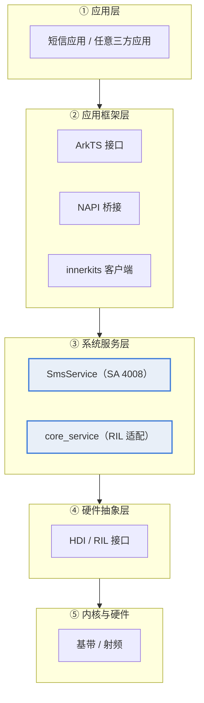
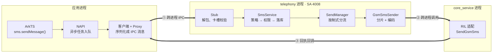
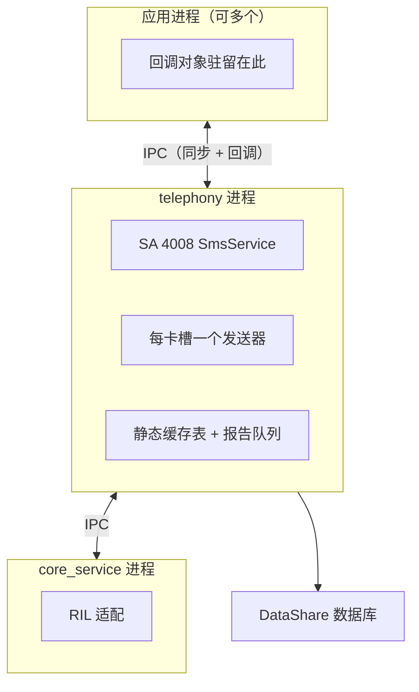
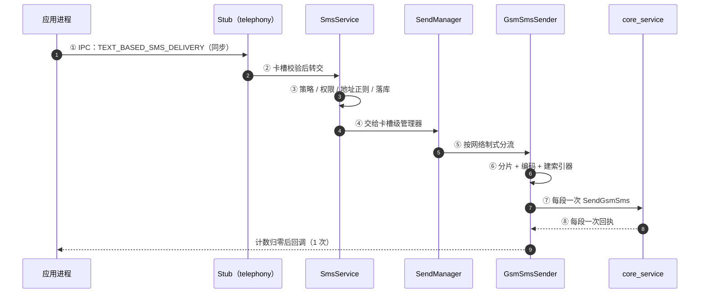
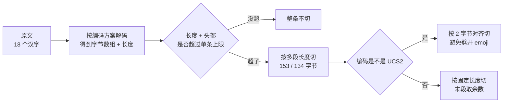
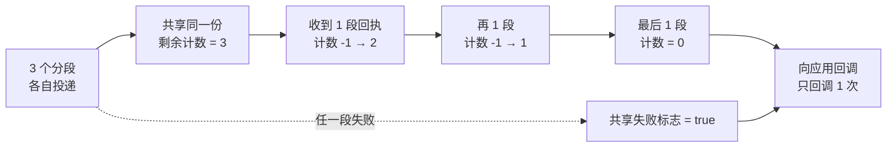
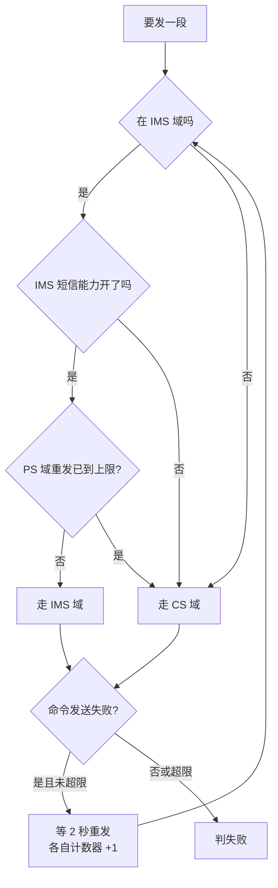
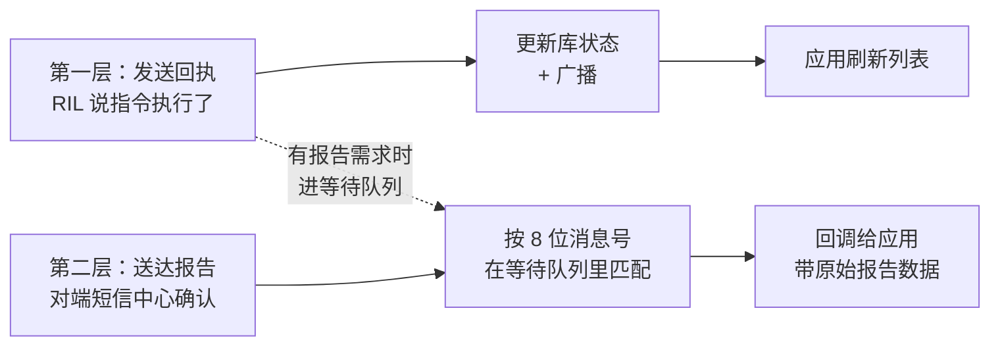
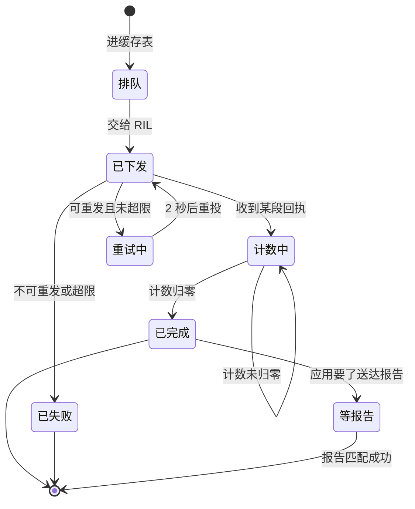

# 汇报脚本 · 一条短信的发送

> **这份文档不是 PPT，是"把 PPT 做出来"的施工图。**
> 用途：交给组内任何一个人，都能按这份脚本在学校模板里逐页填出同一套幻灯片；内容随时可改，改这里即可。
>
> 配套材料：`report.md`（证据与结论）、`anchors.md`（83 个锚点）、`ai-log.md`（AI 协作纪实）
> 基线：OpenHarmony-7.0-Release（`e06478b`）

---

## 0. 怎么用这份脚本

### 0.1 三条约定

| 记号 | 含义 |
|---|---|
| **【浅】【中】【深】** | 认知深度。前 3 页让完全不懂的人跟上，中间 4 页讲结构，后 4 页讲机制 |
| **主旨句** | 直接抄到页面顶部当标题下面那行小字，或当页面唯一一句大字 |
| **图示** | mermaid 源码，可直接渲染成图；也可以在模板里照"手绘要点"用形状重画 |

### 0.2 套学校模板的四条规则

1. **一页只讲一件事**，正文不超过 6 行；讲不完的挪到备用页。
2. **主图占页面 55%–65%**，文字只做注解。所有图统一线宽、统一圆角、统一字号（节点文字 ≥14pt）。
3. **页脚固定**：左下"telephony_sms_mms @ OpenHarmony-7.0-Release"，右下页码"NN / 14"。
4. **色彩克制**：主色一种（深蓝）、强调一种（红，仅用于"问题/失败"）、其余灰阶。不要三种以上颜色同时出现。

### 0.3 改内容时只改这四处

| 要改的东西 | 改哪里 |
|---|---|
| 页数、顺序、时长 | 第 1 节总览表 + 第 6 节配速表 |
| 某页讲什么 | 第 2 节对应小节（结构固定为：主旨 / 版式 / 图示 / 要点 / 讲稿） |
| 数字与结论 | 先改 `report.md`，再同步这里的数字（两处必须一致，抽问会对账） |
| 锚点 | 只改 `anchors.md`，本脚本页脚引用它，不单独维护 |

### 0.4 本版与上一版的差别（为什么重做）

上一版是直接生成的 .pptx，问题是：套不进学校模板、改一个字就要重排版、并且**没有讲清"这条调用链落在鸿蒙的哪一层"**。
这一版把重心从"排版好看"换成"讲清层级"：新增第 3、4、5 三页专门解决层级问题，其余页全部改为可编辑文本。

---

## 1. 全篇设计

### 1.1 一条主线

> **一次发送 = 一次跨层下行 + 一次跨层上行。**
> 下行：应用 → 框架 → 系统服务 → 硬件抽象 → 空口；
> 上行：回执 → 系统服务 → 回调对象 → 应用。
> 中间跨了 3 次进程边界，N 段短信在系统服务层被"收敛"成 1 个结果。

### 1.2 由浅入深的三段式

| 段 | 页 | 回答的问题 | 听众收获 |
|---|---|---|---|
| 第一段 · 看得见 | 2–3 | 我按下发送，手机里发生了什么？ | 有一个直觉画面，知道短信不是"应用自己发的" |
| 第二段 · 结构 | 4–6 | 谁在调用谁？跨了哪几层、哪几个进程？ | 能在鸿蒙分层图上指出这条链 |
| 第三段 · 机制 | 7–10 | 为什么要这么设计？代价是什么？ | 理解分片、聚合、域选择三个机制 |
| 收尾 | 11–14 | 好在哪、差在哪、证据够不够 | 能回答追问 |

### 1.3 总览表

| 页 | 标题 | 深度 | 主图示 | 时长 |
|---|---|---|---|---|
| 1 | 一条短信的发送 | — | 无（封面） | 10s |
| 2 | 你按下发送键之后 | 浅 | 用户视角五格图 | 25s |
| 3 | 这条链落在鸿蒙的哪一层 | 浅 | 五层分层地图 | 30s |
| 4 | 一条短信穿透四层 | 中 | 跨层调用链总图（核心图） | 45s |
| 5 | 三个进程、一个 SA | 中 | 进程与边界图 | 20s |
| 6 | 八跳时序 | 中 | 双泳道时序图 | 40s |
| 7 | 机制一：先编码，再切 | 深 | 文本→字节→分段 数据流 | 40s |
| 8 | 机制二：把 N 段伪装成 1 条 | 深 | 计数递减图 | 45s |
| 9 | 机制三：IMS 优先，CS 兜底 | 深 | 判定树 + 时间轴 | 35s |
| 10 | 闭环：回执怎么回来 | 深 | 上行回环图 | 25s |
| 11 | 利弊各三条 | 评 | 双栏对照 | 25s |
| 12 | 一次真实的 AI 纠错 | 证 | 三格推理链 | 35s |
| 13 | 证据、分工、结论 | — | 数字卡 | 20s |
| 14 | 备用：锚点与预判 | 备用 | 表 | 按需 |

合计约 6 分 15 秒，留 15 秒缓冲。**若被压到 5 分钟：跳第 5 页、第 10 页，其余不动。**

---

## 2. 逐页脚本

---

### 【页 1】封面

**深度**：— ｜ **时长**：10s

**主旨句**：一条短信，四次跨层，三个进程。

**版式**
- 学校模板封面页：标题区放主标题，副标题一行，底部信息条放组号/成员/时间。
- 右侧留白处放一个数字方块：`4008`（SA id），下面一行小字 `libtel_sms_mms.z.so`。

**要点**
1. 主标题：一条短信的发送
2. 副标题：telephony_sms_mms 主链路分析 · 从 ArkTS 调用到空口投递
3. 底部：组号 / 成员 / 基线 OpenHarmony-7.0-Release

**讲稿（约 10 秒）**
> "我们组分析的是短信彩信子系统，题目是《一条短信的发送》。我们不打算讲功能，只讲一件事：你按下发送键之后，这条消息在鸿蒙里走了哪几层、被谁改了、什么时候才算成功。"

---

### 【页 2】你按下发送键之后（浅）

**深度**：浅 ｜ **时长**：25s

**主旨句**：屏幕上是一个动作，系统里是五个现场。

**图示**

**手绘要点（在学校模板里这样画）**
> 五个圆角矩形横排，箭头单向；最后一根箭头画成虚线并回指第一个，表示"回执"。每个框里只放一行字，框下方用小字标注"应用进程 / 系统服务进程 / 硬件"。

**要点**
1. 应用只负责"收集文字 + 显示结果"
2. 真正发出去的是**系统服务**，不是应用
3. 中间要过**基带**，这一步应用完全看不见
4. 短信可能被切成多条，但应用只显示一条
5. 成功与否，取决于**回执**，不取决于"点没点上"

**讲稿（约 25 秒）**
> "先说人话版。你点发送，应用把文字交给系统；系统负责拆、编码、排队，交给基带发出去；网络那头收到后回一条回执。整个过程中你只看到两次变化：消息出现在列表里，和一个'已发送'的勾。但中间其实经过了三个不同的进程。"
>
> "有个细节先说破：如果消息太长，它在系统里会变成好几条分别发，但你在屏幕上永远只看到一条。这是后面第三个机制要解释的事。"

**页脚锚点**：无（本页不涉及代码）

---

### 【页 3】这条链落在鸿蒙的哪一层（浅）

**深度**：浅 ｜ **时长**：30s

**主旨句**：鸿蒙分五层，短信模块横跨第二到第四层。

**图示**

**手绘要点**
> 五条横带自上而下，宽度一致；第 3 条（系统服务层）用与其它层不同的底色高亮，因为**本模块 90% 的代码在这里**。右侧可加一列竖排文字："我们的切片 = 第 3 层的一个部件"。

**要点**
1. 应用层：只写业务，不碰协议
2. 框架层：把 ArkTS 调用翻成 C++ 调用（NAPI），再翻成 IPC 请求
3. 系统服务层：**短信模块的家**，跑在 `telephony` 进程里
4. 硬件抽象层：把"发短信"翻成基带能懂的指令
5. 内核与硬件：真正把比特变成电磁波

**讲稿（约 30 秒）**
> "要讲清调用链，得先有张地图。鸿蒙从上到下五层：应用、框架、系统服务、硬件抽象、内核与硬件。"
>
> "短信模块不是一个能独立运行的 App，它是系统服务层里的一个部件，进程名叫 telephony，系统能力编号 4008。它往上给框架层提供接口，往下通过 core_service 找基带。"
>
> "记住这个位置：第 3 层。后面所有调用，都是在这一层内部以及它和上下邻居之间发生的。"

**页脚锚点**
- `sa_profile/4008.json:2#process` — 进程 telephony
- `sa_profile/4008.json:6#libpath` — 产物 libtel_sms_mms.z.so
- `services/sms/include/sms_service.h:30#SmsService` — 一个类既是 SA 又是 Stub

---

### 【页 4】一条短信穿透四层（中，核心图）

**深度**：中 ｜ **时长**：45s ｜ **本页是全篇最重要的一页，讲慢**

**主旨句**：同一条请求，被翻译了四次：一次 API 调用 → 一次 IPC → 一次业务判断 → 一次设备指令。

**图示**

**手绘要点**
> 三个大竖框代表三个进程，框与框之间的粗箭头必须标上编号①②③——**这三根箭头就是"跨层"的证据**。框内用小方块竖排，箭头向下。全校最该看清的是：**应用进程里没有任何"发送"逻辑**。

**要点**
1. 第 1 次翻译：ArkTS 对象 → C++ 参数（框架层内部）
2. 第 2 次翻译：参数 → IPC 字节流（跨进程边界①）
3. 第 3 次翻译：字节流 → 业务请求（系统服务层内部，含权限与落库）
4. 第 4 次翻译：业务请求 → 设备指令（跨进程边界②）
5. 结果不是"返回"，而是**回调**（跨进程边界③）

**讲稿（约 45 秒）**
> "这张图是全篇的核心。横着看是四个阶段，竖着看是三个进程。"
>
> "第一次翻译在应用进程里：ArkTS 的函数调用被 NAPI 转成 C++ 参数，打包成 IPC 消息。注意这里有个反差——NAPI 是异步的，但 IPC 用的却是同步调用，也就是服务端处理期间，应用的这个工作线程是卡住的。"
>
> "第二次翻译进了 telephony 进程。Stub 先解包、查卡槽号合不合法，然后交给 SmsService 做三件事：看策略允不允许、查有没有发短信权限、先往数据库写一条'发送中'的记录。"
>
> "第三次翻译在系统服务层内部继续：按当前网络制式分流到 GSM 或 CDMA 的发送器，在那里完成分片和编码。"
>
> "第四次翻译跨到了 core_service，把 TPDU 交给 RIL，RIL 再往下就是基带，那已经不是我们的代码了。"
>
> "最后一根箭头是回程：结果不是靠返回值带回来的，而是通过一个回调对象跨进程回调到应用。"

**页脚锚点**
- `frameworks/native/sms/src/sms_service_proxy.cpp:33#SendMessage` — 序列化起点
- `services/sms/sms_interface_stub.cpp:161#OnSendSmsTextRequest` — 服务端解包
- `services/sms/gsm/gsm_sms_sender.cpp:242#SendGsmSms` — 交给 RIL

---

### 【页 5】三个进程、一个 SA（中）

**深度**：中 ｜ **时长**：20s（可压缩）

**主旨句**：进程边界决定了"哪些错误只能在本地处理"。

**图示**

**手绘要点**
> 三个进程画成三个虚线大框，框上写进程名；框之间画双向箭头并注明"IPC"。在 telephony 框内画一个小图标代表"缓存表"，说明它是**进程内的内存结构**，进程一挂就没了。

**要点**
1. 应用进程可以有多个，服务端不关心是谁在调
2. telephony 进程内按卡槽分实例，一个卡槽一套发送/接收管理器
3. 缓存表是**进程内静态成员**，跨卡槽共享
4. 跨进程只能传"可序列化的东西"和"远程对象"
5. 进程崩溃 = 缓存表清空 = 在途短信的回调永远不来

**讲稿（约 20 秒）**
> "为什么强调进程？因为进程边界决定了什么能传、什么不能传。"
>
> "回调传不过去代码，只能传一个远程对象的句柄；服务端攒状态用的那张缓存表，也只是进程内的内存，进程一重启就没了，在途的短信就再也不会回调。这是后面讲弊端时的伏笔。"

**页脚锚点**
- `services/sms/sms_sender.cpp:35#sendCacheMap_` — 静态缓存表
- `frameworks/js/napi/include/send_callback.h:31#SendCallback` — 回调驻留在应用进程

---

### 【页 6】八跳时序（中）

**深度**：中 ｜ **时长**：40s

**主旨句**：八跳里有四跳在"翻译"，只有两跳真的在"发"。

**图示**

**手绘要点**
> 标准泳道图，六条竖线。**实线箭头向下（请求），虚线箭头向上（回执）**。在⑥和⑦之间标一个括号，写明"这里一分为 N"。在最后一根虚线旁标注"只回调 1 次"。

**要点**
1. ① 是同步 IPC，② 到 ⑤ 都在同一进程内
2. ⑥ 是唯一"一变多"的地方：1 条消息 → N 个分段
3. ⑦ 每段一次设备调用，⑧ 每段一次回执
4. 回执不是原路返回，而是事件
5. 最后一根虚线只有一条：聚合后的那一次

**讲稿（约 40 秒）**
> "把刚才那张图展开成时序，一共八跳。"
>
> "前五跳都在做翻译和判断，没有真正发出去；第六跳把一条消息切成了 N 段；第七跳才是真的逐段调用设备。"
>
> "重点看回程：每段都会回一次执，但应用只收到一次回调。中间那个'把 N 收成 1'的动作，就是下一个机制。"

**页脚锚点**
- `services/sms/sms_send_manager.cpp:103#TextBasedSmsDelivery`
- `services/sms/gsm/gsm_sms_sender.cpp:179#SendSmsToRil`
- `services/sms/sms_sender.cpp:96#HandleMessageResponse`

---

### 【页 7】机制一：先编码，再切（深）

**深度**：深 ｜ **时长**：40s

**主旨句**：切的是字节，不是字符；所以必须先编码再量长度。

**图示**

**手绘要点**
> 一条横向流程，三个判断菱形。在"切"那个节点旁边写两个数字：`153`（7bit 每段）和 `134`（UCS2 每段）。右下角画一个小的"被劈开的 emoji"示意，并在上面打叉。

**要点**
1. 先解码拿字节数，不按字符数算
2. 单条上限由协议定，头部（UDH 6 字节）要占额度
3. 多段 7bit 每段 153 字节，UCS2 每段 134 字节（仓内可证）
4. 段数上限 15，超了直接失败，不静默截断
5. UCS2 多段要按 2 字节对齐，否则 emoji 会乱码

**讲稿（约 40 秒）**
> "第一个机制是分片。这里有个很容易讲错的地方：切的是字节，不是字数。"
>
> "代码的做法是先把整段中文按编码方案解成字节数组，拿到字节长度，再拿'字节长度 + 头部开销'去和单条上限比。这解释了为什么同样 18 个字，有时一条发完，有时要切两段——中文在 UCS2 下每个字占两个字节。"
>
> "还有个坑：一个 emoji 在 UTF-16 里占四个字节，硬切会把它的前后两半分到两条短信里，接收端就还原不出来。所以 UCS2 多段的时候单独走了一条按 2 字节对齐的路。"
>
> "最后，段数超过 15 就直接判失败，不会偷偷截断——这是对的，静默丢字比报错更糟。"

**页脚锚点**
- `services/sms/sms_base_message.cpp:478#SplitMessage`
- `services/sms/sms_base_message.cpp:290#multiSegSms7BitLength`
- `services/sms/sms_base_message.cpp:518#SplitMessageUcs2`

---

### 【页 8】机制二：把 N 段伪装成 1 条（深，本页为最难点）

**深度**：深 ｜ **时长**：45s

**主旨句**：计数归零才算成功；任一段失败，整条失败。

**图示**

**手绘要点**
> 左边三个小方块（1/3、2/3、3/3）指向中间一个"计数器"圆环，圆环里写 3→2→1→0。计数到 0 时向右画一个粗箭头写"回调"。下方画一条细虚线从任一分段连到"失败标志"，再并入回调，表示"一旦脏了就整体失败"。

**要点**
1. 这一批分段**共享**同一份计数与失败标志
2. 回执到达时，不是只减自己，而是把同一批全减 1
3. 计数归零那一刻才回调，所以"成功"的定义是"全部回来"
4. 成败取"或"：任一段失败 → 整条失败
5. 三个前提：指针不能漏设、refId 要能找回、回执必须到

**讲稿（约 45 秒）**
> "第二个机制最反直觉，也最值得讲。一条长短信在空口上是 N 条独立短信，如果每段各自回调，应用会收到 N 次'成功'，UI 上可能闪 N 条记录。更麻烦的是：第 1 段成功、第 2 段失败，应用怎么表达'这条长短信失败了'？"
>
> "代码的做法是把这 N 段绑成一个事务：创建一份共享的剩余计数和一个共享的失败标志，每个分段都持有同一份指针。"
>
> "关键在回执处理：收到任何一段的回执时，不是只把当前这条索引器减一，而是遍历缓存表，把所有同一批次的分段计数一起减一。这样无论谁先回来，计数都单调下降，归零的那一次必定是全部到齐。"
>
> "然后才回调，并且把'有没有任一段失败过'作为最终结果。所以对应用来说，这是一条短信；对系统来说，这是一次分布式事务的微型演练。"
>
> "代价是它依赖三个前提：指针不能漏设、refId 在缓存表里必须还在、回执不能永久丢。任何一个破掉，就会退化成'永远等不到回调'。"

**页脚锚点**
- `services/sms/gsm/gsm_sms_sender.cpp:86#unSentCellCount`
- `services/sms/sms_sender.cpp:323#UpdateUnSentCellCount`
- `services/sms/sms_sender.cpp:129#unSentCellCount`

---

### 【页 9】机制三：IMS 优先，CS 兜底（深）

**深度**：深 ｜ **时长**：35s

**主旨句**：先走 IP 域，走不通再回落电路域，两边各自限重试次数。

**图示**

**手绘要点**
> 上方一个三连判断（菱形串），下方一个"重发"回环箭头指回起点，回环上标"2s / 最多 3 次"。左右分色：IMS 用主色，CS 用中性灰，失败用红色（红色只出现这一处）。

**要点**
1. 判定只有三个输入：是否 IMS 域、能力是否开启、PS 重发是否到顶
2. IMS 优先是因为 4G/5G 下 CS 域可能已不可用
3. CS 是兜底，不是备选方案
4. 两个计数器（CS / PS）各自上限 3，互不叠加
5. 只有"命令发送失败"才重发，业务失败不重发

**讲稿（约 35 秒）**
> "第三个机制解决'发不出去怎么办'。"
>
> "判断只有三个条件，任一成立就走电路域：不在 IMS 域、IMS 短信能力没开、PS 域已经重试到上限。这就是'IMS 优先、CS 兜底'。"
>
> "重发有节流：只有错误码是'命令发送失败'才重发，每次等 2 秒，最多 3 次，而且两个域各有一套计数器。所以最坏情况大约 6 秒后判失败。"
>
> "代价是：重试耗尽后，失败原因被统一成'未知失败'，应用拿不到可区分的原因。"

**页脚锚点**
- `services/sms/gsm/gsm_sms_sender.cpp:219#sendCsSMS`
- `services/sms/sms_sender.cpp:361#HandleResend`
- `services/sms/include/sms_sender.h:111#MAX_SEND_RETRIES`

---

### 【页 10】闭环：回执怎么回来（深）

**深度**：深 ｜ **时长**：25s（可压缩）

**主旨句**：两层回执——"发出去了"和"对方收到了"，含义完全不同。

**图示**

**手绘要点**
> 上下两条平行流程，中间一条细虚线把它们连起来。左边标"第一层"，右边标"第二层"。在"8 位消息号"旁打一个问号，暗示它是弱点（为利弊页埋伏笔）。

**要点**
1. 第一层回执只证明"设备接受了这条指令"
2. 第二层报告才证明"对端收到了"
3. 两层都会改数据库状态、发广播
4. 报告匹配靠 8 位消息号，天生会回绕
5. 等待队列有上限，最旧的会被丢弃

**讲稿（约 25 秒）**
> "最后是闭环。这里有两层回执，很多人会混：第一层是设备回执，只说明这条指令基带收下了；第二层是送达报告，才说明对端短信中心收到了。"
>
> "两层都会改数据库、发广播，应用据此刷新。但报告匹配只靠一个 8 位消息号，取值范围 0 到 255，队列只留 25 条——这是概率性缓解，不是根治。"

**页脚锚点**
- `services/sms/gsm/gsm_sms_sender.cpp:306#StatusReportAnalysis`
- `services/sms/sms_sender.cpp:153#UpdateSms`
- `services/sms/include/sms_sender.h:123#MAX_REPORT_LIST_LIMIT`

---

### 【页 11】利弊各三条（评）

**深度**：评 ｜ **时长**：25s

**主旨句**：优点都来自分层，缺点也都来自分层。

**版式**
> 左右双栏，左"利"右"弊"，各三条，每条两行：第一行结论，第二行一句解释 + 一个锚点。不要用图标堆砌。

**要点（利）**
1. 分层清晰：应用不碰协议，服务端不认调用方
2. 回执关联 O(1)：64 位 refId 查表即可还原上下文
3. 制式可扩展：新增制式只加子类与一个分支

**要点（弊）**
1. 发送未成功库已落记录：写库在真正下发之前
2. 权限只在一层：Stub 全文无权限校验，绕过 Service 即失去
3. 报告键只有 8 位：队列上限是缓解不是消除

**讲稿（约 25 秒）**
> "优点是分层带来的：应用不碰协议，服务端不关心调用方是谁，加新制式改动面很小。"
>
> "缺点是同一个原因的另一面：写库写得太早，会有僵尸记录；权限只在业务层收口，绕过就没了；报告匹配键太短，只能靠队列上限兜。三条都能指到具体行，不是猜的。"

**页脚锚点**
- `services/sms/sms_service.cpp:181#InsertSessionAndDetail`
- `services/sms/sms_service.cpp:155#CheckSmsPermission`
- `services/sms/gsm/gsm_sms_sender.cpp:330#GetMsgRef`

---

### 【页 12】一次真实的 AI 纠错（证）

**深度**：证 ｜ **时长**：35s ｜ **这一页是加分项，别跳过**

**主旨句**：AI 说"必然出错"，实测三处全是同一个数——被数据推翻。

**图示**

**手绘要点**
> 三格横向推理链，最后一格用不同底色（结论）。中间那格直接放大三个数字对比：`146=146`、`96=96`、`161=161`。

**要点**
1. AI 的断言听起来很"保守"，但保守也会错
2. 验证方式不是再问一次 AI，而是跑命令
3. 差异确实存在（41 个文件），但没落在锚点所在的函数上方
4. 结论：不能靠版本号猜，要靠双版本批量比对
5. 方法沉淀比结论更重要

**讲稿（约 35 秒）**
> "讲一个我们自己的翻车。我们一开始判断：本地仓在主干上，比基线多 46 个提交，那取的行号在老师那边一定校验失败。听起来很稳妥，对吧？"
>
> "但我们没有直接照这个判断去重做，而是导出了一份基线副本，拿同一批函数在两个版本上各取一次行号。结果是 146 对 146、96 对 96、161 对 161，完全一致。"
>
> "原因是那 41 个文件的改动都落在文件尾部和新增文档里，没有动到我们锚点的函数上方。所以真相是：版本号领先不等于行号漂移，漂移只发生在特定位置。"
>
> "这件事改变的是我们的流程：不再靠版本号猜，而是两棵树各跑一次校验。"

**页脚锚点**
- `services/sms/sms_service.cpp:146#SendMessage`
- `services/sms/sms_sender.cpp:96#HandleMessageResponse`
- `services/sms/sms_interface_stub.cpp:161#OnSendSmsTextRequest`

---

### 【页 13】证据、分工、结论（收尾）

**深度**：— ｜ **时长**：20s

**主旨句**：83 个锚点，0 失败，一条命令可以复现。

**版式**
> 上半部四个数字卡：`83` 锚点 / `0` 失败 / `18` 文件 / `4` 顶层目录。
> 中部一条命令（等宽字体，可截图也可直接投）。
> 下部一行分工：源码追踪 / 图示成稿 / 校验答辩。
> 最底一行结论：**一条短信的旅程，是一次分布式事务的微型演练。**

**要点**
1. 数字必须与 `report.md` 一致，抽问会对账
2. 命令要现场跑，不要放截图
3. 三条结论各一句，不展开
4. 分工按角色写，答辩前替换成真实姓名

**讲稿（约 20 秒）**
> "证据方面：83 个锚点，18 个文件，横跨四个顶层目录，0 失败。这条命令现场就能跑，输出就是这个结果。"
>
> "最后三句话收尾：第一，这条链路的核心不是发出去，而是把 N 段收敛成一个结果；第二，分片的正确性全押在'先编码再切'的顺序上；第三，三个薄弱点都是结构性取舍的必然结果，不是疏漏。"

**页脚锚点**：`report.md` 第五节、`anchors.md`

---

### 【页 14】备用：锚点样例与预判（备用）

**深度**：备用 ｜ **时长**：按需

**用途**：被追问时直接切到这页，不要现场回忆。

**内容**
- 左半：5 条锚点样例（带路径与行号）
- 右半：预判 5 问 + 一句话答案

| 追问 | 一句话答案 |
|---|---|
| 为什么不能按字符切？ | 字符数与字节数不成正比，7bit 与 UCS2 段长不同 |
| 计数是共享还是每段一份？ | 整批共享一份指针，漏设则失败被吞 |
| 8 位消息号回绕怎么办？ | 队列上限 25 + 最旧丢弃，是缓解不是消除 |
| 发送前写库，崩溃了？ | 留"发送中"僵尸记录，靠启动扫描清理 |
| 为什么 Stub 不做权限？ | 收口在 Service 层；代价是绕过 Service 即失去校验 |

**页脚锚点**：`anchors.md` 第 9、10 节

---

## 3. 图示素材库

这三张图可以独立于页面复用（比如放进报告的 mermaid、或重画成矢量图）。

### 3.1 跨层调用链总图（最重要）

见【页 4】。若要在模板里重画，形状清单：

| 元素 | 数量 | 说明 |
|---|---|---|
| 进程大框（虚线） | 3 | 应用进程 / telephony 进程 / core_service 进程 |
| 层标签 | 4 | 应用层 / 框架层 / 系统服务层 / 硬件抽象层 |
| 节点（圆角矩形） | 9 | ArkTS、NAPI、Proxy、Stub、Service、SendManager、Sender、RIL |
| 粗箭头 | 3 | 标注 ①②③，代表三次跨进程 |
| 细箭头 | 6 | 框内顺序调用 |

### 3.2 分段与聚合数据流

见【页 7】【页 8】。可合成一张：左边"一条消息 → 字节 → N 段"，右边"N 段 → 计数 → 1 次回调"。

### 3.3 索引器状态机

---

## 4. 讲演控制

### 4.1 配速表

| 时间点 | 应停在哪 | 若超时 |
|---|---|---|
| 0:00 | 封面，说完题目就翻页 | 不寒暄 |
| 0:25 | 第 2 页讲完用户视角 | — |
| 0:55 | 第 3 页讲完分层 | 删"内核与硬件"一句 |
| 1:40 | 第 4 页讲完四次翻译 | **不能压缩，宁可砍后面** |
| 2:00 | 第 5 页讲完进程 | 整页跳过 |
| 2:40 | 第 6 页讲完时序 | 略过②③④ |
| 3:20 | 第 7 页讲完分片 | 略过"段数上限" |
| 4:05 | 第 8 页讲完聚合 | **不能压缩** |
| 4:40 | 第 9 页讲完域选择 | 略过重发细节 |
| 5:05 | 第 10 页讲完闭环 | 整页跳过 |
| 5:30 | 第 11 页利弊 | 只讲弊 |
| 6:05 | 第 12 页纠错 | 只讲"结论与流程改变" |
| 6:25 | 第 13 页收尾 | — |

### 4.2 三个必须停留的点

1. **第 4 页**：让评委在分层图上看到"三根跨进程箭头"。
2. **第 8 页**：讲清"计数归零才回调"，这是全篇唯一的技术亮点。
3. **第 12 页**：讲清"用数据推翻自己的判断"，这体现方法，不只是态度。

### 4.3 现场演示的准备

- 终端字号调到 20pt 以上，配色改深底浅字，投影才看得清。
- 提前在 `student_kit` 目录下跑一次，确认路径无中文问题。
- 演示命令只跑一条（校验），输出要出现"失败 0"。

---

## 5. 与代码的对应关系（防止讲错）

| 讲到的层 | 仓内位置 | 一句话 |
|---|---|---|
| 应用层 | 无（不在本仓） | 应用只调 `@ohos.telephony.sms` |
| 框架层 · NAPI | `frameworks/js/napi/src/` | 把 ArkTS 调用翻成 C++，并扔到异步任务 |
| 框架层 · 客户端 | `frameworks/native/sms/src/` | 组 IPC 包，发请求 |
| 系统服务层 · 桩 | `services/sms/sms_interface_stub.cpp` | 解包、查卡槽，不做权限 |
| 系统服务层 · 业务 | `services/sms/sms_service.cpp` | 策略、权限、落库 |
| 系统服务层 · 调度 | `services/sms/sms_send_manager.cpp` | 按制式选发送器 |
| 系统服务层 · 编码 | `services/sms/sms_base_message.cpp` | 分片与编码 |
| 系统服务层 · 发送 | `services/sms/gsm/gsm_sms_sender.cpp` | 域选择、逐段投递、报告解析 |
| 硬件抽象层 | 不在本仓 | `CoreManagerInner` 之后的 RIL 与 HDI |

**三条不要讲错的话**

1. 不要说"应用把短信发出去的"——应用只提交请求，发送在系统服务层。
2. 不要说"IPC 是异步的"——NAPI 是异步的，IPC 用的是同步调用。
3. 不要说"权限在 Stub 校验"——Stub 里一次权限判断都没有。

---

## 6. 待办（提交前清账）

- [ ] 套模板：把本脚本逐页填进学校模板，统一字号与页脚
- [ ] 重画 3 张主图：跨层总图 / 分段聚合 / 状态机（矢量，不用截图）
- [ ] 替换分工为真实姓名（当前按角色写）
- [ ] 数字对账：脚本中的 83 / 0 / 18 / 4 与 `report.md` 一致
- [ ] 导出 `slides.pdf` 与 `.pptx` 源文件
- [ ] 彩排一次，按 4.1 配速表掐表
